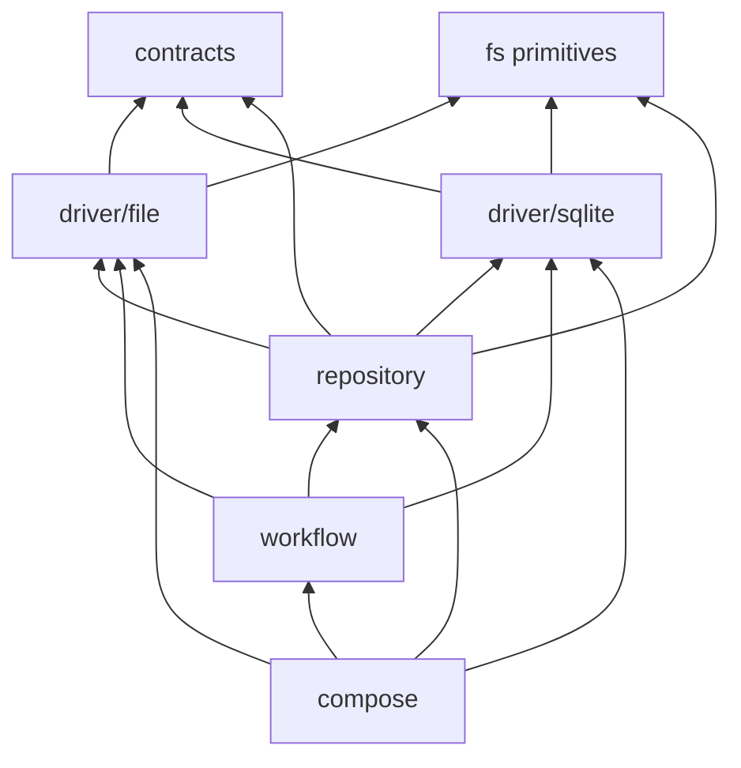

# Architecture

Orbit is a Rust workspace of layered crates. **Lower layers never depend on higher ones.** [`scripts/check-dependency-direction.sh`](scripts/check-dependency-direction.sh) enforces every crate edge, so a new edge means updating that script and the table below in the same PR.

```text
Surfaces      orbit-cli · orbit-web · orbit-mcp
Composition   orbit-cmd
Application   orbit-core
Runtime       orbit-runtime
Domain        orbit-engine · orbit-automation · orbit-agent · orbit-tools · orbit-store
              orbit-search · orbit-registry · orbit-config
Kernel        orbit-exec · orbit-policy · orbit-auth
Foundation    orbit-common · orbit-types
```

Domain crates own their data and transport. Application layers compose them. Kernel crates expose reusable mechanisms and never depend back on a feature.

Decision assistance was removed in [ORB-22808]. Its additive v72 ledger tables stay in
the frozen migration ledger and are no longer read or written.

The store's run-resource minute history feeds profile-cache freshness with a
probe over every sampled run: the newest `finished_at` and the count of finished
runs that have any minute row. A run's minute indexes count from the start of
sampling, but its first recorded minute need not be minute zero: a failed first
read or a lost minute-zero insert leaves no such row, and the run still counts
once it finishes. The probe joins `job_runs` only for sampled runs, so its cost
follows retained minute rows, not job history. The migration (v69) is
read-compatible: older binaries can read the database but stay read-only.
Because that scan grows with retained minutes, `delivery_runs_stamp` (v75,
additive) is a one-row counter that triggers bump on every write that can move
the probe: a run's first or last minute row, and an insert, delete, re-key or
`finished_at` change of a sampled run's `job_runs` row. A cache pass probes
only when the counter moved since its cached answer. The triggers fire on
older binaries' writes too. A rebuild then re-reads minute rows only for runs
whose shape moved: the minute-row count and last minute index from the
primary key, and the `job_runs` row, against the shapes of the cache's last
load.

The workspace agent corpus keeps its versioned row and append contracts in
`orbit-types`, its mapping in `orbit-config`, and pinned reads and deterministic
append production in core. Append proposals reuse task history as a durable
sidecar outbox, in the same update as the human answer or recovery decision.
A deterministic script materializes reviewed repository batches; injection
never reads unreviewed outbox data. No new store or internal crate edge is
introduced. See the [corpus design](docs/design/workspace-agent-corpus/1_scope.md).

## Crates

| Crate | Tier | Depends on (internal) |
|---|---|---|
| `orbit-types` | stable | — |
| `orbit-common` | stable | types |
| `orbit-config` | internal | common, types |
| `orbit-policy` | internal | common, types |
| `orbit-exec` | internal | common, types |
| `orbit-auth` | internal | common, types |
| `orbit-search` | internal | common, types |
| `orbit-store` | stable | common, types |
| `orbit-registry` | internal | common, config, types |
| `orbit-tools` | internal | common, exec, policy, types |
| `orbit-agent` | internal | common, types |
| `orbit-clock` | internal | common |
| `orbit-automation` | internal | clock, common, store, types |
| `orbit-engine` | internal | agent, common, exec, store, tools, types (dev: engine) |
| `orbit-runtime` | internal | common, config, engine, exec, policy, search, store, tools, types (dev: runtime) |
| `orbit-mcp` | internal | common, registry, tools, types (dev: mcp) |
| `orbit-core` | internal | automation, clock, common, config, engine, exec, registry, runtime, search, store, tools, types (dev: core, policy) |
| `orbit-cmd` | internal | common, config, core, mcp, registry, store, tools, types |
| `orbit-web` | internal | auth, cmd, common, config, core, registry, types (dev: engine, store) |
| `orbit-cli` | internal | cmd, common, config, core, mcp, registry, types, web (dev: engine, exec, tools) |

`PipelineState` exposes drain controls, pull admission checkpoints and forge
hold records through `pull_drain: PullDrainState`. The general cancellation
policy remains on the run. Serde flattens the group for reading; an explicit
serializer retains the historical top-level names, field order and omission
rules when writing `state.json`. Changes to this persisted contract must update
both the serializer and the compatibility fixtures in the types integration
suite.

Core uses `git2` (vendored libgit2, network features disabled) to read local
refs, config and trees in process: routine status's branch inspection, and the
instruction and selector-object reads behind the preparation fingerprint. A
repository libgit2 cannot open, such as a partial clone or reftable refs, keeps
the bounded Git commands. Fetches, pins and other source evaluation continue to
use bounded Git commands and the shared fetch lock. A request-scoped source
cache shares inspection facts across routines without retaining stale refs
across polls. Web's host-wide routine memo uses the existing runtime-memo
single-flight mechanism with a separate host namespace and file/database input
stamps.

Automation parses and evaluates condition-trigger predicates with the `cel`
crate (cel-rust, no regex or encoder features). That crate ships no type
checker, so `orbit-automation::condition` checks the parsed AST against the
declared task and workspace schema itself. There is no new internal crate edge.

Core exposes Exec's shared Bubblewrap capability probe to CLI onboarding and
diagnostics. The CLI's dev-only edges to Engine, Exec and Tools support the real
sandbox broker integration test, which pairs the host runtime with the built
CLI and MCP transport.

The dashboard's dev-only Store edge seeds workspace claims directly in isolated
HTTP fixtures, so replay admission can be exercised without routing fixture
setup through an agent tool surface.

The dashboard's dev-only Engine edge exercises the runner's reservation action
in isolated HTTP fixtures, so workspace analytics cover production lock-denial
audit writes as well as seeded history.

`orbit-clock` owns the host's sweep clock: `clock.toml` settings and the tick
budget, launchd/systemd unit templates and install, pause and resume, cadence,
unit convergence and inspection, and clock health. It names only
`orbit-common`, so it compiles beside the `orbit-store` → `orbit-engine` →
`orbit-runtime` chain instead of inside the serial `orbit-core` library
[ORB-22688]. Core re-exports it unchanged as `application::routines::clock`
(and its settings through `application::contracts`), so the CLI, dashboard and
`orbit-cmd` keep their paths; the sweep pass the clock wakes stays in Core.
Automation's edge re-exports the tick budget (`TICK_DEADLINE`) the clock's
health judges an overdue tick against, so the constant has one definition.

Core's dev-only edge to itself enables its `test-support` feature for its own
integration tests, which substitute the detached pipeline worker and execute
submitted runs in-process.
That feature also enables Engine's `test-support` feature for scoped CLI
supervision clocks. Landing fixtures freeze Core's source budget clock; auth
fixtures expire Engine's deadline only after a real child signals readiness.
Both clocks are thread-local, restored on unwind, and absent from shipped builds.
It also enables Store's `test-support` feature, whose thread-local task-commit
lock deadline lets a drain admission fixture wait out a held lock in seconds;
it is restored the same way and is equally absent from shipped builds.
It also enables Runtime's `test-support` feature, which exposes the kernel's
test-only seams (the transition read hook, the Git scan hook and the
ancestry peer anchor) to Core's unit tests.

Core also holds a dev-only edge to `orbit-policy` for the integration tests
that drive `PolicyEngine` directly; shipped code reaches policy through
`orbit-runtime` (and `orbit-tools`), never directly. The
dependency-direction guard enforces this edge: a normal, build, or
target-normal `orbit-core` → `orbit-policy` edge fails the guard. This says
nothing about the kernel's own production `orbit-runtime` → `orbit-policy`
edge, which stays legal.

Runtime's dev-only edge to itself enables its `test-support` feature for its
own unit tests, which also enable Engine's `test-support` feature for its
null runtime host.

Engine's dev-only edge to itself enables its `test-support` feature for its own
unit and integration tests. The feature exports `test_support::NullRuntimeHost`,
the base every `RuntimeHost` test double in Engine and Core builds on, so the
`RuntimeHost` trait itself carries no defaults and shipped builds have no null
host. The test base forwards every capability, including overrides, through its
blanket implementation.

The `orbit-core` → `orbit-exec` edge is a production edge: Core's script steps,
CodeQL fulfilment, plugin conformance, browser kit reads and Linux host probe use
Exec, and its sandbox regression tests also enable Exec's `test-support` feature.
The dependency-direction guard also checks that dependencies defined in `[workspace.dependencies]` are inherited
in member manifests with `workspace = true`.

### Foundation and kernel

- **orbit-types** holds shared serde contracts, pure constructors, and narrow domain errors, organized as domain modules (`identity`, `workspace`, `task`, `workflow`, …). It does no I/O of any kind. Its serde shapes are persisted contracts.
  The review contract also owns the canonical `review-*` artifact namespace
  classifier shared by Core's task update path, claimed-worker broker and
  external-evidence guards, and the live-report validator used by tools and Core.
- **orbit-common** holds `OrbitError` and the shared mechanisms: filesystem and path helpers (including `fs::physical`, the one home of the resolvers for a path whose tail may not exist yet, each with its own `..`, dangling-link and error contract), process support, storage, UTF-8-safe text bounds, protocol and YAML codecs, observability, and security. Security covers the release signing keys and verification used by `orbit update`, redaction, and `security::child_env`, the single allowlist builder for agent-subprocess environments. Operation registries live here so every surface can read them. The matching handlers live in `orbit-core`. Spawned process-group ownership and bounded kill-on-drop cleanup live in `process::OwnedChild`; supervisors borrow its child for pipe setup and waiting. Child supervision lives in `process::supervisor`: one wait loop with output sinks, stdin delivery, deadline termination, cancellation, SIGINT/SIGTERM fan-out to live child groups, a bounded post-exit drain, an opt-in stopped-descendant watch and a periodic caller policy hook. Identity-bound cancellation signalling lives in `process::signal`; `orbit-core` retains its process handles across TERM/KILL and coordinates conservative group snapshots.
- **orbit-policy** resolves `FsProfile` and evaluates `denyRead` and `denyModify` rules.
- **orbit-auth** owns Orbit's credential code so one crate carries the security review: the lease listener's bearer lease tokens (`orbl_` format, generation, SHA-256 hashing and constant-time comparison), principals, classes, verbs, scopes and the allow-or-deny decision, the listener's client-address rule and failed-authentication limiter, the listener user's own token store (`lease-tokens.db`, a separate SQLite file with its own schema and forward-only migrations, opened through `orbit-common`'s SQLite support, never a table in Orbit's main store) and the execution-environment check every listener-user command runs first. It has no HTTP framework, runtime handle or Orbit store. `orbit-web`'s lease intake socket carries its token scope types, and `orbit-web`'s lease listener wraps its token verification, client-address rule and failed-authentication limiter as HTTP middleware. Path leases are not configurable [ORB-22808], so no command mints tokens or starts the listener.
- **orbit-exec** owns sandboxes and the runner entry points for commands run under an `FsProfile`. Its runners supervise children through `orbit_common::process::supervisor`, applying exec's capture, termination and drain policy. Plugin build phases share a capped log across both stream sinks and use the periodic hook for their build-directory cap. Its `browser_kit` module holds the host's headless browser kit layout and the verified-kit check: the engine's CLI runner reads it to hand agents the kit's locator variables, and Core's `bootstrap::browser_kit` re-exports it for `orbit config browser-kit`, onboarding and doctor.

### Domain

- **orbit-config** owns `config.toml`. That covers the key registry, global-over-workspace layering (security keys replace rather than merge, and `[machine]` is global-only), provenance for `orbit config show`, resolved views, and comment-preserving atomic edits through `ConfigStore`, which every writer runs from open to save under one per-file write lock so concurrent edits cannot erase each other. Callers pass explicit roots, so the crate never discovers the cwd or `$HOME`. Pure TOML path access, including the typed read of one dotted path, lives in the private `config_document` leaf; aliases, seeding, operation policy, the key registry and layered loading use it, so aliases and operation policy never depend on layered loading, which orchestrates their admission. The key registry sits above the domain admission modules (`aliases`, `attention`, `crew`, `operation`, `provider_limit`, `seeding`) whose admitters and choices its key table calls: the projections of the admitted `ConfigSnapshot` into their typed settings live beside the snapshot in `registry/settings/projections.rs`, and none of those modules names the registry or its crate-root re-exports. No-follow file reads and path admission live in the private `config_io` leaf, below layered loading, plugin enablement, seeding, compatibility and unknown-key diagnostics, none of which depend on the store; `ConfigStore` builds its locking, staged validation and atomic save on the same reader. The built-in crew registry lives in the private `crew_defaults` leaf (std, `orbit-common` and `orbit-types` only), below snapshot admission, resolved config, layering provenance and seeding, so the key registry admits the default crews without naming resolved config; `scripts/check-dependency-direction.sh` enforces both registry directions and the leaves' isolation. It does not depend on `orbit-engine`; Core translates PR settings at composition time.
- **orbit-search** runs lexical retrieval. It owns the SQLite chunk and FTS5 schema, chunking, task-field extraction, and BM25 ranking. Core projects task records into it. The index file keeps its `semantic.db` name so persisted paths stay compatible.
- **orbit-registry** owns this machine's `[machine]` identity, the workspace catalog, checkout bindings, task-publication bindings, and the operator's registered remote hosts (`hosts.toml`), each persisted atomically. It has no shared database and no runtime execution.
- **orbit-store** handles persistence. See [orbit-store internals](#orbit-store-internals) below.
- **orbit-tools** holds the tool registry and the built-in fs, exec, and Orbit tool definitions. It resolves a plugin source to its plugin root (the source's `.orbit-plugin/` directory, the only tree installed) and loads and runs `plugin.yaml` v2 plugins through an `exec` backend (one confined process per call) or an `mcp` backend (a stdio server per caller context). Both backends run under the operator's granted sandbox profile. Plugin lifecycle (install, enable, grants, `.orbit/plugins.yaml`) belongs to Core. This crate is also the only owner of the `gh` CLI contract.
- **orbit-agent** provides one `AgentRuntime` per provider CLI (claude, codex, copilot, gemini, antigravity, grok, muse, and others). It retains the audit types and redacted blob sinks that the engine persists, including historical event variants.
- **orbit-engine** executes activities and jobs: template rendering, retries, subprocess and tool-aware automation, and the CLI agent runner. It references `orbit-agent` directly, so Core stays free of agent types. It also owns candidate identity, reviewer repair commits, and the reviewed-head rechecks in `pr_open` and `pr_complete`. Host-side CI evidence collection lives here too, with the normalized CI error signature (`ci_log_signature`) that its reproduction check and Core's CI failure filing share.
- **orbit-automation** is the scheduling domain for routines and auto-tasks. It covers definition validation, due evaluation, overlap and retry, coverage acceptance, and state-triggered consumers. Its `review` module owns the before-PR coverage rules. It never depends on Core or Engine and has no loop or store of its own. Store owns cursors, claims, and receipts.

### Application and surfaces

- **orbit-runtime** is the runtime kernel: `RuntimeKernel` and its stores, engine handles, event bus, audit, claims, reservations, plugin host, workspace binding, host probes and process/tool execution mechanisms, plus the actor context, root paths and cost types. It is built from a config value that composition has already resolved, and it never depends on `orbit-core`. Where a kernel mechanism finishes through a use case (task reads, automation updates, audit records, run reconciliation, crew redraws), it calls `ApplicationPort`, which Core composition implements and passes in when it builds the kernel.
- **orbit-core** composes the runtime. Its internal graph is `runtime ← application ← adapter`, with `composition` as the only module that joins config, bootstrap, runtime, and adapters. `bootstrap` depends on `application`, because it seeds through application-owned definitions, and never the reverse. Application and the adapter don't name `bootstrap` or `composition`; they reach them through application-owned ports such as `contracts::TaskBundleMaintenancePort`, which bootstrap implements. The guard refuses those paths and any call from application or the adapter to an inherent method an `impl OrbitRuntime` block in `composition/` or under `bootstrap/` defines [ORB-22005]. Its `runtime` module re-exports `orbit-runtime` and defines `OrbitRuntime`, which owns a `RuntimeKernel` and dereferences to it. Both layers define inherent methods on `OrbitRuntime`. Runtime names no higher layer and calls no application or adapter inherent methods; the dependency-direction guard enforces both restrictions. Its application modules are ordered `contracts < task < job < automation < review < distributed < pull_drain < admission < workspace_auto < backlog_forecast < sweep_filing`; a lower module reaches a higher one only through a port trait the lower module owns and the higher one implements, and `scripts/check-dependency-direction.sh` refuses a path into a higher module or a call to any inherent method a higher module defines (names derived, not listed). `backlog_forecast` reads downward from `task`, `job`, `admission` and `workspace_auto`, and has one authorized edge outside the order: `runtime.task_riskiness_model()` in `assembly.rs`, whose model answers `forecast_regression_prior`. The guard refuses any other path or inherent call into `codebase` and any reference from `codebase` back to the forecast. `task` names the forecast only in two exact-line `task/mod.rs` re-exports of `BacklogForecastHistory` and `COMPUTE_BUDGET_ENV`, a compatibility shim for `lib.rs` and `orbit-web`; retiring it is a follow-up. `routines` (the sweep clock) sits outside the chain but above `automation` and `auto_tasks`: it calls automation's evaluation and the auto-task scheduler, and reaches `review`, `pull_drain` and `backlog_forecast`. The clock settings and `ScheduleDisplayState` those two read are named through `contracts` (the settings are owned by the `orbit-clock` crate and re-exported there [ORB-22688]; `schedule_display` is a `contracts` module), and `routines` re-exports them as a compatibility shim whose retirement is a follow-up. The guard refuses a path, grouped tree or `super::` chain from `automation` or `auto_tasks` into `routines`, any call to an inherent method an `impl OrbitRuntime` block under `routines/` defines, and any `contracts` reference to `routines` or `auto_tasks` [ORB-22623]. It checks direct references only, so it cannot see `automation -> resident -> routines` (`resident_cycle_routine_disabled` reads routine statuses), which remains. `experiment` also sits outside the chain, above `distributed`: its readout reads the claim receipt `distributed` owns, so distributed admission captures a claimed task's experiments through `distributed::DistributedExperimentPort` (`capture_pull_experiments`), which `experiment` implements on `OrbitRuntime` in `experiment/distributed_port.rs`. The guard refuses a path, grouped tree or `super::` chain from `distributed` into `experiment`, and any call to an inherent method an `impl OrbitRuntime` block under `experiment/` defines; the receipt read stays legal [ORB-22416]. `landing` sits above `distributed`: it consumes the authorized handoff outbox and calls down into `task`, `job` and `distributed`. The pure accepted-handoff-to-claim read `landing_claim` lives in `task::handoff_claim`; review dispatches after acceptance and approval through its own `review::ReviewLandingDispatchPort`, implemented in `landing/review_port.rs`. The guard refuses paths, grouped trees, `super::` chains and calls to landing-owned inherent methods from `task`, `job`, `review` and `distributed` [ORB-22708]. `codebase` sits outside the chain but above `task`: task owns the pure block classification (`task::classify_block`, `BlockCause`, `Anchor`), reaches the done-landing diff stats through `task::TaskCodebasePort`, which `codebase` implements on `OrbitRuntime`, and the guard's `task` upper-module list includes `codebase`; `codebase` keeps the settlement read that needs `distributed` and re-exports the moved names as a compatibility shim [ORB-22625]. `resident` sits outside the chain but above `task`: it drives task writes, so task applies a `resident_authority` decision answer, admits a resident comment under the task lock and refuses a resident record needing redaction only through `task::TaskResidentPort`, which `resident` implements on `OrbitRuntime` in `resident/task_port.rs`, and the guard's `task` upper-module list includes `resident` [ORB-22955]. `tag_instructions` sits outside the chain but above `task`: task reads commit-pinned files (`run_base_revision`, `workspace_base_revision`, `read_blob_at`, `list_blob_paths_at`, `commit_at`) from its own `task::base_revision`, and the guard's `task` upper-module list includes `tag_instructions`, whose free-function re-exports of those readers are a compatibility shim for its other importers. Executor `host_os` limits live in `task` (`task::executor_host_os`); the task's host-OS wait over the draw's candidates is job's (`job::crew_pools::host_os_wait`), and task reads it through `TaskJobPort` [ORB-22289]. The adapter sits above the whole application layer, so application reaches it only through ports the application layer owns and the adapter implements on `OrbitRuntime`: `contracts::ToolInvocationPort` for tool execution, which still runs the adapter's tool chokepoint, and `pull_drain::drain::PullTransportPort` for the pull drain's owner peer and leaf launcher. The guard refuses a `crate::adapter` path from application, and any call from application to an inherent method an `impl OrbitRuntime` block under `adapter/` defines [ORB-22004]. Core never depends on `orbit-agent`, `orbit-cmd`, or transport crates. Store retention reads the workspace registry read-only, through `orbit-registry`, to tell a live partition from an id no checkout still owns. Notable application modules:
  - `review` runs the before-PR review gate (admit, settle, certificates, landing verification).
  - `landing` is the owner-side landing consumer above `distributed`, dispatched from the coordination outbox through the review-owned landing dispatch port when handoff authority is recorded.
  - `config` projects `orbit-config` as structured data for the dashboard. Writes go through the same `ConfigStore`.
  - `task/desktop` separates bounded snapshot projections, authorization and completion checks, idempotent writes, review evidence and PR-head observation. Shared input validation lives in `validation`; its sibling `tests` directory preserves isolated mutable fixtures.
  - `sweep_filing` files CI failures and Dependabot, code scanning and secret scanning alerts as tasks, and admits piloted CI repairs to the backlog. `task/pilot` prepares and applies task-pilot assessments, including promotion from `proposed` to `backlog`. `admission` decides which backlog tasks automatic dispatch may admit and when (backlog exclusion, gap fit, leaf occupancy, CPU-light budget, claim holders, surface reservation, unknown footprint), `workspace_auto` runs the workspace auto-drain's classify, approval, window and readiness steps on it, `pull_drain` runs a follower's pull drain: refill, settlement, the failure breaker and leaf reconciliation, `task/blocked_recovery/steps` prepares and applies blocked-task recovery runs, `automation/members` refuses a pilot or escalation-triage step whose state claim belongs to another run, and `job/pipeline_actions` validates bundles, resolves the delivery Job, checks a bundle's footprint for conflicts and reserves it once its dependencies allow, re-checks gate admission, defers starved gates and guards pipeline results. The adapter's `engine_host/actions` dispatches the engine's deterministic actions to all of them; its `pipeline_actions` module dispatches and waits on child Jobs, and its `pull` module implements `PullTransportPort`, which supplies the routed owner peer and leaf launcher the pull drain runs over [ORB-22004].
  - `search` keeps its public contracts and exports at the module root. `runtime` coordinates workspace queries, `candidates` owns filtered task retrieval and BM25 paging, `friction` builds friction results, and `merge` combines branches. Conversion, filters, federation and path matching keep their existing modules.
- **orbit-cmd** composes the application for the CLI and web. It joins Core to Registry and holds command groups, runtime assembly, routines, and managed-worker transports. Its `hosts` group backs `orbit host` and the doctor `hosts` row, joining the Registry's host file to the MCP crate's federated identity probe. Its `doctor` group holds the read-only `orbit doctor` report that both the CLI and the dashboard's Health › Doctor panel run, and `mcp_clients` holds the MCP client config-path table that `orbit mcp init` writes and the doctor `mcp-registration` row reads. `update` is the one group that composes outward: it handles release download, integrity checks, binary replacement, and post-install convergence. `log_format` is the plain-text source and code columns that `orbit log` and the dashboard's log view share, so a target reads the same on both. `browser_kit` installs, verifies and removes the headless browser kit behind `orbit config browser-kit` and the `workspace init` offer, and the doctor's `browser-kit` rows report it.
- **orbit-mcp** implements the MCP transport over `rmcp`: stdio and TCP transports, tool discovery, per-call traces, the SSH stdio proxy, and the federated mux, which routes host-qualified `hm_*/ws_*` selectors to the registered hosts and fails closed. Core owns validation and auditing. Its adapter consumes `McpToolDefinition.rules` rather than matching builtin names: `orbit-tools/src/mcp_rules.rs` owns selector/echo conditions, ID-routing classifications, presentation readers and input-schema decorations. Adapter-owned presentation entrypoints are declared in `orbit-mcp/src/presentation_definition.rs`. These internal rules are separate from client annotations and are not emitted in `tools/list`; custom and plugin definitions default to ordinary transport behavior. Name-based CLI routing uses the same builtin routing metadata, including CLI-only task operations. Its dev-only self dependency enables `test-support` for per-probe fixture line caps; shipped builds retain the fixed production caps.
- **orbit-web** serves the HTTP API and embedded dashboard, plus `web connect` over an SSH tunnel and `/api/on/<host>`, which forwards to a registered host's own dashboard over an on-demand SSH tunnel. It holds the lease intake socket (`lease_intake`), a Unix socket that accepts lease operations only from the lease listener's OS user, and the client that listener calls it with; with path leases not configurable [ORB-22808] it serves no socket.
- **orbit-cli** is the clap entry point and client configuration. It assembles MCP, Registry, Web, and Core. The accepting machine always resolves its own state and dispatches through Core.
- **`desktop/`** is the Tauri desktop shell, a separate Cargo workspace outside the crate graph. It depends on no workspace crate: it runs the installed `orbit web serve` as a child process, shows the dashboard from its loopback address and reads that server's `/api` routes for its tray and notifications. Its update check reads GitHub releases over HTTPS and verifies them against a copy of `orbit-common::security::release`'s trust set, which `scripts/check-installer-pubkey.sh` keeps identical. See [`desktop/README.md`](desktop/README.md).

## orbit-store internals



- **`contracts`** holds every consumer-visible trait and DTO. Application code uses only these.
  The distributed pull preflight fingerprints a JSON schema derived with
  Schemars from the actual admission request and nested Types contracts. The
  tool adapter also derives its accepted request fields from that schema.
- **`driver/file`** and **`driver/sqlite`** are private, implement one technology each, and never import each other. Shared atomic-write, lock, path-safety, and YAML code lives in `fs`.
- **`repository`** enforces invariants that span drivers. A task write, for example, is a canonical bundle plus registry rows. Task and reservation changes commit through one boundary ([pattern](docs/design-patterns/task_commit_boundary.md)).
- **`workflow`** holds the explicit import, export, reindex, repair, publication, and layout-upgrade operations. Nothing imports implicitly on open.
- **`compose`** builds the concrete stores. Construction and migrations stay in composition, bootstrap, and maintenance code.

The operator-only `maintenance::migration` surface also exposes the shared
SQLite ledger engine for databases owned by other crates. Core's protected
recovery authority supplies its own frozen registry; the engine records its
migration and compatibility metadata in that same database and serializes
adoption with the store and task registry's transaction rules.

The dependency-direction script enforces these arrows too.

Job catalog listings fetch the latest run for all selected jobs through the
store's batched `latest_job_runs` contract. The SQLite backend probes the
per-job creation index in bounded groups and hydrates steps in batches, so a
catalog refresh does not issue separate run and step queries for each job or
decode older run history. Empty catalogs require no run-store reads.

Bounded multi-state recency pages select at most the requested limit from
each distinct state through the workspace/state recency index, then merge
those candidates by recency and run ID before applying the final limit.
Active and failed page selection does not scan unrelated success history.
Per-job bounded recency pages that name the success state, as failure streaks
do, seek the per-job creation index and sort only that job's run IDs and
recency values, then hydrate the bounded page. Old inputs stay outside the
sort. Forcing the workspace/state recency index there would walk unrelated
jobs once per state and catalogue entry, including jobs with no matching runs.
Other per-job pages keep their existing selection, so a failed-only or
cancelled-only page does not walk that job's success history. Live-only pages
continue to seek the sparse state index.
Other filters apply inside each selection; counts retain the complete
matching set. Workspace HTTP lists reconcile stale runs once per request,
while aggregate lists read the stored rows observationally.

Task delivery observations without a named run prefilter candidate runs in
SQLite by exact membership in the submitted `input.task_ids` array or equality
with a text top-level `input.task_id`. The runtime then re-checks the
`input.task_ids` array before accepting a candidate and skips jobs that do not
hold task delivery. Candidates remain ordered by creation time, newest first.
This avoids decoding unrelated workspace history without imposing a history
cap that could hide an older delivery. The JSON predicate still scans workspace
rows; candidate input hydration scales with the task's matching run history,
while SQL filtering scales with workspace history.

## Stability tiers

Each crate declares `stability` under `[package.metadata.orbit]` in its `Cargo.toml`. [`scripts/check-stability.sh`](scripts/check-stability.sh) fails if the marker is missing or invalid. There is no automated API diff; the tier signals refactor scope to reviewers.

- **stable**: breaking changes need owner sign-off.
- **experimental**: free to refactor, and downstream depends at its own risk.
- **internal**: refactor freely.

## Scoping rules

Orbit has two roots: global `~/.orbit/` and the workspace `.orbit/`.

Registered repositories may share one explicit data root. In that mode the
selected logical workspace binding scopes runtime identity, tasks, job runs,
friction, default v2 audit/recovery reads, reservations and workspace claims;
the root's single compatibility `config.yaml` cannot identify every repository.
Ordinary checkout roots keep their persisted partition identity, which can
differ from the logical catalog ID. Opening a root without a selected binding
retains the compatibility config identity.

| Artifact | Strategy | Notes |
|---|---|---|
| Tasks, job runs, run traces | Workspace only | Per-repo backlog and execution artifacts |
| Search index | Workspace only | Lexical task index |
| Activities, jobs, skills | Merge by key | Global defaults, workspace overrides by name |
| Policies | Merge by key | Workspace overrides profiles; global deny rules accumulate |
| Command audit | Global only | One authoritative SQLite trail |
| Global defaults stamp | Global only | Lets a warm open skip re-hashing managed catalogs |

A runtime that joins a foreign executable generation retains read-only state
handles and skips operational repairs. Tool dispatch appends its command audit
through a separate connection to the existing global database, without creating
or migrating it. This append requires the exact supported store schema; an
unwritable or incompatible database still leaves read-only tool results available
with an audit warning. Ordinary writable runtimes reuse their audit handle.

## Automation persistence

- Automation state (consumer checkpoints, delivery-owner intents, accepted coverage, and recovery records) lives in host SQLite store tables that the store ledger creates (v49 absorbed the automation feature ledger). Every checkpoint and receipt change is generation-fenced. Recovery never moves a cursor, drops an obligation, or mints a receipt.
- Task action keys live with task allocation in the registry, and job keys commit with job admission.
- Task artifacts reserve `automation-evidence-authority.json` for transport-supplied run origin plus a digest. Neither a model nor caller JSON can create that authority. Source ranges are retained under `refs/orbit/automation/...` until explicit cleanup.

## Product identity

Orbit is the only supported application profile. A `.orbit-product` marker, checked in [`application::workspace::product_profile`](crates/orbit-core/src/application/workspace/product_profile.rs), stops another product from initializing or reconciling an Orbit root. Unmarked legacy roots still open. The marker guards against accident, not attack.

Before a second public profile can exist, it must be fixed before state opens and carried through every entry point, not just filtered in tool discovery. That means these entry points:
- tool execution and command dispatch
- engine and Core dispatchers
- job submission and web run handlers
- the MCP and federated servers
- detached workers
- agent callbacks
- clock installation
