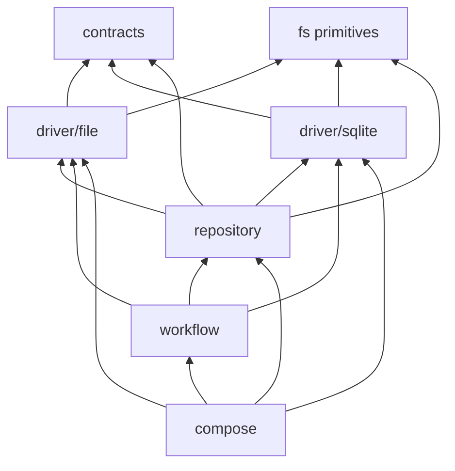

# Architecture

Orbit is a Rust workspace of layered crates. **Lower layers never depend on higher ones.** [`scripts/check-dependency-direction.sh`](scripts/check-dependency-direction.sh) enforces every crate edge, so a new edge means updating that script and the table below in the same PR.

```text
Surfaces      orbit-cli · orbit-web · orbit-mcp
Composition   orbit-cmd
Application   orbit-core
Domain        orbit-engine · orbit-automation · orbit-agent · orbit-tools · orbit-store
              orbit-search · orbit-registry · orbit-config
Kernel        orbit-exec · orbit-policy
Foundation    orbit-common · orbit-types
```

Domain crates own their data and transport. Application layers compose them. Kernel crates expose reusable mechanisms and never depend back on a feature.

## Crates

| Crate | Tier | Depends on (internal) |
|---|---|---|
| `orbit-types` | stable | — |
| `orbit-common` | stable | types |
| `orbit-config` | internal | common, types |
| `orbit-policy` | internal | common, types |
| `orbit-exec` | internal | common, types |
| `orbit-search` | internal | common, types |
| `orbit-store` | stable | common, types |
| `orbit-registry` | internal | common, config, types |
| `orbit-tools` | internal | common, exec, policy, types |
| `orbit-agent` | internal | common, types |
| `orbit-automation` | internal | common, store, types |
| `orbit-engine` | internal | agent, common, exec, store, tools, types |
| `orbit-mcp` | internal | common, registry, tools, types |
| `orbit-core` | internal | automation, common, config, engine, exec, policy, registry, search, store, tools, types (dev: core) |
| `orbit-cmd` | internal | common, config, core, mcp, registry, store, tools, types |
| `orbit-web` | internal | cmd, common, core, registry, types (dev: engine, store) |
| `orbit-cli` | internal | cmd, common, config, core, mcp, registry, types, web (dev: engine, exec, tools) |

`PipelineState` exposes drain controls, pull admission checkpoints and forge
hold records through `pull_drain: PullDrainState`. The general cancellation
policy remains on the run. Serde flattens the group for reading; an explicit
serializer retains the historical top-level names, field order and omission
rules when writing `state.json`. Changes to this persisted contract must update
both the serializer and the compatibility fixtures in the types integration
suite.

Core uses `git2` (vendored libgit2, network features disabled) to read local
refs, config and trees in process: routine status's branch inspection, and the
instruction and selector-object reads behind the preparation fingerprint. A
repository libgit2 cannot open, such as a partial clone or reftable refs, keeps
the bounded Git commands. Fetches, pins and other source evaluation continue to
use bounded Git commands and the shared fetch lock. A request-scoped source
cache shares inspection facts across routines without retaining stale refs
across polls. Web's host-wide routine memo uses the existing runtime-memo
single-flight mechanism with a separate host namespace and file/database input
stamps.

Core exposes Exec's shared Bubblewrap capability probe to CLI onboarding and
diagnostics. The CLI's dev-only edges to Engine, Exec and Tools support the real
sandbox broker integration test, which pairs the host runtime with the built
CLI and MCP transport.

The dashboard's dev-only Store edge seeds workspace claims directly in isolated
HTTP fixtures, so replay admission can be exercised without routing fixture
setup through an agent tool surface.

The dashboard's dev-only Engine edge exercises the runner's reservation action
in isolated HTTP fixtures, so workspace analytics cover production lock-denial
audit writes as well as seeded history.

Core's dev-only edge to itself enables its `test-support` feature for its own
integration tests, which substitute the detached pipeline worker and execute
submitted runs in-process.
That feature also enables Engine's `test-support` feature for scoped CLI
supervision clocks. Landing fixtures freeze Core's source budget clock; auth
fixtures expire Engine's deadline only after a real child signals readiness.
Both clocks are thread-local, restored on unwind, and absent from shipped builds.
It also enables Store's `test-support` feature, whose thread-local task-commit
lock deadline lets a drain admission fixture wait out a held lock in seconds;
it is restored the same way and is equally absent from shipped builds.

Engine's dev-only edge to itself enables its `test-support` feature for its own
unit and integration tests. The feature exports `test_support::NullRuntimeHost`,
the base every `RuntimeHost` test double in Engine and Core builds on, so the
`RuntimeHost` trait itself carries no defaults and shipped builds have no null
host.

The `orbit-core` → `orbit-exec` edge supports the Linux host probe and sandbox
regression tests. The dependency-direction guard
also checks that dependencies defined in `[workspace.dependencies]` are inherited
in member manifests with `workspace = true`.

### Foundation and kernel

- **orbit-types** holds shared serde contracts, pure constructors, and narrow domain errors, organized as domain modules (`identity`, `workspace`, `task`, `workflow`, …). It does no I/O of any kind. Its serde shapes are persisted contracts.
  The review contract also owns the canonical `review-*` artifact namespace
  classifier shared by Core's task update path, claimed-worker broker and
  external-evidence guards, and the live-report validator used by tools and Core.
- **orbit-common** holds `OrbitError` and the shared mechanisms: filesystem and path helpers, process support, storage, UTF-8-safe text bounds, protocol and YAML codecs, observability, and security. Security covers the release signing keys and verification used by `orbit update`, redaction, and `security::child_env`, the single allowlist builder for agent-subprocess environments. Operation registries live here so every surface can read them. The matching handlers live in `orbit-core`. Spawned process-group ownership and bounded kill-on-drop cleanup live in `process::OwnedChild`; supervisors borrow its child for pipe setup and waiting. Child supervision lives in `process::supervisor`: one wait loop with output sinks, stdin delivery, deadline termination, cancellation, SIGINT/SIGTERM fan-out to live child groups, a bounded post-exit drain, an opt-in stopped-descendant watch and a periodic caller policy hook. Identity-bound cancellation signalling lives in `process::signal`; `orbit-core` retains its process handles across TERM/KILL and coordinates conservative group snapshots.
- **orbit-policy** resolves `FsProfile` and evaluates `denyRead` and `denyModify` rules.
- **orbit-exec** owns sandboxes and the runner entry points for commands run under an `FsProfile`. Its runners supervise children through `orbit_common::process::supervisor`, applying exec's capture, termination and drain policy. Plugin build phases share a capped log across both stream sinks and use the periodic hook for their build-directory cap. Its `browser_kit` module holds the host's headless browser kit layout and the verified-kit check: the engine's CLI runner reads it to hand agents the kit's locator variables, and Core's `bootstrap::browser_kit` re-exports it for `orbit browser-kit`, onboarding and doctor.

### Domain

- **orbit-config** owns `config.toml`. That covers the key registry, global-over-workspace layering (security keys replace rather than merge, and `[machine]` is global-only), provenance for `orbit config show`, resolved views, and comment-preserving atomic edits through `ConfigStore`, which every writer runs from open to save under one per-file write lock so concurrent edits cannot erase each other. Callers pass explicit roots, so the crate never discovers the cwd or `$HOME`. It does not depend on `orbit-engine`; Core translates PR settings at composition time.
- **orbit-search** runs lexical retrieval. It owns the SQLite chunk and FTS5 schema, chunking, task-field extraction, and BM25 ranking. Core projects task records into it. The index file keeps its `semantic.db` name so persisted paths stay compatible.
- **orbit-registry** owns this machine's `[machine]` identity, the workspace catalog, checkout bindings, task-publication bindings, and the operator's registered remote hosts (`hosts.toml`), each persisted atomically. It has no shared database and no runtime execution.
- **orbit-store** handles persistence. See [orbit-store internals](#orbit-store-internals) below.
- **orbit-tools** holds the tool registry and the built-in fs, exec, and Orbit tool definitions. It resolves a plugin source to its plugin root (the source's `.orbit-plugin/` directory, the only tree installed) and loads and runs `plugin.yaml` v2 plugins through an `exec` backend (one confined process per call) or an `mcp` backend (a stdio server per caller context). Both backends run under the operator's granted sandbox profile. Plugin lifecycle (install, enable, grants, `.orbit/plugins.yaml`) belongs to Core. This crate is also the only owner of the `gh` CLI contract.
- **orbit-agent** provides one `AgentRuntime` per provider CLI (claude, codex, copilot, cursor, gemini, antigravity, grok, pi, opencode, muse, and others). It retains the audit types and redacted blob sinks that the engine persists, including historical event variants.
- **orbit-engine** executes activities and jobs: template rendering, retries, subprocess and tool-aware automation, and the CLI agent runner. It references `orbit-agent` directly, so Core stays free of agent types. It also owns candidate identity, reviewer repair commits, and the reviewed-head rechecks in `pr_open` and `pr_complete`. Host-side CI evidence collection lives here too, with the normalized CI error signature (`ci_log_signature`) that its reproduction check and Core's CI failure filing share.
- **orbit-automation** is the scheduling domain for routines and auto-tasks. It covers definition validation, due evaluation, overlap and retry, coverage acceptance, and state-triggered consumers. Its `review` module owns the before-PR coverage rules. It never depends on Core or Engine and has no loop or store of its own. Store owns cursors, claims, and receipts.

### Application and surfaces

- **orbit-core** composes the runtime. Its internal graph is `runtime ← application ← adapter`, with `composition` as the only module that joins config, bootstrap, runtime, and adapters. It exposes `OrbitRuntime` and never depends on `orbit-agent`, `orbit-cmd`, or transport crates. Store retention reads the workspace registry read-only, through `orbit-registry`, to tell a live partition from an id no checkout still owns. Notable application modules:
  - `review` runs the before-PR review gate (admit, settle, certificates, landing verification).
  - `landing` is the owner-side landing consumer for distributed drains, dispatched from the coordination outbox.
  - `config` projects `orbit-config` as structured data for the dashboard. Writes go through the same `ConfigStore`.
  - `task/desktop` separates bounded snapshot projections, authorization and completion checks, idempotent writes, review evidence and PR-head observation. Shared input validation lives in `validation`; its sibling `tests` directory preserves isolated mutable fixtures.
  - `sweep_filing` files CI failures and Dependabot, code scanning and secret scanning alerts as tasks, and admits piloted CI repairs to the backlog. `task/pilot` prepares and applies task-pilot assessments, including promotion from `proposed` to `backlog`. `admission` decides which backlog tasks automatic dispatch may admit and when (backlog exclusion, gap fit, leaf occupancy, CPU-light budget, claim holders, surface reservation, unknown footprint), `workspace_auto` runs the workspace auto-drain's classify, approval, window and readiness steps on it, `pull_drain` runs a follower's pull drain: refill, settlement, the failure breaker and leaf reconciliation, `task/finding_verification_steps` and `task/blocked_recovery/steps` prepare and apply finding-verification and blocked-task recovery runs, and `job/pipeline_actions` validates bundles, resolves the delivery Job, re-checks gate admission, defers starved gates and guards pipeline results. The adapter's `engine_host/actions` dispatches the engine's deterministic actions to all of them; its `pipeline_actions` module dispatches and waits on child Jobs, and its `pull` module keeps the routed owner peer and leaf launcher the pull drain runs over.
  - `search` keeps its public contracts and exports at the module root. `runtime` coordinates workspace queries, `candidates` owns filtered task retrieval and BM25 paging, `friction` builds friction results, and `merge` combines branches. Conversion, filters, federation and path matching keep their existing modules.
- **orbit-cmd** composes the application for the CLI and web. It joins Core to Registry and holds command groups, runtime assembly, routines, and managed-worker transports. Its `hosts` group backs `orbit host` and the doctor `hosts` row, joining the Registry's host file to the MCP crate's federated identity probe. Its `doctor` group holds the read-only `orbit doctor` report that both the CLI and the dashboard's Health › Doctor panel run, and `mcp_clients` holds the MCP client config-path table that `orbit mcp init` writes and the doctor `mcp-registration` row reads. `update` is the one group that composes outward: it handles release download, integrity checks, binary replacement, and post-install convergence. `log_format` is the plain-text source and code columns that `orbit log` and the dashboard's log view share, so a target reads the same on both. `browser_kit` installs, verifies and removes the headless browser kit behind `orbit browser-kit` and the `workspace init` offer, and the doctor's `browser-kit` rows report it.
- **orbit-mcp** implements the MCP transport over `rmcp`: stdio and TCP transports, tool discovery, per-call traces, the SSH stdio proxy, and the federated mux, which routes host-qualified `hm_*/ws_*` selectors to the registered hosts and fails closed. Core owns validation and auditing. Its adapter consumes `McpToolDefinition.rules` rather than matching builtin names: `orbit-tools/src/mcp_rules.rs` owns selector/echo conditions, ID-routing classifications, presentation readers and input-schema decorations. Adapter-owned presentation entrypoints are declared in `orbit-mcp/src/presentation_definition.rs`. These internal rules are separate from client annotations and are not emitted in `tools/list`; custom and plugin definitions default to ordinary transport behavior. Name-based CLI routing uses the same builtin routing metadata, including CLI-only task operations.
- **orbit-web** serves the HTTP API and embedded dashboard, plus `web connect` over an SSH tunnel and `/api/on/<host>`, which forwards to a registered host's own dashboard over an on-demand SSH tunnel.
- **orbit-cli** is the clap entry point and client configuration. It assembles MCP, Registry, Web, and Core. The accepting machine always resolves its own state and dispatches through Core.
- **`desktop/`** is the Tauri desktop shell, a separate Cargo workspace outside the crate graph. It depends on no workspace crate: it runs the installed `orbit web serve` as a child process, shows the dashboard from its loopback address and reads that server's `/api` routes for its tray and notifications. Its update check reads GitHub releases over HTTPS and verifies them against a copy of `orbit-common::security::release`'s trust set, which `scripts/check-installer-pubkey.sh` keeps identical. See [`desktop/README.md`](desktop/README.md).

## orbit-store internals



- **`contracts`** holds every consumer-visible trait and DTO. Application code uses only these.
  The distributed pull preflight fingerprints a JSON schema derived with
  Schemars from the actual admission request and nested Types contracts. The
  tool adapter also derives its accepted request fields from that schema.
- **`driver/file`** and **`driver/sqlite`** are private, implement one technology each, and never import each other. Shared atomic-write, lock, path-safety, and YAML code lives in `fs`.
- **`repository`** enforces invariants that span drivers. A task write, for example, is a canonical bundle plus registry rows. Task and reservation changes commit through one boundary ([pattern](docs/design-patterns/task_commit_boundary.md)).
- **`workflow`** holds the explicit import, export, reindex, repair, publication, and layout-upgrade operations. Nothing imports implicitly on open.
- **`compose`** builds the concrete stores. Construction and migrations stay in composition, bootstrap, and maintenance code.

The operator-only `maintenance::migration` surface also exposes the shared
SQLite ledger engine for databases owned by other crates. Core's protected
recovery authority supplies its own frozen registry; the engine records its
migration and compatibility metadata in that same database and serializes
adoption with the store and task registry's transaction rules.

The dependency-direction script enforces these arrows too.

Job catalog listings fetch the latest run for all selected jobs through the
store's batched `latest_job_runs` contract. The SQLite backend probes the
per-job creation index in bounded groups and hydrates steps in batches, so a
catalog refresh does not issue separate run and step queries for each job or
decode older run history. Empty catalogs require no run-store reads.

Bounded multi-state recency pages select at most the requested limit from
each distinct state through the workspace/state recency index, then merge
those candidates by recency and run ID before applying the final limit.
Active and failed page selection does not scan unrelated success history.
Other filters apply inside each state selection; counts retain the complete
matching set. Workspace HTTP lists reconcile stale runs once per request,
while aggregate lists read the stored rows observationally.

Task delivery observations without a named run prefilter candidate runs in
SQLite by exact membership in the submitted `input.task_ids` array or equality
with a text top-level `input.task_id`. The runtime then re-checks the
`input.task_ids` array before accepting a candidate and skips jobs that do not
hold task delivery. Candidates remain ordered by creation time, newest first.
This avoids decoding unrelated workspace history without imposing a history
cap that could hide an older delivery. The JSON predicate still scans workspace
rows; candidate input hydration scales with the task's matching run history,
while SQL filtering scales with workspace history.

## Stability tiers

Each crate declares `stability` under `[package.metadata.orbit]` in its `Cargo.toml`. [`scripts/check-stability.sh`](scripts/check-stability.sh) fails if the marker is missing or invalid. There is no automated API diff; the tier signals refactor scope to reviewers.

- **stable**: breaking changes need owner sign-off.
- **experimental**: free to refactor, and downstream depends at its own risk.
- **internal**: refactor freely.

## Scoping rules

Orbit has two roots: global `~/.orbit/` and the workspace `.orbit/`.

Registered repositories may share one explicit data root. In that mode the
selected logical workspace binding scopes runtime identity, tasks, job runs,
friction, default v2 audit/recovery reads, reservations and workspace claims;
the root's single compatibility `config.yaml` cannot identify every repository.
Ordinary checkout roots keep their persisted partition identity, which can
differ from the logical catalog ID. Opening a root without a selected binding
retains the compatibility config identity.

| Artifact | Strategy | Notes |
|---|---|---|
| Tasks, job runs, run traces | Workspace only | Per-repo backlog and execution artifacts |
| Search index | Workspace only | Lexical task index |
| Activities, jobs, skills | Merge by key | Global defaults, workspace overrides by name |
| Policies | Merge by key | Workspace overrides profiles; global deny rules accumulate |
| Command audit | Global only | One authoritative SQLite trail |
| Global defaults stamp | Global only | Lets a warm open skip re-hashing managed catalogs |

A runtime that joins a foreign executable generation retains read-only state
handles and skips operational repairs. Tool dispatch appends its command audit
through a separate connection to the existing global database, without creating
or migrating it. This append requires the exact supported store schema; an
unwritable or incompatible database still leaves read-only tool results available
with an audit warning. Ordinary writable runtimes reuse their audit handle.

## Automation persistence

- Automation state (consumer checkpoints, delivery-owner intents, accepted coverage, and recovery records) lives in host SQLite store tables that the store ledger creates (v49 absorbed the automation feature ledger). Every checkpoint and receipt change is generation-fenced. Recovery never moves a cursor, drops an obligation, or mints a receipt.
- Task action keys live with task allocation in the registry, and job keys commit with job admission.
- Task artifacts reserve `automation-evidence-authority.json` for transport-supplied run origin plus a digest. Neither a model nor caller JSON can create that authority. Source ranges are retained under `refs/orbit/automation/...` until explicit cleanup.

## Product identity

Orbit is the only supported application profile. A `.orbit-product` marker, checked in [`bootstrap::product_profile`](crates/orbit-core/src/bootstrap/product_profile.rs), stops another product from initializing or reconciling an Orbit root. Unmarked legacy roots still open. The marker guards against accident, not attack. A test-only fixture shows the runtime can be reused without the engineering assets.

Before a second public profile can exist, it must be fixed before state opens and carried through every entry point, not just filtered in tool discovery. That means these entry points:
- tool execution and command dispatch
- engine and Core dispatchers
- job submission and web run handlers
- the MCP and federated servers
- detached workers
- agent callbacks
- clock installation
