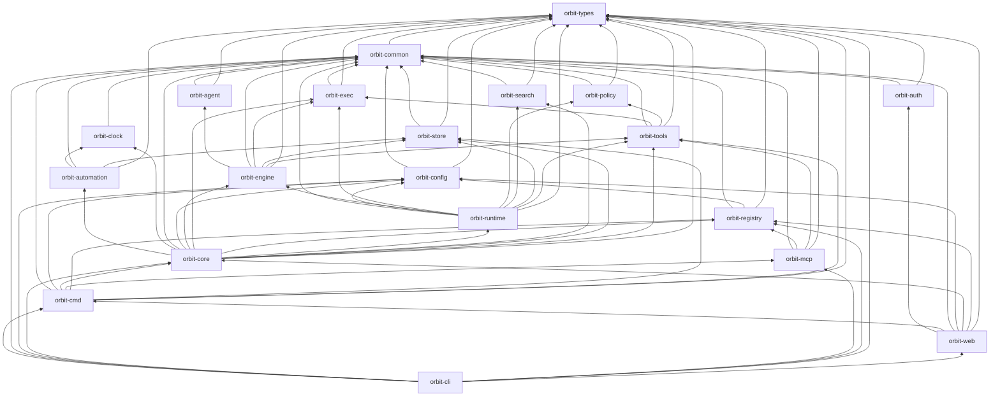

# Orbit architecture — code map

This is a map of the code as it is today. Design intent lives in
`docs/design/`; this folder describes the current structure and links
there instead of repeating it. Layering rules and the authoritative crate table
live in `ARCHITECTURE.md`; `scripts/check-dependency-direction.sh` enforces
every edge below.

## End-to-end data flow

1. **Task filed.** A task (`Task` in `crates/orbit-types/src/task/model/task.rs`)
   is created through `orbit.task.add` (MCP, `crates/orbit-mcp/src/lib.rs`) or
   the CLI (`crates/orbit-cli/src/main.rs`). It is persisted by `orbit-store`
   (`TaskStoreBackend` in `crates/orbit-store/src/contracts/traits/task.rs`)
   as a canonical bundle plus registry rows; task and reservation changes
   commit through one boundary (see `docs/design-patterns/task_commit_boundary.md`).
2. **Pilot.** `orbit-core`'s `application/task/pilot` prepares and applies the
   task-pilot assessment, promoting `proposed` → `backlog`
   (`crates/orbit-core/src/application/`).
3. **Dispatch.** `application/admission` decides which backlog tasks automatic
   dispatch may admit; `application/workspace_auto` runs the auto-drain
   (classify, approval, window, readiness); `application/pull_drain` runs a
   follower's pull drain. Jobs are validated and reserved by
   `application/job/pipeline_actions`.
4. **Activity-job runs.** `orbit-engine` (`crates/orbit-engine/src/activity_job/dispatcher.rs`)
   renders templates, dispatches through `RuntimeHost`
   (`crates/orbit-engine/src/lib.rs`), runs provider CLIs via `orbit-agent`
   (`AgentRuntime`), tools via `orbit-tools` (`ToolRegistry` in
   `crates/orbit-tools/src/registry.rs`), and processes via `orbit-exec`
   (`run_process`) under `orbit-policy` (`PolicyEngine` in
   `crates/orbit-policy/src/engine.rs`). `orbit-runtime` (`RuntimeKernel`)
   supplies stores, event bus, audit, claims and reservations.
5. **PR, review and landing.** The engine owns candidate identity and
   `pr_open`/`pr_complete` rechecks; `application/review` runs the before-PR
   review gate (admit, settle, certificates); `application/landing` (above
   `application/distributed`) consumes the authorized handoff outbox and lands.
6. **Done.** Task state transitions close linked notices
   (`application/notice` via `task::TaskNoticePort`) and project costs
   (`application/evolution`); terminal tasks close their Orbit-authored PRs.

Scheduling alongside the flow: `orbit-automation` evaluates routines and
auto-tasks (due, overlap, retry, CEL condition triggers in
`crates/orbit-automation/src/condition/`); `orbit-clock` owns the host sweep
clock (`TICK_DEADLINE` in `crates/orbit-clock/src/lib.rs`) that wakes the sweep
pass in `orbit-core`'s `application/routines`.

## The store, and federation between owner and follower hosts

- **Store.** `orbit-store` is the persistence crate: consumer-visible traits in
  `crates/orbit-store/src/contracts/`, private SQLite/file drivers in
  `crates/orbit-store/src/driver/`, invariants in `repository`, explicit
  import/export/repair in `workflow`, construction in `compose`. Two roots:
  global `~/.orbit/` and workspace `.orbit/` (see Scoping rules in
  `ARCHITECTURE.md`). `orbit-search` maintains its own SQLite FTS5 index
  (`LexicalIndex`); `orbit-registry` persists machine identity and the
  workspace catalog as files (`hosts.toml`) with no shared database.
- **Federation.** One owner host holds the authoritative store. Follower hosts
  pull work: `application/pull_drain` refills and settles claims over the
  routed owner peer (`PullTransportPort`), with owner-only landing — followers
  never merge (see `docs/design/distributed-drain/` and
  `docs/runbooks/distributed-drain.md`). The MCP federated mux
  (`crates/orbit-mcp/src/federated/`, `crates/orbit-mcp/src/remote/`) routes
  host-qualified `hm_*`/`ws_*` selectors to registered hosts (from
  `orbit-registry`'s `hosts`) and fails closed. Claimed work returns artifacts
  and results to the owner through the run's coordinator.

## MCP and dashboard surfaces

- **MCP.** `orbit-mcp` implements the transport over rmcp (stdio + TCP
  listener `McpListener`, SSH stdio proxy, federated mux). It exposes
  `OrbitToolServer` and the `McpHost` trait (`crates/orbit-mcp/src/lib.rs`);
  `orbit-tools` owns tool definitions and `mcp_rules`
  (`crates/orbit-tools/src/mcp/`), while `orbit-core` owns validation and
  auditing. `orbit-cmd`'s `mcp_clients` holds the client config-path table
  that `orbit mcp init` writes. Design: `docs/design/mcp-bridge/`,
  `docs/design/federated-mcp/`.
- **Dashboard.** `orbit-web` serves the HTTP API and embedded dashboard
  (`serve` / `serve_from_env` in `crates/orbit-web/src/serve.rs`), plus
  `web connect` over SSH and `/api/on/<host>` forwarding to a registered
  host's dashboard. It composes `orbit-cmd` + `orbit-core`; the Tauri
  `desktop/` shell is a separate workspace that runs `orbit web serve` as a
  child (see `ARCHITECTURE.md`). Design: `docs/design/user-interface/`.

## Crate dependency diagram

Production internal edges only (dev-dependency edges omitted). Lower layers
never depend on higher ones.

## Per-crate pages

| Crate | Page |
| --- | --- |
| orbit-agent | [orbit-agent.md](./orbit-agent.md) |
| orbit-auth | [orbit-auth.md](./orbit-auth.md) |
| orbit-automation | [orbit-automation.md](./orbit-automation.md) |
| orbit-cli | [orbit-cli.md](./orbit-cli.md) |
| orbit-clock | [orbit-clock.md](./orbit-clock.md) |
| orbit-cmd | [orbit-cmd.md](./orbit-cmd.md) |
| orbit-common | [orbit-common.md](./orbit-common.md) |
| orbit-config | [orbit-config.md](./orbit-config.md) |
| orbit-core | [orbit-core.md](./orbit-core.md) |
| orbit-engine | [orbit-engine.md](./orbit-engine.md) |
| orbit-exec | [orbit-exec.md](./orbit-exec.md) |
| orbit-mcp | [orbit-mcp.md](./orbit-mcp.md) |
| orbit-policy | [orbit-policy.md](./orbit-policy.md) |
| orbit-registry | [orbit-registry.md](./orbit-registry.md) |
| orbit-runtime | [orbit-runtime.md](./orbit-runtime.md) |
| orbit-search | [orbit-search.md](./orbit-search.md) |
| orbit-store | [orbit-store.md](./orbit-store.md) |
| orbit-tools | [orbit-tools.md](./orbit-tools.md) |
| orbit-types | [orbit-types.md](./orbit-types.md) |
| orbit-web | [orbit-web.md](./orbit-web.md) |

Kept current by the design-sync auto-task's weekly architecture-refresh step.
