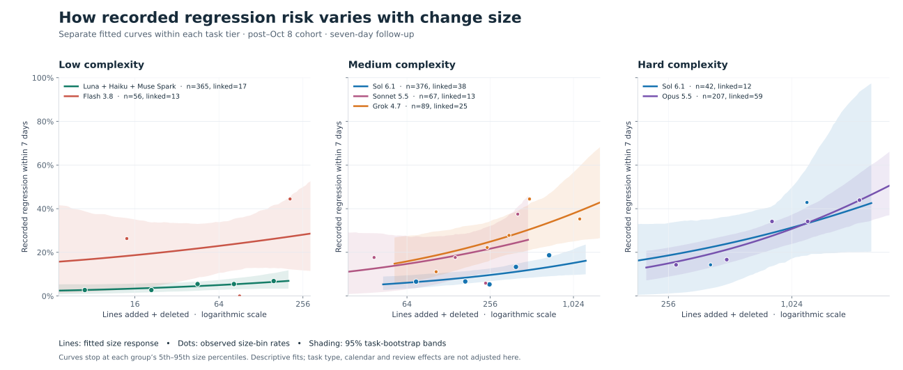
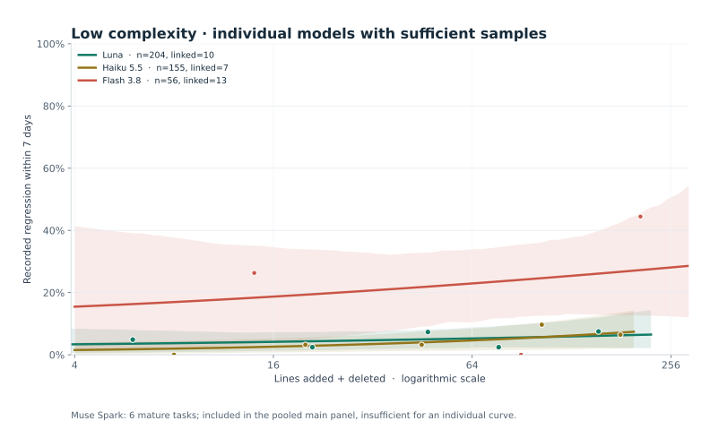

# Exploratory task-risk evidence: October 29, 2026

Supplement to the attribution-aware backtest for ORB-20095 / ORB-20094. Uses the same frozen owner snapshot at 2026-10-30T06:31:09Z (October 29 Pacific), SHA-256 d6445bfd33beea3e350597945be1fc95a69c58ee393ed5e5872ea93af7e7811d. User requests: compare models within the same complexity tier; Sol should have medium and hard support; pool Luna + Haiku + Muse Spark where individual samples are thin.

## Cohort and method

Primary cohort starts at the October 8, 2026 09:23:38 PDT source commit fixing claimed reviewers' regression attribution filing. Both landing and completion must follow that cutoff, with seven complete days of follow-up by the frozen snapshot. This is a source-policy cutoff, not verified deployment or proof of complete reporting. Exact historical model IDs stay separate; no merging of older Sol/Luna versions into current models.

Outcome is a task with at least one current regression_from link whose observation-time proxy falls within seven days after completion. This is escaped recorded linked work, including the ledger's different regression natures/severities, not all latent defects or implementation failure. Relation observation time is the latest relation-related task event, otherwise finding creation; first-known per-edge payloads were not reconstructed. Historical sizes use git-subject attribution rather than an exact delivery-ledger reconstruction. Complexity may be the current task assessment rather than an immutable assignment-time snapshot, and cross-host execution-model coverage may be incomplete. All mature sizes in this cohort use git-subject attribution proxies rather than recorded landed diff rows, which only began later.

Report individual comparisons at >=30 tasks per model within a tier, with explicit event counts and Wilson 95% intervals. Fewer than five outcomes is a sparse-outcome warning rather than an exclusion rule: zero-event models must not be hidden as if unavailable evidence proved safety.

For pairwise adjusted comparisons, use only exact common UTC calendar-week x task-type x floor(log2(1+lines-changed)) cells. Within each cell, directly standardize rates using min(nA,nB) as the overlap weight. Require at least 30 supported tasks per side, balanced cell weight >=20 per side, and >=10 pooled outcomes for an exploratory adequate-overlap flag. Pair-specific rates refer to different common-support populations and cannot be chained into a league table.

Use 20,000 conditional within-cell label permutations and Holm correction across all seven individual-model pairs meeting the raw n threshold. These are association screens: they assume task exchangeability within cells, do not model related-task dependence, and are not causal model-capability evidence. Review-source-only outcomes provide sensitivity checks. Final-size adjustment conditions on something the model itself influences, so both raw and adjusted views are retained.

## Raw within-tier observations

| Task complexity | Model | Tasks | Linked within 7 days | Rate | Wilson 95% interval | Median lines changed |
|---|---|---:|---:|---:|---:|---:|
| Low | GPT-6 Luna | 204 | 10 | 4.9% | 2.7–8.8% | 47 |
| Low | Claude Haiku 5.5 | 155 | 7 | 4.5% | 2.2–9.0% | 45 |
| Low | Gemini 3.8 Flash high | 56 | 13 | 23.2% | 14.1–35.8% | 88.5 |
| Medium | GPT-6.1 Sol | 376 | 38 | 10.1% | 7.5–13.6% | 251 |
| Medium | Claude Sonnet 5.5 | 67 | 13 | 19.4% | 11.7–30.4% | 190 |
| Medium | Grok 4.7 | 89 | 25 | 28.1% | 19.8–38.2% | 347 |
| Hard | GPT-6.1 Sol | 42 | 12 | 28.6% | 17.2–43.6% | 715.5 |
| Hard | Claude Opus 5.5 | 207 | 59 | 28.5% | 22.8–35.0% | 820 |

These are retrospective within-tier estimates across the full mature cohort, not held-out forecasts. The previous backtest had only 66 strict-regime held-out tasks because it also reserved an earlier training window and seven days for training-label maturity; that does not limit the descriptive cohort to 66 tasks.

## Comparisons on overlapping calendar/type/size cells

| Tier and pair | Supported tasks | Standardized linked rates | Individual-family Holm-adjusted association p | Reading |
|---|---:|---:|---:|---|
| Medium: Sol vs Grok | 302 vs 77 | 10.9% vs 26.6% | 0.015 | Clearest medium-tier association after measured matching |
| Medium: Sol vs Sonnet | 155 vs 55 | 7.1% vs 14.6% | 0.320 | Suggestive direction, unresolved with this support |
| Hard: Sol vs Opus | 34 vs 90 | 28.1% vs 20.8% | 0.826 | No reliable separation; 42 raw Sol hard tasks are limited support |
| Low: Luna vs Haiku | 158 vs 133 | 5.0% vs 5.4% | 0.898 | No reliable separation |
| Low: Luna vs Flash | 144 vs 51 | 2.9% vs 22.4% | 0.0035 | Strong observed association under task-level assumptions |
| Low: Haiku vs Flash | 106 vs 45 | 7.5% vs 25.0% | 0.0515 | Direction consistent, weaker corrected evidence |

Sonnet vs Grok has only 40 vs 22 supported tasks and balanced overlap weight 19; it fails the prespecified overlap screen, despite sufficient raw within-tier totals. The standardized direction reverses their raw ordering on this small selected overlap, illustrating why raw rates cannot be read as a complete ranking.

Review-source-only sensitivity: Sol vs Grok standardized 6.3% vs 26.6%, preserving direction. Sol vs Sonnet 4.8% vs 14.6%, but sensitivity p-values have no separate family correction and are not confirmatory. Hard Sol vs Opus becomes 18.75% vs 18.83%, effectively identical, so the all-source hard-tier adjusted gap is not robust across outcome sources. Full pair outputs and cells are in within-tier-results.json.

## User-authorized small-model pooling

Exact pool members: gpt-6-luna, claude-haiku-5-5, muse-spark-1.3-contributor. Pool only within each task-complexity tier. Do not compare the aggregate against its own members or treat pooled support as individual Muse Spark support.

| Task tier | Pool composition | Total | Outcomes | Rate and 95% interval |
|---|---|---:|---:|---|
| Low | Luna 204 + Haiku 155 + Muse Spark 6 | 365 | 17 | 4.7% (2.9–7.3%) |
| Medium | Luna 6 + Haiku 13; Muse Spark 0 | 19 | 2 | 10.5% (2.9–31.4%); below sample threshold |
| Hard/xhard | No mature examples | 0 | — | Unavailable |

The pooled low group versus Flash has 255 vs 54 tasks on common cells and standardized rates 4.9% vs 23.6%. This is an additional user-requested descriptive pool comparison, not a confirmatory test or proof that the pool's members are equivalent. Muse Spark contributes just six tasks and zero recorded outcomes; its individual Wilson upper bound is large. Pooling does not create evidence about small models on hard tasks.

## Size-response plots



Fit each displayed group independently with the same complementary-log-log
size-response family:

```text
p(linked within 7 days | completed task, tier, model, lines)
  = 1 - exp(-exp(a + b * ln(1 + lines)))
```

The free slope `b` may be negative. No monotonic increase, exponential
acceleration or ordering between model capabilities is imposed. The chosen
family has a power response in `1 + lines` on the cumulative-hazard scale;
it does not test arbitrary curvature or establish an exponential law in lines.
Observed bins and alternative nonlinear families remain necessary checks. Each curve is
displayed only across that group's 5th–95th observed size percentiles. The
horizontal axis is logarithmic; counts are lines added plus deleted, including
tests and other classified paths. The curves are descriptive fits on the mature
cohort, not held-out predictions or the proposed 30-day production estimator.

Dots are observed rates in equal-count size bins of at least ten tasks; they
may fall outside the central fitted display range. Shading is a **pointwise 95%
task-bootstrap percentile band**, from 800 independent resamples of tasks and
refits per group. These bands do not include related-task dependence, rubric,
reporting, proxy-join or model-class uncertainty. All main-panel refits were
finite; the individual Haiku supplement had 798/800 finite fits; two
resamples lacked an estimable fit. Bands use the finite fits, with that
exclusion recorded in `curve-fits.json`.

| Task tier | Model/group | Tasks / linked | Log-size slope b | Task-bootstrap 95% slope interval | Displayed central size range |
| --- | --- | ---: | ---: | ---: | ---: |
| Low | Luna + Haiku + Muse Spark | 365 / 17 | 0.293 | -0.018 to 0.644 | 4–202 lines |
| Low | Flash 3.8 | 56 / 13 | 0.171 | -0.294 to 0.941 | 4–335 lines |
| Medium | Sol 6.1 | 376 / 38 | 0.348 | 0.077 to 0.615 | 43–1,256 lines |
| Medium | Sonnet 5.5 | 67 / 13 | 0.313 | -0.199 to 1.347 | 22–481 lines |
| Medium | Grok 4.7 | 89 / 25 | 0.367 | 0.092 to 0.835 | 52–1,825 lines |
| Hard | Sol 6.1 | 42 / 12 | 0.436 | -0.050 to 2.462 | 172–2,502 lines |
| Hard | Opus 5.5 | 207 / 59 | 0.593 | 0.284 to 0.929 | 200–3,155 lines |

For scale, these are illustrative fitted values at sizes inside each group's
central support, **not calibrated per-task predictions**:

| Task tier | Model/group | 100 lines | 300 lines | 1,000 lines |
| --- | --- | ---: | ---: | ---: |
| Low | Small-model pool | 5.7% | Outside displayed support | Outside displayed support |
| Low | Flash 3.8 | 24.5% | 28.7% | Outside displayed support |
| Medium | Sol 6.1 | 7.1% | 10.2% | 15.0% |
| Medium | Sonnet 5.5 | 16.7% | 22.6% | Outside displayed support |
| Medium | Grok 4.7 | 18.4% | 26.2% | 37.6% |
| Hard | Sol 6.1 | Outside displayed support | 19.8% | 31.1% |
| Hard | Opus 5.5 | Outside displayed support | 16.3% | 30.4% |

These are unadjusted within-tier size responses. The preceding common-cell
analysis additionally accounts for observed calendar week and task type; its
standardized rates are different estimands and should not be read off these
curves. Both condition on a final diff that the model and repair process helped
produce. Routing, reviewer/test configuration and unrecorded difficulty remain
possible confounders.

The medium Sol/Grok curves show different levels with similar estimated slopes;
they do not establish a different growth law. Hard Sol/Opus curves and slope
intervals overlap substantially. Even where a single-model slope interval lies
above zero, that alone does not test whether its slope differs from another
model. Direct response-difference tests, model support and prospective validation
remain necessary.



The individual low panel retains Luna and Haiku because each has useful raw
support. Muse Spark contributes only six mature low-tier tasks and remains in
the main panel's pool. The pool has just 19 medium tasks and no hard tasks, so
neither a medium/hard small-model curve nor compiler-scale extrapolation is
supported.

## Temporal rerun and historical-evidence status

The original historical backtest scripts and frozen cohort were not recovered
in the inspected task records or searched scratch locations. Its reported AUC
0.737 and small added crew effect remain unvalidated; if pre-attribution silence
was treated as clean negatives, those calibration/model-comparison conclusions
are invalid. The new protocol does not reproduce those historical scores.

The initial source-policy cutoff is commit
`09e60b0757811368879fd0885f36950f586c0aa0`, September 12 at 21:25 PDT,
which added attribution instructions to both review templates. The stricter
cutoff is the October 8 filing repair
`536c84994cb5e8dcf7b88d1bd0d75a0e5d3061ca`. Later label changes include
typed nature/escape on October 18 at 17:13 PDT
(`37d10744d68d076be18ace14b3387d9f961da570`) and expanded QA/full-review
attribution on October 24 at 23:59 PDT
(`689139770b3a7bb399d3b4834c2bb355adf803db`). None proves host deployment
or complete ascertainment.

A new exploratory temporal rerun after the initial policy cutoff has four
weekly test bins, 2,036 held-out tasks and 264 linked seven-day outcomes.
Training outcomes must mature before each test origin. Size-only log loss is
0.39767; adding complexity/type gives 0.37424, model intercepts 0.37488 and
model-specific size/complexity terms 0.37554. The stricter post-October-8
protocol has only 66 held-out tasks and five outcomes in one partial bin;
it cannot settle model effects. No supported test bins exist yet for the
later typed/expanded-QA regimes under this protocol. These proxy-input analyses
are exploratory, not primary 30-day validation.

The broader mature initial-policy cohort has Astra 14 tasks, all hard/xhard,
and current Luna 361 tasks, all low/medium. It supplies no shared recorded
complexity tier and no fair Astra/Luna comparison on equivalent demands.
The within-tier results above are more informative than an aggregate
model-equivalence claim, while remaining observational.

## Implication for risk design

The current cohort contains model-associated differences within a task tier, especially Sol versus Grok on medium work and Luna versus Flash on low work. A global model coefficient or an across-tier pooled backtest can obscure such structure. These observations support evaluating model-by-complexity effects rather than assuming a shared curve. They do not establish causal capability rankings, a particular exponential response, or any valid extrapolation from low-tier small-model results to compiler-sized hard work. Preserve uncertainty and require stronger prospective/control evidence before changing production calibration.

## Reproduction and checks

Run within_tier.py with NumPy beside the frozen input.json from the original attached input.json.gz. Seeds, sample/overlap thresholds, matching cells, all pairwise outputs, class composition and source sensitivity are persisted in within-tier-results.json. Checked: unique cohort task IDs; no mixing of task tiers; pool member counts/events sum to totals; common cells contain both models; all standardized weights are positive and sum to one by construction. No production source/configuration change or build/test suite is needed for this scratch analysis.

## Receipts and reproduction

Owner snapshot and machine-readable outputs are attached to [ORB-20095] under
`backtest-2026-10-29/`: `input.json.gz`, `export.py`, `analyze.py`,
`results.json`, `within_tier.py`, `within-tier-results.json`,
`plot_curves.py` and `curve-fits.json`, plus SVG/PNG/PDF figures. Raw per-task
inputs stay in task artifacts rather than this repository. Reproduce with
Python, NumPy and Matplotlib; extract `input.json` beside the scripts and run
the analysis/plot scripts. Fixed seeds, fitted coefficients, observed bins,
bootstrap success counts, support limits and curve grids are in the JSON.
Source snapshot time is October 29 at 23:31 Pacific; later label edits do not
silently rewrite these receipts.

## Task References

- [ORB-20107] — publishes these supplementary figures and results.
- [ORB-20095] — owns the task-risk design and attached evidence artifacts.
- [ORB-20094] — records the authoring-session analysis.

> Resolve any task above with `orbit task show <ID>` or `git log --grep=<ID>`.
