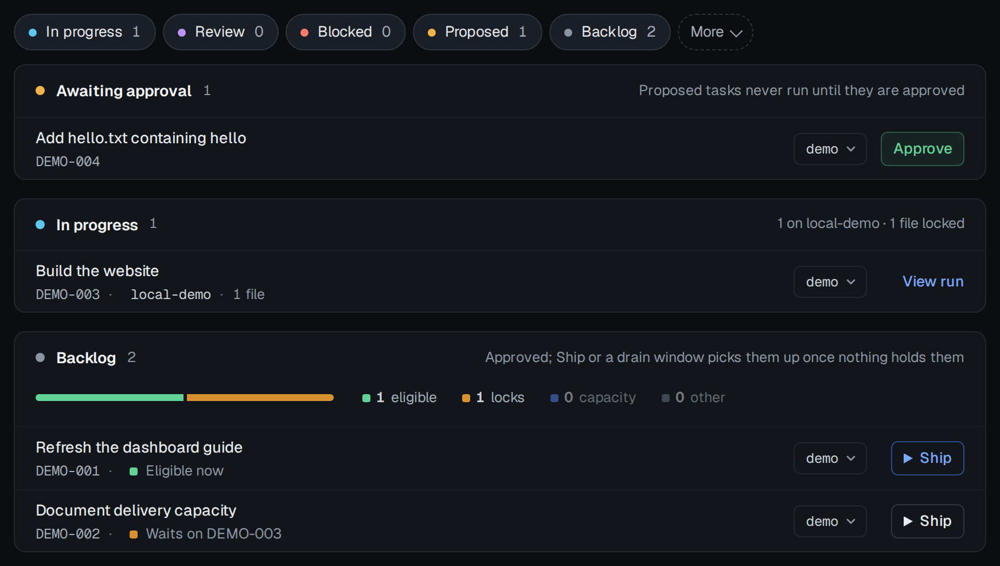
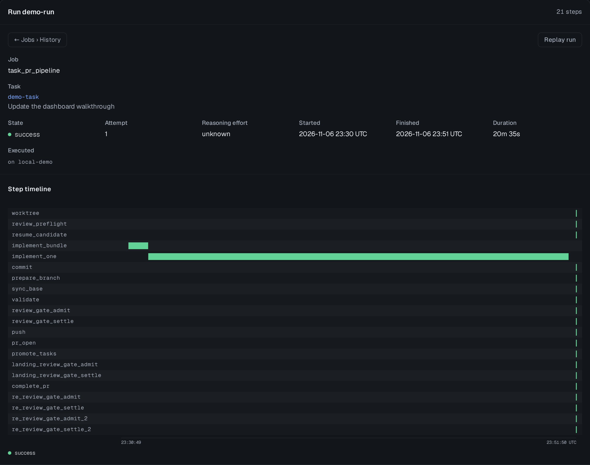

Take one task from request to merged pull request: your agent files it, you
approve and ship it from the dashboard, and you review what comes back. The
same flow runs [from the terminal](#from-the-terminal).

## Before you start

Finish the [Quickstart](/getting-started/) setup: Orbit connected to your
agent in this repository, and the dashboard open with `orbit web serve`. Use a
repository where a throwaway change is fine.

## 1. Ask for a change

Ask your agent for something small and checkable:

> Add orbit-hello.txt at the repository root containing "hello from orbit".
> File it as an Orbit task.

The agent files a task with a title, a complexity, and acceptance criteria,
which the run checks its work against. The task lands in `proposed`. Nothing
runs yet.

## 2. Approve it

In the dashboard, the task appears in **Tasks** under **Awaiting approval**.
Open it, read the description and criteria, and click **Approve**. It moves to
`backlog`. If the task is wrong, click **reject**, or ask your agent to fix it
first.

The **Context files** tab lists the files and directories the task expects to
change. Orbit locks those paths for the run, so a task that overlaps them
waits. Some file types, such as Markdown, can skip the lock; see
[What `orbit init` seeds](/reference/config/#what-orbit-init-seeds).



You can also tell your agent to approve it. Either way, the task's history
records the approval.

## 3. Ship it

Click **Ship** on the task. Orbit gives the task an isolated worktree and runs
an agent in the sandbox to plan, make, and check the change. Click **View
run** to follow each step live.



In the default `pr` ship mode, the run ends by opening a pull request. Asking
your agent to ship the task starts the same run.

A second agent reviews the change when `review.timing` is on.
`orbit workspace init` sets it to `before_landing` for a pull-request
workspace when `luna`, `haiku`, or `muse-spark` is enabled, and to `off`
otherwise. [Review layers](/concepts/tasks/#review-layers) explains the
choices.

## 4. Review and close it

A successful run stops with the task in `review` and the pull request open.
The task's detail shows the plan, the execution summary, and the reviewer's
verdict when review is on.

Review the pull request and merge it on GitHub. Then close the task one of two
ways:

- Click **Approve** on the task.
- Let Orbit settle it. Each `orbit run auto` delivery window, and
  `orbit task settle-merged <id>`, moves a task to `done` once its pull
  request has merged. A task with a live run or claim, or with a post-deploy
  criterion not yet recorded, stays open.

Neither route merges anything for you. Merging stays your decision unless you
[let runs merge](/getting-started/workflows/#completing-work-with---complete).

### If the run fails

The run's detail opens on the step it stopped at and the error it recorded.
Fix the cause, then click **Resume** to restart from that step. Or ask your
agent what went wrong: the `orbit-orchestrate` skill reads the run's evidence
and matches it to a known failure.

## From the terminal

The same task, end to end:

```bash
TASK_ID=$(orbit task add --title "Create orbit-hello.txt" \
  --acceptance-criteria "orbit-hello.txt exists at the repository root." \
  --acceptance-criteria "It contains the text 'hello from orbit'." \
  --complexity low --workspace . \
  --context file:orbit-hello.txt --allow-missing-context)
orbit task lint "$TASK_ID"               # flag vague criteria or unusable scope
orbit task update "$TASK_ID" --approve   # proposed → backlog
orbit run ship "$TASK_ID"                # prints a run ID and returns
orbit run show <RUN_ID>                  # follow the run
orbit task update "$TASK_ID" --approve   # after you merge: review → done
orbit task settle-merged "$TASK_ID"      # or let Orbit settle it once merged
```

- `orbit task add` prints the new task ID. `--title` and `--complexity` are
  required.
- `--context` names the files and directories the task expects to change, and
  Orbit locks them for the run. `--allow-missing-context` covers a file the
  task will create, as here. A task with no context holds no file lock, and
  `orbit task add` warns about it.
- The context is a starting point, not a limit. A run that changes other files
  still delivers, and Orbit adds them to the task's context.
- `--approve` takes the next approval step: `proposed` to `backlog`, then
  `review` to `done`.

`orbit task show "$TASK_ID"` shows the task, and `orbit audit list` shows the
recorded events. `orbit task artifact put "$TASK_ID" <file>` attaches a report
or other output; see [Task artifacts](/concepts/tasks/#task-artifacts).

## Next

- [Delivery workflows](/getting-started/workflows/): ship many tasks at once,
  and let runs merge.
- [Use the dashboard](/how-to/dashboard/): everything the dashboard can do.
- [Run a delivery window](/how-to/continuous-delivery/): drain a whole
  backlog.
