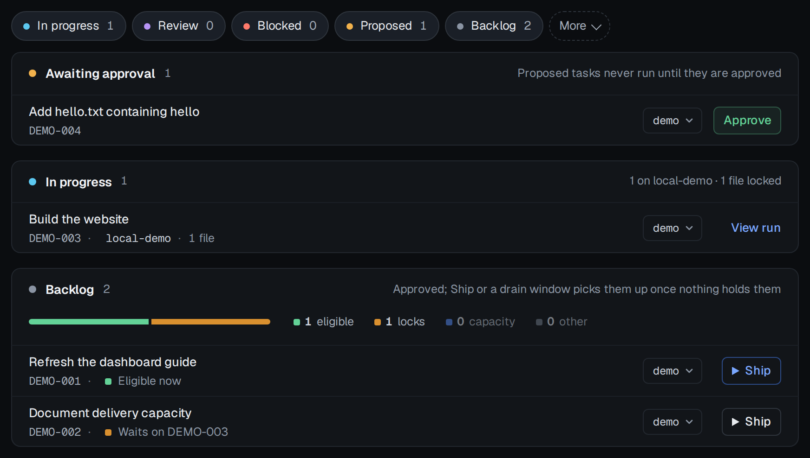
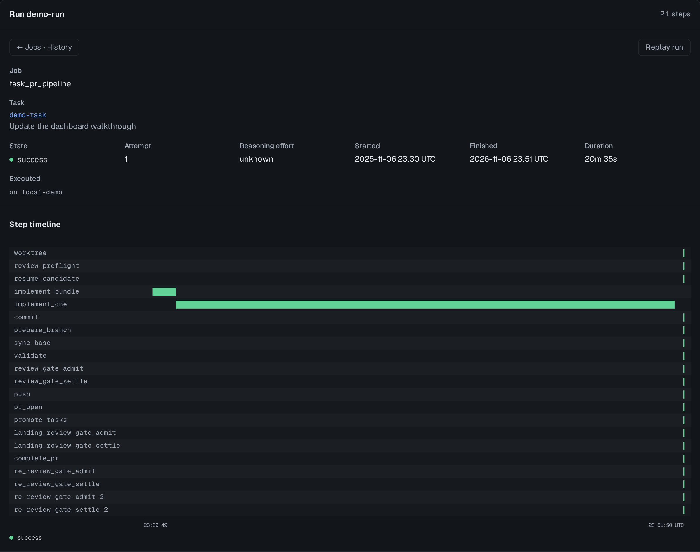

A task is Orbit's unit of work: a request with acceptance criteria that can be
run, checked, and traced. This page takes one task through its whole life:
your agent files it, you approve and ship it from the dashboard, and you
review what comes back.

## Before you start

Finish the [Quickstart](../) setup: Orbit connected to your agent in this
repository, and the dashboard open with `orbit web serve`. Use a repository
where a throwaway change is fine.

## 1. Ask for a change

Ask your agent for something small and checkable:

> Add orbit-hello.txt at the repository root containing "hello from orbit".
> File it as an Orbit task.

The agent files a task with a title, a complexity, and acceptance criteria.
The criteria are the finish line: the run checks its work against them. The
bundled `orbit` skill tells your agent how to write checkable criteria, so you
describe the outcome and it fills in the rest.

The task lands in `proposed`. Nothing runs yet.

## 2. Approve it

In the dashboard, the task appears in **Tasks** under **Awaiting approval**.
Open it, read the description, criteria, and **Context files** tab, and click
**Approve**. It moves to `backlog`. If the task is wrong, click **reject**, or
ask your agent to fix it first.

The **Context files** tab lists the files and directories the task expects to
change. Orbit locks those paths for the run. By default, Markdown paths take
no lock when the task also names other files; a task whose context is only
Markdown still locks those files. Overlapping tasks wait on any locked path.



You can also tell your agent to approve it. Either way, approval is an
explicit step, recorded in the task's history; nothing approves a task on its
own.

## 3. Ship it

Click **Ship** on the task. Orbit locks its context paths for the run. By
default, Markdown paths take no lock when the task also names other files; a
task whose context is only Markdown still locks those files. Orbit gives the
task an isolated worktree and runs an agent in the sandbox to plan, execute,
and check the change. Click **View run** to follow each step live. A second agent reviews
the change only when review is on. The built-in `review.timing` is `off`.
`orbit workspace init` on a pull-request workspace, the default, sets it to
`before_landing` when `luna`, `haiku`, or `muse-spark` is enabled, and to
`off` when none of them is. A local ship mode always seeds `off`.
[Review layers](../../concepts/tasks/#review-layers) explains the choices.



Asking your agent to ship it starts the same run. In the default `pr` ship
mode, the run ends by opening a pull request.

## 4. Review and close it

A successful run stops with the task in `review` and the pull request open.
The task's detail shows the plan and the execution summary, plus the
reviewer's verdict when second-agent review is on. **Jobs** holds every step
and event behind them.

Review the pull request and merge it on GitHub. Then the task moves to `done`
by one of two routes. Click **Approve** on the task. Or let Orbit settle it:
each `orbit run auto` delivery window, and `orbit task settle-merged <id>`,
closes a task whose delivery pull request has merged, unless a run or claim of
the task is still live or a post-deploy criterion is still unrecorded. Settling
writes a landing note that names the pull request and merge commit, and starts
no work. It approves nothing and merges nothing.

If the run fails, its detail opens on the step it stopped at and the error it
recorded. Fix the cause, then click **Resume** to restart from that step. Or
ask your agent what went wrong: the `orbit-orchestrate` skill reads the run's
evidence and matches it to a known failure.

:::note[Two gates stay yours]
A new task waits in `proposed` until you approve it, and a ship run stops at
`review` with the pull request open. Merging the pull request is your decision,
unless you choose to
[let runs merge](../workflows/#completing-work-with---complete). Closing the
task can follow your merge, through Approve or settlement. Neither merges
anything for you.
:::

## From the terminal

Every step has a CLI equivalent. The same task, end to end:

```bash
TASK_ID=$(orbit task add --title "Create orbit-hello.txt" \
  --acceptance-criteria "orbit-hello.txt exists at the repository root." \
  --acceptance-criteria "It contains the text 'hello from orbit'." \
  --complexity low --workspace . \
  --context file:orbit-hello.txt --allow-missing-context)
orbit task lint "$TASK_ID"               # flag vague criteria or unusable scope
orbit task update "$TASK_ID" --approve   # proposed → backlog
orbit run ship "$TASK_ID"                # prints a run ID and returns
orbit run show <RUN_ID>                  # follow the run
orbit task update "$TASK_ID" --approve   # after you merge: review → done
orbit task settle-merged "$TASK_ID"      # or let Orbit settle it once merged
```

With a context declared, `orbit task add` prints only the new task ID (with
none, it first warns that the task holds no file lock). `--title` and
`--complexity` are required. `--context` names the files and directories the
task expects to change; `--allow-missing-context` covers a file the task will
create, as here. Orbit locks those paths. By default, Markdown paths take no
lock when the task also names other files; a task whose context is only
Markdown still locks those files. An overlapping task waits on any locked
path. It is a starting point, not a limit: a
run that changes other files still delivers, Orbit adds them to the task's
context, and the run is recorded as a footprint miss. See
[how a delivery window starts tasks](../../how-to/continuous-delivery/#3-check-what-will-actually-start).
`--approve` takes the next approval step: `proposed` to `backlog`, then
`review` to `done`.

- `orbit task show "$TASK_ID"` shows the task.
- `orbit audit list` shows the recorded events.
- `orbit task artifact put "$TASK_ID" <file>` attaches a report or other output
  to the task. See [Task artifacts](../../concepts/tasks/#task-artifacts).

## Next

- [Delivery Workflows](../workflows/): ship many tasks at once, and let runs
  merge.
- [Use the Dashboard](../../how-to/dashboard/): everything the dashboard can
  do.
- [Run a Delivery Window](../../how-to/continuous-delivery/): drain a whole
  backlog.
