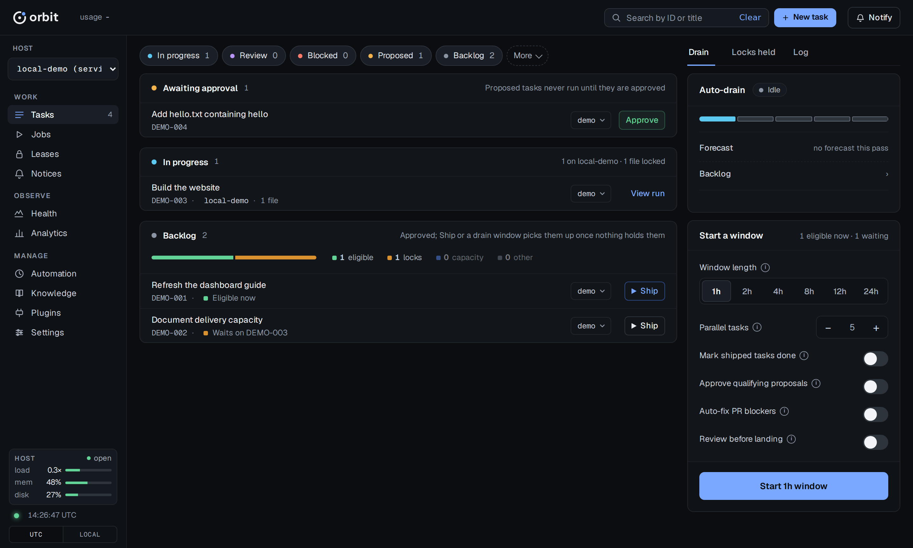

Go from nothing to a first shipped task: install the CLI, let your agent set
up the repository, then approve and ship one task from the dashboard.

## Before you begin

- macOS or Linux, on x64 or arm64. On Windows, use
  [WSL2](/getting-started/install/#windows).
- Node 18 or newer.
- A signed-in agent CLI, such as Claude Code or Codex.
- The GitHub CLI (`gh`), signed in, so Orbit can open pull requests.

## 1. Install the CLI

```bash
npm install -g @orbit-tools/cli
orbit init
```

`orbit init` asks for a machine name and a task-ID prefix of 2–5 uppercase
letters, such as `ABC`. The prefix is permanent on this machine.

[Install Orbit](/getting-started/install/) covers the agent plugin, unattended
setup, and the Linux sandbox.

## 2. Set up the repository

Open your agent in the repository and ask it to **set up Orbit for this
repo**. The `orbit-setup` skill registers the repository, connects your agent
over MCP, and runs `orbit doctor`. When it finishes, start a fresh agent
session so the Orbit tools load.

To do it yourself, run this in the repository:

```bash
orbit workspace init --mcp
orbit doctor
```

[Set up by hand](/getting-started/install/#set-up-by-hand) explains each step.

## 3. Open the dashboard

```bash
orbit web serve
```

The dashboard opens at `http://127.0.0.1:7878` and shows every workspace on
this machine. Keep it running in its own terminal. It listens on loopback
only; to open the dashboard of another machine, run
`orbit web connect <ssh-host>`.

## 4. Ship your first task

1. **Ask your agent for a small change**, such as documenting one function.
   It files a task with acceptance criteria. The task appears in **Tasks**
   under **Awaiting approval**.
2. **Click Approve.** The task moves to the backlog.
3. **Click Ship.** Orbit runs an agent in an isolated worktree to plan, make,
   and check the change. Follow it from **View run**.
4. **Review the pull request.** The run stops with the task in `review` and
   the pull request open. Merge it on GitHub, then click **Approve** on the
   task to close it.



Two gates stay yours: a new task waits until you approve it, and a ship run
stops at `review` without merging. Your agent can approve and ship for you
when you tell it to.

[First task](/getting-started/first-task/) walks through each step, what to do
when a run fails, and the same flow
[from the terminal](/getting-started/first-task/#from-the-terminal).

## Next steps

- [Delivery workflows](/getting-started/workflows/): hand your agent a spec,
  drain a backlog, and let runs merge.
- [Use the dashboard](/how-to/dashboard/): edit tasks, read run traces, and
  reach a remote host.
- [Run a delivery window](/how-to/continuous-delivery/): ship an approved
  backlog for a set time, several tasks at once.
- [Schedule recurring work](/how-to/recurring-work/): run jobs on a schedule
  and let auto-tasks file routine chores.
