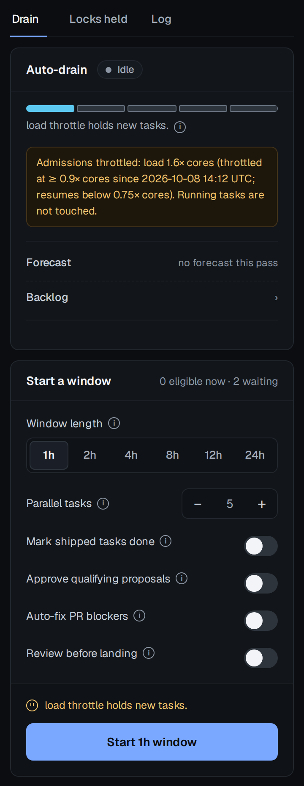

Ship one task, drain a backlog, or hand your agent a whole spec. Each starts
from your agent, the dashboard, or the CLI, and runs the same pipeline: an
isolated worktree, locks on the task's context paths, a sandboxed agent, then
a pull request.

Starting a run returns a run ID at once. The run keeps going whether or not
you watch.

## Hand a spec to your orchestrator

Give your agent the outcome you want and ask it to orchestrate:

> Here's the spec for retry support in the sync client: … Break it into Orbit
> tasks, and once I approve them, ship them and merge what passes.

With the `orbit-orchestrate` skill, the agent:

1. Splits the spec into scoped tasks with acceptance criteria. They wait in
   `proposed`.
2. Prepares them: checks for duplicates, pins each task's files, and assigns
   crews.
3. Queues them in the backlog once you approve.
4. Starts a delivery window and follows it. It diagnoses any run that fails
   and files a repair task when the code needs one.

Pull requests merge only when you ask; see
[Completing work with `--complete`](#completing-work-with---complete).

## Ship one task

| From | Do |
|---|---|
| Dashboard | Click **Ship** on a backlog task in **Tasks**, then **View run**. |
| Agent | "Ship ABC-12." |
| CLI | `orbit run ship ABC-12` |

A ship run uses the workspace's ship mode:

- **`pr`** (the default) opens or updates a pull request and stops with the
  task in `review`.
- **`local`** commits and merges into the base branch before the task reaches
  `review`.

Set the mode with `orbit workspace init --ship-mode`, or change it later with
`orbit workspace ship-mode pr|local`. On the CLI, `--mode` and `--base`
override the mode and base branch for one run.

`pr` mode needs a Git remote on a forge host. Without one, Orbit refuses to
ship, and `orbit doctor` warns on its `forge-remote` row. Switch the workspace
to `local`, or tag one task `delivery:task_local_pipeline` to deliver just
that task locally.

## Drain the backlog

A drain keeps several tasks in flight for a set time and starts the next ready
task as each one finishes. Tasks that overlap on locked paths wait their turn.

| From | Do |
|---|---|
| Dashboard | Open **Tasks**, then **Start a window** in its **Drain** dock. Pick a window length and parallel tasks, then **Start**. |
| Agent | "Drain the backlog for four hours, eight at a time." |
| CLI | `orbit run auto --for 4h --concurrency 8` |



The window limits only when new work starts: a task already running when it
closes still finishes. To see what a window would start, read the eligible
and waiting counts on the **Start a window** card, or run
`orbit run readiness` for the reasons.
[Run a delivery window](/how-to/continuous-delivery/) covers preparing work,
retuning, and stopping a window.

## Completing work with `--complete`

By default a run stops at `review`, and you close the task after merging. To
let a run merge and close the task itself, authorize completion:

| From | Do |
|---|---|
| Dashboard | On the drain card, turn on **Mark shipped tasks done** before **Start**. |
| Agent | Ask it to merge what passes. Over MCP only a drain can carry this authorization, so the agent starts one. |
| CLI | `orbit run auto --for 4h --complete`, or `orbit run ship ABC-12 --complete` |

A `pr` run then merges its pull request through GitHub as soon as branch
protection allows, never with an administrative bypass. The task moves to
`done` only after the merge is verified. A `local` run reaches `done` after it
has committed, merged, and pushed. A closed or blocked pull request, or a
failed merge or push, fails the run and leaves the task in `review`.

Completion belongs to one run:

- A drain's completion covers its whole window, including tasks that reach the
  backlog after it starts. It does not carry over to any other run, and
  routines never complete tasks.
- It never approves `proposed` work, and it does not stand in for a review
  verdict.

[Distributed handoffs](/how-to/distributed-drain/) use a setting on the owner
instead: `workflow.distributed_completion = "done"` lands accepted handoffs
automatically. The default, `"review"`, waits for **Approve handoff** on the
owner's dashboard.

## Watch and recover runs

The dashboard's **Jobs** view shows runs in flight under **History**, which
opens on **Running**; switch to **All** to see every run. A failed run opens on the step it stopped at and the
error it recorded. From a run's detail you can **cancel** a running run,
**Resume** a failed one from its first unfinished step, or **Replay run** to
start it again.

Or ask your agent what happened. The `orbit-orchestrate` skill reads the run's
evidence and fixes the cause or files a repair task.

From the terminal:

```bash
orbit run history                      # recent runs
orbit run show "$RUN_ID"               # state and step summary
orbit run logs "$RUN_ID"               # raw output
orbit run events "$RUN_ID"             # audit events
orbit run trace "$RUN_ID"              # parent and child event trace
orbit run cancel "$RUN_ID" --confirm   # stop it and release its locks
```

## More from the terminal

- `orbit run task-pilot` prepares `proposed` and `backlog` tasks by pinning
  the files each one touches. It promotes and dispatches nothing.
- `orbit run job <job-id>` runs any job definition directly. `--wait` blocks
  until it finishes.

The [CLI reference](/reference/cli/) lists every flag.
