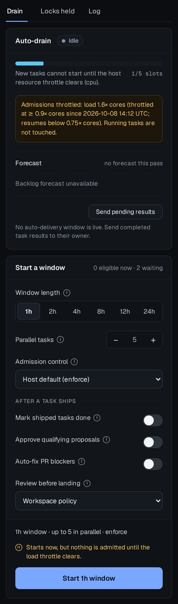

The Orbit dashboard is the browser UI for the host it runs on: tasks, runs,
errors, automation, and settings. It has no login and binds to loopback only.
To use another machine's dashboard, tunnel to it over SSH, or switch to a
registered host with the host picker.


## Open it locally

```bash
orbit web serve
```

This serves every workspace in the current Orbit registry at
`http://127.0.0.1:7878` and tries to open a browser.

| Option | Effect |
|---|---|
| `--no-open` | Do not open a browser. |
| `--port <N>` | Serve on another port. |
| `--workspace <SELECTOR>` | Open on this workspace: a registered name, `ws_*` ID, or checkout path. If nothing matches, the dashboard opens on **All workspaces**. |
| `--operator` | Enable operator controls without an interactive terminal. See [Authorization](#authorization). |
| `orbit --root <DIR> web serve` | Serve only the workspaces in `<DIR>/workspaces.json`, not `~/.orbit/workspaces.json`. |

`--global` is still accepted but does nothing. The server refuses
non-loopback addresses such as `--host 0.0.0.0`; use
[`orbit web connect`](#open-it-over-ssh) to reach another machine.

## Open it over SSH

```bash
orbit web connect my-server
```

`my-server` is anything `ssh` accepts: a hostname, `user@host`, or a
`~/.ssh/config` alias. The command:

1. Forwards a local loopback port to the remote dashboard port.
2. Attaches to a remote `orbit web serve` that is already running, or starts
   one with `--operator`.
3. Prints `http://localhost:<port>` and opens it in a browser.
4. On Ctrl-C, closes the tunnel. It stops the remote server only if it
   started it.

| Option | Effect |
|---|---|
| `--port <N>` | Local port. Default `7878`, or a free port if `7878` is busy. An explicit port that is busy fails. |
| `--remote-port <N>` | Remote dashboard port. Default `7878`. |
| `--workspace <SELECTOR>` | Open on this remote workspace. `connect` refuses `--root`. |
| `--no-operator` | Start the remote server without operator capability, so automation controls and settings writes stay read-only. |
| `--no-open` | Do not open a browser. |

`connect` cannot add operator capability to a server it did not start. If it
attaches to one running without it, it prints a notice. Restart that server
with `orbit web serve --operator`, or stop it and reconnect.

`connect` opens a separate tab, and its own port, for each machine. If the
machine is already registered with `orbit host add`, you can instead stay in
one dashboard and [switch hosts](#switch-hosts). Use `connect` when the
machine is not registered, when you want to choose its operator capability
with `--no-operator` or a different `--remote-port`, or when you want a
dashboard that does not depend on a machine in between. Use the host picker
to move between machines you have already registered.

## Switch hosts

When the serving machine has registered other hosts (see
[Run Orbit across hosts](../multi-host/)), the left rail shows a **Host**
picker above the workspace picker. It lists the serving host first, marked
`(serving host)`, then each registered host by name. Choose one and every
panel, action, log tail, and the rail's host readings show that host.
The host picker names it; the readings do not repeat the name. The workspace picker then lists that
host's workspaces: the workspace you had stays selected if the host also
lists it as active, **All workspaces** stays the aggregate of that host's workspaces,
and anything else falls back to that host's remembered workspace, a workspace
with a live drain, then its registry default (or its first active workspace
when that default is not active).

The serving dashboard reaches the host over SSH, with the SSH identity of the
machine that serves the dashboard, not your browser's machine. It opens a
tunnel when you first select a host, attaches to a dashboard already running
there or starts one, and closes the tunnel after five minutes without use.
The remote host stays authoritative: it answers from its own stores and
enforces its own gates. SSH runs without a prompt here, so a host that needs a
passphrase or password reports as unreachable. The remote dashboard is
expected on the default port, `7878`.

- **`?host=`** names the host in the URL, by registered name (any case) or
  machine ID, so a reload or copied link opens the same host. The URL always
  wins. Choosing the serving host removes the parameter.
- **Remembered choice.** The browser remembers the last host you picked and
  uses it when the URL has no `?host=`. It forgets a host that is no longer
  registered. Choosing the serving host clears it.
- **Skew banner.** A host on a different Orbit version or protocol than the
  serving host shows a persistent note above the panels, naming both. It is a
  warning, not a refusal: views and actions follow what that host supports.
- **Unreachable state.** A host that cannot be shown replaces every panel
  with one state naming the host, an error code, and its message. The codes
  are `unknown_host` (a `?host=` that is not registered, listed in the picker
  as `(not registered)`), `unreachable_destination`, `process_timeout`,
  `host_identity_mismatch`, and `host_too_old`. **Retry** tries the host again
  and **Back to** the serving host returns. The picker stays available. The
  dashboard asks the host again on each refresh and shows its panels once it
  answers.
- **Remote-run links.** Where a task's execution line says which machine ran
  it (`on build-box`) and that machine is registered on the serving host, the
  name links to that run on that host, as `?host=<name>&workspace=<workspace>&window=<window>#runs?run_id=<run>`.
  An unregistered machine stays plain text.
- **Run links.** Every run link (Drain, Jobs, Routines, Tasks, Health, Analytics) uses that
  same form and carries the selected host, workspace and time window, so a link
  opened in a new tab or copied shows the run in that scope. A run link in a
  task's detail names the task's own workspace, so a run opened from **All
  workspaces** or from a task shown from another workspace lands where the run
  lives.
- **Read-only.** Writes to another host go through the serving dashboard's
  [operator session](#authorization). Without one, a note reads `Read-only on
  <host>: <reason>` and write controls are disabled with the same reason.

**Settings › Hosts** edits the serving host's registry, including while
another host is selected, and says so. The picker reads that same registry.
Each reachable row also shows that host's load, memory, disk, admission
throttle, and drain or pull-drain state, so those readings do not require a
host switch. **Show** on a row switches the dashboard to that host.

## Workspace scope

With more than one workspace registered, the left rail has a workspace picker.
An explicit `?workspace=` link (including the `--workspace` match and
`workspace=all`) takes precedence. Otherwise, the dashboard restores the last
workspace you chose in this browser for the selected host. If that workspace
is unavailable, or browser storage is disabled, it selects an active workspace
with a live drain, then the registry default (the workspace containing the
server's current directory when available), then the first active workspace.
Choosing **All workspaces** in the picker is remembered too.

The header drain chip counts workspace/host pairs across registered hosts,
for example **2 of 20 workspaces draining**. A workspace registered on two
hosts counts twice. Click the chip to open the **All workspaces** fleet drains,
one tab per host (each with a dot for its liveliest drain, hollow when the host
is unreachable) and one line per workspace; the dashboard remembers the host
tab you chose. Select a workspace to inspect it on its host.

- **All workspaces** lists tasks from every served workspace. Automation, the
  auto-drain, settings, and other per-workspace panels are read-only there.
  Task actions still work on a row that names its owning workspace and are
  sent to that owner. A row without an owner stays read-only.
- Inactive workspaces show as `<name> (unavailable)` and cannot be selected.
- The URL holds the host, workspace, and time window, so a reload or copied
  link opens the same view.
- **Analytics → Reliability → Pipeline** covers every workspace, whatever is
  selected. **Metrics**, **Codebase**, **Resources**, **Forecast**, **Cost**,
  and **Agents** show one workspace; **All workspaces** leaves those panels on "Select a
  workspace to view this panel". See [Analytics](#analytics).

Confirm the selected workspace before you act. A count or metric does not
prove that a particular task or run succeeded.

## Find your way around

| Rail | Shows |
|---|---|
| **Tasks** | Tasks, with the ones waiting on you first. The right dock has three tabs: **Drain** (the auto-drain card and a simple **Start a window** card), **Locks held** and a live **Log**; an open task takes its place. |
| **Runs** | Job runs, newest first, and run detail. |
| **Health** | What is broken now: **Incidents** and **Doctor**. Incidents has three tabs: **Incidents** (grouped failures), **Events** (every audited call, opening on failures and denials), and **Errors** (step and event failures). |
| **Analytics** | How delivery is trending: **Metrics**, **Reliability** (**Pipeline** and **Tools**), **Codebase**, **Resources**, **Forecast**, **Cost**, **Agents** (**Orchestrators**, **Implementers**, **Reviewers**, **Pilots**), and **Experiments**. See [Analytics](#analytics), the Reliability notes in [Runs and errors](#runs-and-errors), and [Agents](#agents). |
| **Automation** | **Routines** (with the host scheduler clock), **Auto-tasks**, and **Jobs**. |
| **[Leases](#leases)** | Read-only path holders, waiters and recent landing notices for the selected workspace. |
| **Knowledge** | Friction records. |
| **[Plugins](#plugins)** | Installed plugins and the panels they add. |
| **Settings** | Effective, Workspace file, Global file, Crews, Keys, System, and Hosts. |

The rail foot shows live load, memory, and disk readings for the serving host
(plus disk I/O stall on Linux hosts) above the refresh line and the UTC/Local
control. The top bar shows one chip per provider with its worst window's value, a
meter and its weekly pressure (`claude 13% ×1.09`), the drain state when a
delivery window is active, **Refresh**, and one warning chip only when a reading
is elevated or worse. Hover, focus or click a provider chip to open a dialog with
each of its windows, when they reset, the gate that holds crews back and what the
pressure means; click or **Pin open** keeps it open, and Esc or a click outside
closes it. `+N more` (and, on narrow screens, the single summary chip) lists
every provider. Counts in
the selected window sit on the rail: failed, timed-out, and interrupted runs
under **Runs**, and doctor warnings, policy denials, and failing routines under
**Health**. Click a rail count to open the view behind it. The denial count
opens **Health → Incidents → Events** filtered to denials.

View URLs keep older section names: `#diagnostics/…` is Health,
`#operations/…` is Automation, and `#config/…` is Settings. Plugins is
`#plugins`.

## Leases

Select a workspace and open **Leases** to see path holders and queued requests
or expansions, including holders inherited from a directory lease. Recent
landing notices appear alongside them. The view is read-only and does not
aggregate **All workspaces**. Request, renew, expand or release leases with the
CLI or MCP tools instead; see [Hold paths with leases](../path-leases/).

## Tasks

Search by ID or title, or filter by status. Done, Rejected, Archived,
Someday, All, and Not ready are under **More**. Press Enter on a full task ID
to open it even when the filter, page, or selected workspace hides it.
**New task** proposes a task.

Tasks are grouped in the order you act on them: **Awaiting approval**
(`proposed`), review, blocked, in progress, then backlog. Each row shows the
title on its first line and the full task ID on its second, followed by what a
backlog task waits on (`Waits on ORB-77`, `Throttled`) or where a running or
blocked task's run is. An estimated regression risk appears as a percentage,
with `~` for partial support; a task without an estimate has no risk part in
its row. Focus or hover an estimate for its explanation. Each row carries the
action its group waits on:
**Approve** on a proposed task, **Ship** on a backlog task, and **View run**
on a task in progress.

Open a task to see its detail and every action its status allows:

| Action | Shown for |
|---|---|
| **ship** | `backlog`. Runs the workspace's ship mode (`pr` or `local`). Disabled while a ship run for the task is in flight. |
| **approve** | `proposed` or `review`. Refused while a non-terminal local run lists the task; the error names that run, and the task, its comments, and its history stay unchanged. Stop the run, then approve. |
| **reject** | `proposed`, `review`, or `backlog`. |
| **archive** | Any status except `archived`. |
| **comment** | Any status. A comment's **#** button copies a link that reopens the task and scrolls to that comment: `#tasks?open=<id>&comment=<n>` beside the list, `#tasks/<id>?comment=<n>` on the full page. |

The row's crew dropdown and the detail's status dropdown are editable when a
workspace is selected, or in **All workspaces** for a row that names its
owner. The status list shows every status:

- Moves the [lifecycle table](../../concepts/tasks/#transition-rules) allows
  still ask for the evidence they need, such as a plan or completion summary.
- Every other status sits under **force (off-table)**, marked ⚠. Picking one
  asks for confirmation, then applies it as an operator override. This is the
  same as `orbit task update <id> --status <status> --force` and is recorded
  in task history as a `forced` event. Agents cannot force a status.

The right dock has three tabs. **Drain** shows the auto-drain card and
**Start a window** (window length, parallel tasks, admission control and
what happens after a task ships; see [auto-drain](#auto-drain)). On a replica,
Start pulls directly from the owner. **Locks held** lists the files tasks
currently lock, by file or by task. **Log** is a live `orbit.log` tail you can
filter to **all**, **err**, **deny**, or **warn**. Opening a task replaces the
dock with its detail; below 1000px the task list fills the width.

While the browser tab is visible and a workspace is selected, the dashboard
opens a live change stream for that workspace. **All workspaces** has no single
workspace to stream and uses the regular 30-second refresh. In Tasks, task,
run, lock and drain notices refresh the panels subscribed to those kinds; while
refreshes succeed, a full refresh runs on a three-minute safety interval.
Other tabs keep their regular 30-second refresh even while a workspace stream
is open. Host chips can also update from host-resource notices. If the stream
cannot connect, for example because the host runs an older Orbit, Tasks returns
to regular polling. A fully closed stream is retried after 60 seconds. When it
reconnects or sends a resync notice, the dashboard refreshes in full to cover
any gap. A failed full refresh doubles the normal 30-second interval up to five
minutes; a successful refresh resets that normal interval to 30 seconds. With
the Tasks stream connected, the safety poll still keeps a three-minute floor
between periodic full refreshes.

In a hidden browser tab, the dashboard closes the stream and refreshes no
panels. It checks failed runs and, for a selected workspace, drain state and
red-base holds once a minute. New failed runs add a `(N failed)` prefix to the
page title until the tab is shown again. **Notify** opts in to a browser
notification when a drain ends or a task is newly held on a red base; the
browser asks for permission only when you click it. Showing the tab refreshes
the dashboard and reopens the stream when a concrete workspace is selected. A
change that brings nothing new leaves the list as it is, and a changed task
redraws only its own row, so the scroll position, open task and keyboard focus
stay put.
Slow Tasks reads (crew choices, Health counts and the drain forecast) run on
entry or manual **Refresh**, then when five minutes have elapsed and a full
refresh reaches that check. With the connected Tasks safety poll, this may be
the next three-minute poll after the five-minute threshold.

A task's detail leads with **Details**: status, complexity, crew, the
operating systems it can run on, who created and carried it, its run and the
machine it ran on, its pull request, its tags, and a **Risk** chip with the
regression-risk score. The estimate is fitted on task size alone, without
per-file or crew attribution. Tasks without a usable diff-based fit use the
number of distinct file and directory paths in their context selectors. A
review or done task with a resolvable diff and enough matching landed-diff
history uses the diff's inserted and deleted lines. The **Risk** pill
tooltip shows this basis and its size band: recent done tasks on the same
basis at least this size, and how many regressed. A `~` before the percentage
means some selectors have no path and are omitted from the declared-file count,
so that count is a lower bound. When no estimate is available, the Tasks row
has no risk part; the Risk chip says **No estimate** and its tooltip gives the
reason: `no files` (no context selectors and no usable diff-based estimate),
`no paths` (selectors identify no file or directory), `thin history` (not
enough usable done-task observations on the selected basis to fit), or
`unavailable` (the estimate could not be computed). Hover, keyboard-focus or
tap the pill to read its accessible description; Escape dismisses the tooltip.
The score uses `window_days` and `min_support` even when `workflow.regression_risk.enabled` is off, since that
switch controls prompt marks only. A circled *i* beside a value explains it on
hover or focus. Its tabs are
**Overview**, **Delivery** (only for a task with a delivery claim), **History**,
**Runs**, [**Artifacts**](../../concepts/tasks/#task-artifacts), and
**Comments**. The Artifacts tab lists files already stored on the task and
previews the ones that are safe to show. It does not attach files. See
[Task artifacts](../../concepts/tasks/#task-artifacts).

The metadata card above the tabs starts with **Scheduled**: the scheduled
time, or **not scheduled**, with **Edit** beside the value when you can change
it. Once the task has started, that same row adds `· started` and the actual
start time, and no longer offers Edit. The row remains visible even when the
card has no other metadata. The card also keeps the **Run**, its execution
machine, and **Pull request** when present.

The card lists relations one row per type, with each task id opening that
task. A **Regression from** id that carries a classification adds its readable
nature, escape and severity beside the id — for example `ORB-1 · contract
drift · escaped: no test · severity: high (verified)`, with `unclassified`
muted. The severity names who rated it unless that was the filer, and a link
stored before severity existed shows `medium (unrated)`, muted. Each link also
offers a **1 site** or **N sites** dropdown under that id. Open it to read
every complete defect selector in monospace, wrapped to fit the pane. A link
without a classification stays a plain id, as do the other relation types.

### Edit task metadata

Expand a row to edit these fields in place. Edits change the task record; they
do not dispatch work.

| Field | Where and how |
|---|---|
| **description** | Left column. **edit** opens a Markdown editor. |
| **acceptance criteria** | Left column, collapsed section. **edit**, then one criterion per line. |
| **complexity** | **Details**. Pick **low**, **medium**, **hard**, or **xhard**; it saves on change. A stored **unassessed** is shown but cannot be picked. |
| **Scheduled** | Top of the metadata card. Before the task starts, **Edit** accepts an RFC 3339 time with an offset; clear it to remove the schedule. After start, the row shows both times without an editor. |
| **tags** | **edit** after the tags in **Details**. Separate tags with commas or newlines. |
| **context files** | **context files** section. **edit**, then one selector per line: `file:…`, `dir:…`, or `symbol:…`. |

Text fields save with **save** and discard with **cancel**. A failed save
keeps your draft open with the error.

For context files, the server checks that the file or directory exists and is
the kind the selector names. It does not look up `symbol:` names. If the task
will create the target, check **allow missing context** before you save.

### Distributed tasks

On the owner of a [distributed drain](../distributed-drain/), a task with an
execution claim shows a **distributed execution** panel with the claim's
state and the accepted handoff.

- **approve** on a `review` task with a handed-off claim sends **Approve
  handoff** for the exact candidate shown.
- **Revoke authority** and **Recover claim → blocked** / **Recover claim →
  backlog** require a reason. With the field empty, they send nothing.
- A replica shows the claim as held by its owner and refuses all three
  actions.

### Diagnose and recover blocked work

A blocked task, or a delivery the pipeline is holding, opens with a **Why
stuck** card above its tabs. Read the card before you choose an action. The
card is read-only and shows five facts:

| Row | What it shows |
|---|---|
| **Escalation** | The escalation note the run recorded. When it repeats the block's reason, it reads **See blocked note above** and jumps to that note. |
| **Landing review** | The verdict of the review that checked the candidate, with its finding count. |
| **Root cause** | The root cause the run recorded. |
| **Mergeable** | Whether the task's pull request is `mergeable` or `conflicting`. |
| **Required checks** | Each required check on the pull request, as `passed`, `failed` or `pending`. |

A note longer than 280 characters or five lines is clamped. Use **Show full
escalation** or **Show full root cause** to expand it. A fact the dashboard
could not read shows `unavailable`. A note the run recorded as absent shows
`none`. For **Mergeable**, `unavailable` is followed by the reason.

Use the detail's **Runs** tab to open the failed step behind a block. For the
failed run's own **Resume**, see [Runs and errors](#runs-and-errors).

Blocked tasks show **Resume candidate** and **Discard and re-implement**.
Blocked, in-progress and review tasks, and any task with a Why stuck card,
also show **Settle merged PR**.

- **Resume candidate** (`blocked` tasks). Returns the task to backlog and
  keeps the candidate and pull request its stopped run published. The next run
  adopts them, then validates, reviews and lands them. Nothing is
  re-implemented.
- **Discard and re-implement** (`blocked` tasks). Discards that candidate,
  closes the task's undelivered pull requests, and returns the task to backlog.
  The next run implements from scratch.
- **Settle merged PR** (`blocked`, `in-progress` or `review` tasks, and any
  task with a Why stuck card). If its delivery pull request already merged
  outside the pipeline into its target branch, the task moves to `done` with a
  landing note that names the pull request and merge commit. If it has not
  merged, nothing changes and the refusal shows.

The same three actions from the command line:

```bash
orbit task requeue "$TASK_ID" --reason "flaky test fixed; rerun the candidate"
orbit task requeue "$TASK_ID" --reason "candidate is stale" --discard-candidate
orbit task settle-merged "$TASK_ID"
```

Choose by what the evidence shows:

- The cause is fixed and the candidate is sound: **Resume candidate**.
- The candidate is wrong or stale: **Discard and re-implement**.
- You merged the delivery pull request yourself: **Settle merged PR**.

**Resume candidate** and **Discard and re-implement** each open a
confirmation that states their effect, then ask for a reason. The reason is
recorded in task history. An empty reason sends nothing and shows
`[requeue_reason_required]`. Cancelling either prompt sends nothing.
**Discard and re-implement** is destructive. The dashboard does not restore
the discarded candidate or reopen the pull requests it closed. **Settle merged
PR** asks only for confirmation.

Write the reason for the next reader of the task history, for example
`flaky test fixed; rerun the candidate`.

### Clear a pilot admission hold

A backlog task that a pilot assessment held from admission shows a **Pilot
admission hold** callout in its detail, with two actions:

- **Clear hold** records that the held requirement is satisfied.
- **Approve anyway** records a deliberate override. The task is admitted
  despite the finding.

Each action asks you to confirm, then asks for evidence. **Approve anyway**
asks for a reason instead. The evidence is recorded with the decision. Blank
evidence sends nothing and shows `[pilot_admission_evidence_required]`. A
refused record shows its error beside the action, also while the task's detail
is held open by an unsaved draft or pinned from another list, and the controls
the attempt disabled become usable again. The
callout does not appear while an open **Decision needed** request exists for
the pilot-admission gate. Answer that request's options instead.

The same decision from the command line is a comment whose first line is
exact. Put the evidence on the following lines:

```bash
orbit task update "$TASK_ID" \
  --comment $'task-pilot-admission: clear\nThe duplicate finding is wrong: the migration is new.'
```

Read [Continuous delivery](../continuous-delivery/) for what each hold means
and the other admission checks that still apply after a decision.

### Scope and refusals

- The **Why stuck** card and the **Pilot admission hold** callout are visible
  to every viewer. Only the actions need operator capability. Without it, the
  server refuses with `403` and `code: authorization_denied`. See
  [Authorization](#authorization).
- Recovery and pilot-admission actions are disabled, with the reason on hover,
  in **All workspaces** unless the row names its owner. They are also disabled
  on a host that refuses forwarded writes, which shows `Read-only on <host>:`.
  Select the task's workspace or host, then try again.
- A refused action changes nothing. The code and message stay on the task
  until you start another attempt on it.

## Auto-drain

The **Drain** tab in the Tasks dock contains the auto-drain card and
**Start a window**: a time-bounded [delivery window](../continuous-delivery/)
that ships approved backlog tasks in parallel. Select one active workspace to
start a window. On a replica checkout, Start pulls work from its owner without
leaving Tasks. The header drain indicator opens the dock's fleet overview in
**All workspaces** mode.

Old `#drain`, `#drain/start` and `#drain/log` bookmarks open Tasks with the
auto-drain card, Start card or Log selected. The dock keeps the throttle as an
amber note and forecast peaks as compact meters against their thresholds.



The card shows:

- **State.** **Draining**, with time left and `N running / M admitted`;
  **Winding down · N workers still running** once admissions stop; or `idle`.
  The header links the live window's run. Windows started from the CLI show
  here too.
- **Queued windows.** A window started while another runs waits under the
  live one, with its own settings and a **Cancel**. Cancel only removes a
  window that has not started: if the live window ended and the queued one
  started in the meantime, Cancel is refused, the window keeps running, and
  the card refreshes to show it.
- **Capacity.** Running tasks against the limit, free slots, and what a window
  started now would admit.
- **Admission forecast.** The last pass's forecast time, CPU and memory peaks
  against the admit thresholds (for example `85.6% / 98%`, with timing, amount and headroom in the tooltip), the tasks it
  admitted with the profile that priced each one, and any candidate enforce
  held. A pass that built no
  forecast says `no forecast this pass` and, when an earlier forecast was
  kept, shows that one too. Shadow decisions are marked hypothetical; they
  do not hold anyone.
- **Readiness.** **Start a window** counts the tasks eligible now and those
  waiting, from a read-only readiness snapshot. The task list's **Backlog**
  card splits the same snapshot into **Eligible now**, **Waiting on locks**,
  **Waiting on capacity**, and **Waiting, other**; click one to filter the
  card. Each backlog row's dot shows its pool, and its tooltip names the wait,
  such as `Waits on ABC-2` and the lock they contend for. **Locks held** has
  **By file** (default) and **By task** views. Expand a locked path to see its
  holders or a task to see its paths. Shared paths are marked and sorted first;
  typing a task ID filters to the paths its context overlaps. The chosen view
  is remembered.

**Start a window** offers duration, parallelism, admission control and the
permissions below. Its footer sums the window up and shows any refusal or
throttle warning. The server validates the request before starting a run.

| Control | Effect |
|---|---|
| **Window length** | `1h`, `2h`, `4h`, `8h`, `12h` or `24h` (`--for`). The default is `1h`. |
| **Parallel tasks** | How many tasks run at once. Blank uses the runtime default (5). Anything but a whole number of 1 or more disables **Start**. |
| **Mark shipped tasks done** | Off (default) leaves shipped tasks in `review`. On moves every task the window ships from `review` to `done`, not only those in the readiness snapshot before the window starts. It needs an operator session on the owner; disabled on a replica. |
| **Approve qualifying proposals** | Off (default) leaves `proposed` tasks for you. On (`--approve-proposed`) lets every pass approve proposed tasks that have context files and an assessed complexity (or the `no-diff-expected` tag) and a clean task-pilot verification, including tasks filed while the window runs; `no-auto-approve` tasks are skipped. It needs an operator session and is disabled on a replica, where only the owner approves work. A live window started with it shows **Approving proposed tasks** with its approved and held counts. A hold for pilot warnings also shows each finding's kind and first line. |
| **Auto-fix PR blockers** | Off by default. Repairs failed required checks and merge conflicts on the window's own PRs through the existing watcher and repair ledger. Needs an operator session on the owner machine; disabled on pull replicas with a visible reason. It never grants merging or proposed-task approval; merging still requires **Mark shipped tasks done**. |
| **Review before landing** | **Workspace policy** (default) leaves review to `review.timing`. **Add before-PR review** or **Add before-landing review** (`--review`) adds that layer to this window only when policy applies none. The layer policy already applies is accepted, and the other one, a workspace that sets neither `workflow.purpose_crews.pre_landing_review` nor `workflow.purpose_crews.review`, and local-only delivery are refused when you start. Disabled on a replica, where the owner decides review. See [Review layers](../../concepts/tasks/#adding-review-to-one-run). |
| **Start … window** | After a confirmation, starts a window with these settings and stays on Tasks. On a replica, it pulls from the owner. Reads **Start another … window** while one is draining. |
| **Stop** | Stops new admissions (`orbit run auto --stop`). Admitted workers keep running; this is not cancellation. Needs an operator session. |
| **Send pending results** | On a replica checkout only, replaces **Stop** when no window is admitting. An owner checkout with no live window shows no stop or settle control. Delivers pull settlements this replica recorded but has not yet delivered to its owner. Needs an operator session. |

Without operator capability you can still start a window that stops at
review; **Mark shipped tasks done**, **Approve qualifying proposals**, and **Auto-fix PR blockers** stay disabled and say why. Each control's help is behind the circled *i* beside its label. Nothing is reserved or
started until you click **Start**. Results appear in the card's status line,
including whether auto-fix was enabled. If the submission response is lost, check
the window and run history before starting again; the browser does not retry it.

On a replica, a live pull drain counts as a window. The header reads **Pull
drain**, and the **Stop** confirmation says admitted leaves stay claimed by
their owner and that cancelling one fails its claim. See
[Set Up a Distributed Drain](../distributed-drain/#stop-cancel-and-settle).

## Runs and errors

**Runs** lists job runs for the selected workspace. Filter by **All**,
**Live**, or **Failed**, narrow the list with a task id or job id, and use
the same time window as the rest of the dashboard. The address keeps
`run_state`, `task_id`, `job_id`, and `window`, so a shared link reopens the
same list. A task id such as `ORB-15159` keeps that task's runs; any other
id keeps one job. **Window all** lists every matching run with no time bound.
Click a run for its metadata, steps, events, child
runs, and a timing chart when one is recorded. A failed, timed-out, or
interrupted run opens on the step it stopped at and the error it recorded.

| Action | Available for | Effect |
|---|---|---|
| **cancel** | `pending` or `running` | Cancels the run. |
| **Resume** | `failed`, `interrupted`, or `timeout` | Restarts from the first step that did not succeed. A run authorized to mark tasks done requires an operator session to resume. |
| **Replay run** | Any run (asks first if it is still running) | Submits a new run of the same job. |

A refused action shows its error above the list until you dismiss it or start
another action. If the action succeeded but the view could not refresh, the
message says the view is stale. A `409` from ship or another start means a
conflicting run or workspace claim is held: refresh and open the named run
instead of retrying.

On a distributed-drain follower, cancelling a run that works a claimed task
asks first: it fails the claim on the owner and blocks the owner's task, which
the confirmation names. The run detail shows the claim (`pull_claim`), and a
pull drain's detail lists the crews its window can run and those it excluded,
with the reason.

A delivery run's detail has a **review** cell with the review layer it
captured and its origin: the run's own `--review` option, workspace policy
with the key's source, or the owner's claim.

These counts answer different questions:

| Where | Counts |
|---|---|
| **Runs** rail count | Job runs that failed, timed out, or were interrupted in the window that count was computed for. Click the count to open Runs on **Failed** for that window; the list total matches the count. |
| Runs **Failed** filter | Failed, timed-out, and interrupted runs in the selected window. **All** drops the state filter and keeps the window. |
| **Health** denial count | Policy denials in the window that count was computed for. Click it to open **Events** filtered to denials. |
| **Health → Incidents → Errors** | Step and event failures in the selected window. The panel header names the window and reports when retention or the stderr read cap leaves part of it unread. |

From a terminal, the same facts come from `orbit task show <task-id>`,
`orbit run show <run-id>`, and `orbit audit list`.

**Events** opens on the **failure + denied** filter, because nearly every
audited call is a successful poll. Choose **all** to list every status. A
link from an incident lists its events whatever their status.

The **Analytics → Reliability → Tools** cards for **Failure categories**,
**Unexpected Failures by Callable Tool**, and **Lifecycle diagnostics** use
the capped incident scan. When the scan reaches its limit, each card marks its
counts as **capped** and shows partial coverage. These counts cover only the newest non-success audit rows in the
selected window; older failures and affected runs may be omitted. Per-tool
unexpected-failure rates use the scanned failure counts with successful-call
counts from the full window, so rates may be understated. Total audited events
and raw tool-call counts still cover the full window.

Tools follows the Analytics window independently of an Events cutoff. With
an **all** or **1h** window, its bounded summary uses **24h**, named in the cards.
Select a tool on **Tools** to open its events for the window the card shows.
Exact incident-event links select **all** statuses because they list the
recorded event IDs without a status restriction. Spend, tokens, and
read-only exploration are explained in [Analytics](#analytics).

## Analytics

**Analytics** shows how delivery is trending on the host you are viewing.
Open it from the rail. The views are **Metrics**, **Reliability**,
**Codebase**, **Resources**, **Forecast**, **Cost**, and **Agents**. Reading
them leaves tasks, drains, and admission unchanged. **Forecast** also keeps
one snapshot of its forecast an hour, so it can later be checked.

**Metrics**, **Codebase**, **Resources**, **Forecast**, **Cost**, and
**Agents** show the selected workspace. **All workspaces** replaces each of those panels with
"Select a workspace to view this panel". **Reliability → Pipeline** covers
every workspace on this host. While it is open, the workspace picker is
marked fleet-wide. Resources are learned on the host you are viewing.
Switching hosts shows the profiles that host learned.

The address keeps the host, the workspace, and the dashboard time window
(`1h`, `24h`, `7d`, `30d`, or **all**). Metrics and Cost follow it, and so
do Agents when you pick a time window there. Codebase and Reliability keep
the windows named below. Views that rate each delivery (Resources, Forecast
and, by default, Agents) count deliveries instead, so a month without work
does not empty them. What each agent role
is scored on, and `orbit agents scorecard`, are in [Agents](#agents).

### Metrics

Open **Metrics** to see whether implementation is getting slower, whether
tasks are finishing, how many tokens a task takes, how many tool calls
precede the first edit, where new bugs were filed, how many lines each
delivery changes, or how much delivery friction each finished task costs,
for the selected workspace.

Eight trends share **Chart** and **Table**. Select a series to hide it; one
series stays visible. A duration point backed by fewer than three runs is
drawn hollow. An empty trend offers the next wider window.

**Tasks completed**, **Defects**, **Tokens**, and **Lines changed** also
offer **Per bucket** | **Cumulative** | **Per day**. **Per bucket** draws
each bucket's own value. **Cumulative** draws the running total from the
start of the window, so its last point is the card total and empty buckets
stay flat. **Per day** draws the sum of the 24 hours ending at each
bucket's close, filled from the buckets before the window so the first
points are complete; leading points with less than 24 hours of history
behind them are hollow, and the last bucket is still in progress.
**Per day** appears only when the bucket width divides a day evenly, so
week-wide buckets offer only **Per bucket** and **Cumulative**. The window
opens on **Per day** for `7d` and `30d` and on **Cumulative** otherwise
(where the width allows it; otherwise **Cumulative**);
the address remembers the view you pick for each trend.

| Trend | Counts |
|---|---|
| **implement_one duration** | Wall-clock time of `implement_one` runs that finished in each bucket, by complexity (**Low**, **Medium**, **Hard**, and **All runs**). **Succeeded**, the default, counts the final attempt in a successful run that committed a candidate. **All** also counts failed, cancelled, no-diff, and unknown outcomes. Pick **Avg**, **p50**, or **p95**. |
| **Tasks completed** | Tasks that moved to done in each bucket, by the same complexities. |
| **Tokens per task** | Mean normalized tokens of the tasks that closed in each bucket, one line per complexity. A task's total sums every managed invocation linked to it; **Implement only** keeps implement invocations. **Done**, the default, counts done tasks; **All closed** adds rejected and archived ones. **Implementing model** keeps tasks whose latest implement run used that model. **Compare a tag** splits each complexity into tasks that carry the tag now and a dashed line for the rest. The tooltip gives the task count, mean, and median; a point from fewer than three tasks is hollow. Tasks with a model that has no price, or with no linked invocation, are left out and counted. A task's time is its last write after it closed. |
| **Tokens** | Total normalized tokens of the tasks that closed in each bucket, by complexity, with a **Tokens (total)** card for the window total. A task's total sums every managed invocation linked to it, whenever it ran. It shares the **Tokens per task** filters (**Done** / **All closed**, **All invocations** / **Implement only**, implementing model, tag comparison) and the same exclusions: tasks with a model that has no price, or with no linked invocation, are left out and counted. **Tokens per task** shows the mean; **Tokens** shows the sum, with the **Per bucket** / **Cumulative** / **Per day** views above. |
| **Turns to first edit** | Tool calls, and the result bytes those calls returned, before the first file edit in a task's first implement invocation, one line per complexity. **Done**, the default, counts done tasks; **All closed** adds rejected and archived ones. **Provider** keeps tasks whose first implement invocation ran on that provider. **Compare a tag** splits each complexity into a solid line for tasks that carry the tag now and a dashed line for the rest. **Turns** and **Result bytes** switch which mean the chart draws; the tooltip gives the task count and the mean and median of both. A point from fewer than three tasks is hollow. An invocation whose edits go through a shell, or that records no edit tool, is left out and counted, never drawn as zero. A task's time is its last write after it closed. |
| **Lines changed** | Lines added and deleted by the deliveries that landed in each bucket. **Line kind** draws code and test lines, deletions dashed; **Crew** draws one line per implementing crew (the seven busiest, the rest folded into Other) for the chosen measure. **Statistic** switches between **Totals** and the per-task mean or median, and the complexity picker narrows the deliveries, so crews are compared on like work. The tooltip gives the delivery count, the value, totals, and net lines (code and tests added minus deleted); a point from fewer than three deliveries is hollow. Which paths count as tests or other is set by `workflow.test_paths` and `workflow.non_code_paths`. Deliveries that landed before diff stats were recorded appear after `orbit migrate --backfill-diff-stats`. |
| **Delivery friction** | Step recoveries, final recoveries, PR auto-fixes, merge conflicts, failed CI, cost in USD and normalized tokens in each bucket. Pick families with the family buttons; recoveries, auto-fixes, conflicts and failed CI are on by default. **Count** shows distinct occurrences (USD and tokens summed); **Per done task** divides by the tasks that reached done in the same bucket, so a busy week does not look worse just for being busy. The tooltip gives each family's count, tasks done and rate. A bucket with fewer than three done tasks is sparse: its points are hollow and its table row is starred. Families in different units are each scaled to their own peak. The complexity and crew pickers narrow done tasks, auto-fixes, failed CI, cost and tokens; recoveries and conflicts are not tied to one task, so they stay unfiltered and say so. Failed CI counts each pull-request head with a failed required check that `--auto-fix` saw, plus each CI-failure sweep filing. |
| **Defects** | Bug tasks filed in each bucket. **Lineage** groups them by what `regression_from` names as the cause. **Fix-for-a-fix** means that cause was itself a bug fix. **Origin** groups them by the review or sweep that filed them. |

The run bars under a duration chart stack low, medium, and hard, then other.
Xhard and unset count toward **All runs** only. Bucket times follow the
dashboard clock. Buckets of six hours or wider are labeled in UTC. The panel
header counts runs and done tasks in the window.

Under the chart:

- **implement_one by actor** uses the selected window. A row with fewer than
  five runs is dimmed. The list starts at seven actors; **Show all** lists
  the rest.
- **Slowest runs** uses the selected window. Each row opens its task.
- **Actors within a complexity** is the last 30 days, whatever window is
  selected above. The bar is the average and the tick is p95.
- **Outcome by complexity** is all time: done, rejected, archived, and still
  open. It is separate from the **Succeeded** / **All** switch on the
  duration trend.

Set the window to `7d`, open **implement_one duration**, leave **Succeeded**
and **p50** selected, and compare **Medium** with the previous `7d`. A hollow
point is one or two runs. This chart has no matching `orbit` command.

### Codebase

Open **Codebase** when a path keeps showing up in regressions, mid-run
footprint widenings, blocked runs, or rejections, or when tasks keep
reserving the same files. A rate's denominator is tasks that declared the
path: the footprint, which is not always the diff that landed. The one
exception is **Regressed**, whose denominator also takes done tasks that a
regression sited under the path without declaring it. Each rate shows its
numerator and its denominator. How well task pilots predicted
landed diffs is graded under [Agents](#agents), on **Pilots**.

The view's own window is `7d`, `30d`, `90d`, or **All** (default `90d`).
Group by **File**, **Directory**, or **Crate**. **Min. tasks** (default 15)
is the smallest denominator a ranked row needs. At **Crate**, most crates
clear that minimum and show up under several signals. Group by file or
directory to find a hotspot.

**Hotspots** (`#analytics/codebase`) is one table:

| Signal | Rate |
|---|---|
| **Regressed** | Done tasks that later regressed at a recorded site under the path, over done tasks that declared the path or were sited under it. |
| **Footprint miss** | Tasks widened onto the path mid-run, over tasks that declared it. |
| **Blocked** | Tasks blocked by a run failure, over tasks that declared it. |
| **Rejected** | Tasks rejected after a run, over tasks that had a run. |

**Regressed** counts a done task only against the paths that a `regression_from`
link to it records as defect sites: the file, symbol or directory the defect
was in, not every path the task declared. A directory site counts under that
directory and under each path below it that a done task declared in the window.
A regressed task none of whose links record a site counts as regressed under no
path; it is reported as unsited, and it stays in the denominator of each path it
declared. A done task whose regression names a site under a path it never
declared joins that path's denominator, so a path can rank on a task that never
touched it.

**Regressions only** filters the Regressed column by nature, escape, layer,
and detected-by. **Show all** lists every ranked path; otherwise you see the
top of each signal. The path search also opens a path that is known and not
ranked.

**File** opens when you select a path. The address is
`#analytics/codebase/file` with that path in the query. It shows the path's
signals and rank, then **Symbols**: the defect sites recorded under the path,
one row per site named by its symbol or file, most regressed tasks first. A
row opens to the regressed tasks it attributes and the regression tasks that
name it, with nature, escape and severity. The box also says how many regressed
tasks that declared the path record no site, since none of them is attributed
to it. Below it are **Regressed tasks** (the task that regressed each one, with
nature, layer, detected-by and severity), and **Changes with**: files that
landed in the same tasks. **Changes with** lists single files, so group by
file to see it.

**Coupling & locks** (`#analytics/codebase/coupling`) has two lists.
**Reserved together** is tasks holding both paths, divided by tasks holding
either. A directory and its own `tests/` child are tagged **expected: its
tests**. Release files fold into one **Release bump set** while **Group
release files** is on, because those pairs record a release. **Lock waits**
is the time a task spent denied a lock on the file, from the first denial
until admission or until the task left the backlog. A wait still in progress
is measured to now. Paths under the minimum are hidden.

**Marks** (`#analytics/codebase/marks`) compares regression rates on paths
that implement and review prompts marked as regression-prone. **With marks**
is done tasks in the window whose prompt marked the path: regressed divided
by marked. Regressed here means any `regression_from` link to the task
matches, whether or not the link records a site, so these rates can differ
from the Regressed signal. **Before** is done tasks that touched the path in
the days before the first mark. Open it from **Per-path comparison** on Hotspots. Until a
prompt has marked a path, the view says there is nothing to compare. Recent
tasks have had less time to be named by a regression. Marks are written
while `workflow.regression_risk.enabled` is true (the default). With it off,
prompts carry no marks and this comparison stays empty. The key is global;
see [Settable keys](../../reference/config/#settable-keys).

The same rankings from a terminal, for the active workspace:

```bash
orbit codebase analytics --window 30d --min-support 15 --rollup file
orbit codebase analytics --escape no_test --nature broke_existing
orbit codebase show path/to/file.rs --window 30d
orbit codebase related path/to/file.rs --window 30d --top 10
```

`path/to/file.rs` stands in for a repository-relative path. `analytics` and
`show` take `--window 7d|30d|90d|all` (default `90d`), `--min-support`
(default 15), and `--rollup file|dir|crate`. `--nature`, `--escape`,
`--layer`, and `--detected-by` count only regressions of that kind; `absent`
means the record stored no classification. `related` uses tasks that landed
together: its `--window` defaults to `30d`, `--min-support` is shared landed
tasks (default 15), and `--top` is 1–100 (default 10). `--json` on
`analytics` is the dashboard payload. Pass `--workspace <selector>` for a
workspace other than the active one. The commands read the rankings and
change nothing. The full contract is the [CLI reference](../../reference/cli/#observe).

### Resources

Open **Resources** for the curves admission forecasts with: what one delivery
of a given kind costs on this host, minute by minute since the drain admitted
it. The [auto-drain](#auto-drain) card shows the last pass's forecast. This
view shows the profiles behind that forecast. Forecast admission for one
window is `off`, `shadow`, or `enforce` (`orbit run auto --auto-concurrency`).
The host default is `machine.auto_concurrency.mode`. See
[Run a delivery window](../continuous-delivery/).

A profile is learned from the CPU and memory that delivery's workers recorded
on this host. It appears once a delivery the drain admitted here finishes.
Each profile keeps the most recent completed deliveries of its kind, however
old. How many it keeps is `machine.auto_concurrency.profile_window` (default
50), across every crew model and Orbit version. Admission prices a task by
its crew model's own deliveries of that kind when it has at least
`machine.auto_concurrency.min_profile_deliveries`, and by all of them
otherwise; the **Crew models** column counts the models behind each
profile and how many have enough of their own, and hovering it lists
each. The page prints the number in effect, the
host's cores and memory, and the admit thresholds.

The history selector beside the work class changes the displayed history
without changing admission: **Last 50** (admission's own window, or its
configured count), **Last 200**, or **Last 1,000**. Each count is an upper
bound of retained completed deliveries per kind. **Last 1,000** is capped at 1,000 even when the host retains more. An
admission window configured above 1,000 still applies to the default
selection. The API's `last=all` is a compatibility alias for this capped
choice; `delivery_limit` reports the effective bound and `max_last` reports
the 1,000-delivery maximum for explicit selections.

**Work class** is **Change**, **No-diff**, then each auto-task template that
already has a profile. Change and no-diff split by complexity: **Low**,
**Medium**, **Hard**, **Xhard**, **Unassessed**, and **Unset**. A template is
one series and has no complexity. Select a series to hide it; one series
stays visible.

**Units** are **Cores · GiB** or **% of host**. Percent is available when the
host size is known. In percent, the dashed line is the admit threshold. It
bounds the whole host's forecast, not the one delivery drawn on the chart.
The defaults are 90% of cores and 75% of memory
(`machine.auto_concurrency.admit_cpu_percent` and `admit_memory_percent`).
The page prints the thresholds it is using.

A series with fewer deliveries than
`machine.auto_concurrency.min_profile_deliveries` (default 10) is **sparse**:
dimmed, with a hollow end. Admission then uses a wider profile. Each line
ends at its horizon, the first minute where fewer than 1 in 10 of its
deliveries are still running, and no later than
`machine.auto_concurrency.horizon_cap_minutes` (default 120). Each minute
averages the deliveries still running then, so the tail is the long runs.

The three charts share minutes since admission on the horizontal axis:

- **CPU** is the mean, with a band of one standard deviation.
- **Memory** draws the p90 solid and the mean dashed.
- **Still running** is the share of deliveries still going.

The table lists, for each series, deliveries, horizon, peak CPU, peak memory
p90, spread, and build-like deliveries. Spread is per-minute standard
deviation over the mean: near 0 the profile forecasts well, near 1 it does
not. Build-like marks no-diff work that held more than 1 core for 2
consecutive minutes. `qa-sweep` and `qa-full-sweep` are left out, because
those templates build by design.

From a terminal, on this host:

```bash
orbit run profiles
orbit run profiles --json --workspace <selector>
```

One row per workspace, work class, and complexity. A template's complexity
column is `-`. The row's series peak can sit below each delivery's own peak
p50 and p90, because averaging minute by minute blurs peaks that fall at
different times. A sparse profile still shows those quantiles. `--json` adds
the per-minute series. The command reads profiles and changes nothing.

Compare recorded forecasts with the host's measured CPU and memory:

```bash
orbit run profiles --accuracy
orbit run profiles --accuracy --wide
orbit run profiles --accuracy --since 2026-10-15T00:00:00Z --mode enforce
orbit run profiles --accuracy --drain <run-id> --json
```

`--accuracy` reads the newest 5000 forecasts from drains in `shadow` or
`enforce`, whatever their age; `--last <N>` reads another count and `--since`
sets an RFC3339 bound. Error is forecast minus
measured, so a positive CPU error means the forecast was high. The summary is
one row per offset (`+5m`, `+10m`, `+20m`, `+30m`): pairs, mean CPU error and
mean absolute error in cores, how often the CPU forecast was under, mean
memory error in GiB, and how often the memory forecast was under. `--wide`
adds the remaining columns, including the worst miss. `--mode shadow` or
`--mode enforce`, and `--drain` with a drain run id, choose which forecasts
are included. A following table counts, per drain, what shadow would have
held or added and what enforce admitted.
This command reads those records. Column-by-column detail is in the
[CLI reference](../../reference/cli/#run-inspection). The limits are
[settable keys](../../reference/config/#settable-keys), global to the
machine.

### Forecast

Open **Forecast** to see how long the backlog takes to drain and what it
costs. It reads the selected workspace's **backlog** and **in-progress**
tasks; review, blocked, and someday tasks are left out. Every figure is a
range: **p50** (as likely over as under) and **p90** (nine times in ten it
finishes under). The view changes nothing.

The forecast replays recent history. Each finished task in the lookback is
one sample: the wall time its agent runs took (short waits between them
included), and the normalized tokens and dollars they used. Each open task
draws a sample from finished tasks of the same complexity and crew, falling
back to its whole complexity when there are fewer than five, and to every
finished task when it has no complexity yet. The drain is replayed 1000
times on as many parallel runs as the auto-drain admits: the running
window's limit, else the default of 5. An in-progress task counts only what
it has left.

- The tiles give **Time to drain**, **Cost**, and **Tokens** as p50 and p90.
  A quantile reads `—` when its measure is unavailable. Missing simulated
  totals sort after known totals; p50 or p90 is unavailable if its rank falls
  among those missing totals.
- The history selector chooses the finished tasks sampled. The default is
  the last 30 days, reaching further back when those hold fewer than 50
  finished tasks, so a quiet month still forecasts. **Last 200** and **Last
  500** sample that many of the newest finished tasks, whatever their age;
  **90d** samples 90 days. The figures name how many tasks they sampled and
  since when. More tasks means older behavior.
- **No arrivals**, the default, assumes nothing new is filed. The strip
  beside it shows how many tasks were filed a day over the last week
  (auto-tasks, sweeps, other filings) and how many were done, so you can see
  how far that assumption is off. **Recent arrivals** adds new tasks at that
  rate, drawing each arrival from all finished deliveries in the lookback.
  If a sampled arrival lacks tokens or cost, that simulation's total for
  that measure is unavailable; it never counts as free. Time to drain and
  the other measure remain available independently. This also applies to
  the if-approved totals. With arrivals off, initial tasks redraw missing
  tokens or cost from their history pool's recorded values; with none, that
  measure is unavailable.
- With proposed tasks waiting, a line gives the drain, cost, and tokens if
  they were all approved.
- **By complexity** gives each complexity's work hours, cost, and tokens, and
  how many tasks sampled their own crew's history, their complexity's, or
  every task's. These rows cover initial tasks and exclude new arrivals.
- **Coverage** counts the tasks forecast on thin evidence: unassessed, thin
  crew history, models without token prices, runs without a cost, and no
  history at all. It also counts deliveries missing tokens or cost in the
  arrival history pool, out of all deliveries in that pool. These separate
  history counts apply to both the backlog and if-approved arrival forecasts;
  they do not affect the no-arrivals forecast. Fully covered arrival history
  keeps cost and token quantiles numeric.

**Calibration** checks earlier forecasts. While **Forecast** is open on its
defaults, one forecast an hour is kept. As its tasks finish, each task's
actual time, cost, and tokens are compared with its own p50 and p90, and once
every task is done, so are the whole drain's. A forecast that is well
calibrated has about half of actuals under p50 and nine in ten under p90.
Tasks since rejected, archived, removed, or moved to another complexity are
left out and counted. A new workspace needs a few days of finished work
before there is anything to score.

### Cost

Open **Cost** for managed-execution spend and token use in the selected
workspace, and to compare implement runs that delegated read-only explorer
calls with runs that did not.

The header reads **Managed execution only**. Interactive
orchestration-session overhead is excluded. The range under the tabs includes
the start and excludes the cutoff. **all** has no preceding window to compare
with.

**Spend & tokens** is the default (`#analytics/cost`).

Normalized token usage adds uncached input, cache read, 5-minute cache write,
1-hour cache write, and output. An invocation whose model or input basis is
unknown is left out of the total. A bounded window shows the change against
the preceding window of the same length. Per-invocation and per-linked-task
figures are dashes when the count is zero.

Spend is grouped by task ownership: **Orchestrator:** and the name, **Shared
task ownership**, **Unattributed task ownership**, or **Missing linked
task**. **Provider-reported** dollars come first. **Derived estimate** is
labeled as an estimate and has its own coverage. Compare the two under
**Same-invocation comparison**, the invocations that have both figures. When
that population is empty, the panel says to leave the partial sums
unreconciled. A non-zero amount that rounds to $0.00 is shown as `<$0.01`.
**unknown** means the figure was not reported.

**Read-only exploration** is `#analytics/cost?tab=exploration`. For each
implementing crew it shows **with explore** and **without**. Each row has the
run count, mean duration, mean cost with how many runs were priced, and the
footprint-miss rate (misses over runs whose footprint is known). Explorer
call count and explorer cost are a separate column. The mean cost is the
implementing crew's own spend. The sample count stays on the row, so a thin
cohort stays visible as thin. When the read is truncated, the footnote names
how many of the newest implement runs it counted. With no implement runs, the
panel says so.

Explorer delegation follows `workflow.explore.enabled` (default false). While
it is on, a managed implement or review-repair agent can ask a sandboxed
explorer a read-only question. See
[Settable keys](../../reference/config/#settable-keys).

### Reliability

**Pipeline** (`#analytics/reliability`) is fleet-wide on this host. Every rate
shows its window and its sample size. A sample that is too small shows the
raw counts and **n too small** in place of a percentage. The window is `1h`,
`24h`, `7d`, or `30d`. The dashboard window **all** is outside that list, so
Pipeline uses `7d` and labels that cutoff.

**Tools** (`#analytics/reliability/tools`) is the tool-failure scan. What each
card counts, and when a count is capped, is under
[Runs and errors](#runs-and-errors). Tools offers `24h`, `7d`, and `30d`. A
dashboard window of `1h` or **all** uses `24h`, named on the cards.

## Agents

**Agents** is an Analytics view. It ranks the crews and models behind each
agent role in the selected workspace. The window starts at **Last 500**: the
newest 500 delivery attempts, whatever their age. The selector offers
**Last 500**, **Last 1000**, **7d**, and **30d**: a calendar tab (`7d` or
`30d`) follows the dashboard's window, while the `1h`, `24h`, and **all**
dashboard windows fall back to **Last 500**. Count windows reach back no
further than 90 days.
Pick a role from the
tabs above the panel; each tab shows how many rows it ranks. A role whose
scorecard is not computed yet says so and lists the terms it will be scored
on.

- **Who each problem counts against** splits the window's problems by the role
  they count against. Every problem counts against one role, or is not scored
  (for example, rework caused by infrastructure). Select a legend entry to open
  that role.
- **The ranking** lists one row per crew and model, with a rate per 100 units
  of work for each term and the score. Rows with fewer than 10 units are greyed,
  unranked, and listed last.
- **The detail column** shows the selected row: its score, its raw score and
  the fleet average (a row above the average is pulled down toward it, the
  more the less work backs it; a row below keeps its raw score), how each
  term adds to or takes from
  the score, and context such as active hours that is shown but never scored.
  Select another row to change it.
- **How the score works** lists every term with its weight and definition and
  the smoothing formula. It stays open while the page refreshes.

The **Orchestrators** tab replaces Analytics → Orchestrators, and old
`#analytics/orchestrators` links open it. An orchestrator earns one point per
landed task, whatever its complexity, and loses one per spec defect or
spec-caused rework, all per 100 owned tasks. Complexity does not count because
the orchestrator sets it when filing or piloting a task. Rework caused by the
crew and review rejects count against **Implementers**, and reviewer fixes
that failed revalidation count against **Reviewers**. Rework and regressions
with no recorded cause count against no one; their number shows under the
score as `N unclassified`, because such a score rests on less evidence.
The **Rework by cause** panel shows where each orchestrator's rework went.

The **Implementers** tab ranks each crew and model separately. It credits
weighted landed work and first-pass accepts, and counts review rejects,
reviewer repairs, and crew-caused rework. A review reject is counted once;
regressions the reviewer missed count against Reviewers. Regressions that
escaped because there was no test do not change the score; they appear as
unscored context in the detail column. Each task counts once per crew and
model that started an implementation run in the window.

Cost per weighted landed task, median completed run time and tasks by tier
appear under **Shown, not scored** in the detail column. Cost uses recorded
delivery-run invocations, including delivery reviews and repairs, and prefers
provider cost to derived pricing. Missing or unpriced telemetry and rows with
no landed work show a dash; a dash does not mean free work. Cost and time never
change the score. On a phone, the ranking scrolls within its own box and the
detail stacks below the ranking.

Tasks can also be worked in an interactive session, such as a desktop or
terminal agent that moves the task itself, with no delivery run and so no
cost, token, or run-time record. Orbit derives each task's execution from its
runs: **managed** when a delivery run (local or pulled by another machine)
worked its final implementation attempt, **interactive** when it reached review
or done without one, and unclassified otherwise (not implemented yet, or
interactive work not yet in review). The **execution** control above the
panel, shown on this tab, picks which tasks the ranking, detail, and size
curves count: **Managed** (the default), **All** (managed and interactive), or
**Interactive** on its own. Unclassified tasks count in none. Cost and run time
count managed tasks whatever you pick. **Interactive work by crew**, under the
panels, lists each crew and model's managed, interactive, and unclassified
tasks, with how many interactive tasks landed and how many a regression names,
so interactive work stays visible while the default leaves it out. The CLI and
tools take the same choice as `--execution` and `execution`.

Below the ranking, the **Regression rate by change size** panel is the tab's
one role panel. It shows the share of landed tasks with a regression linked to
them within 7 days of completion, by lines changed. Each task counts once,
under the crew reference of its final implementation run as dispatched in the
window, and needs a recorded diff size and at least 7 days since completion.
Each crew reference as dispatched is its own curve, pooling every model
recorded under that reference (the picker entry names those models), so
`opus@medium` and `opus@high` are separate. The ranking above stays one row
per crew and model. Buckets double in width, and each point shows its Wilson 95%
interval. Use **Complexity** to narrow the curves to one tier, and the crew
checklist above the chart to choose which curves are drawn; crews with at least
30 tasks and a drawn bucket start selected. Buckets with fewer than 10 tasks are
not drawn, and hollow markers flag buckets with fewer than 5 regressed tasks.
The panel follows the window and execution control above, and the **Bucket table** under the chart
lists every bucket of the crews drawn. The score-against-cost plot and the
first-reviews tier comparison stay removed. The panel is shown, not scored.

The **Reviewers** tab ranks the reviewers of the review gate, and the review
jobs that file findings as tasks, by how their verdicts turned out. A reviewer
earns for findings and fixes that held: fixes that passed revalidation, open
findings on a reject whose cited files the next run changed, and filed
findings that finding verification confirmed, each weighted by severity. It
loses for findings that were disposed or rejected by verification, for false
rejects (the next run changed none of the cited files and the next review
accepted), for fixes that failed revalidation, for `review_missed` regressions
against work it accepted, and for incomplete reviews not caused by
infrastructure. How often a reviewer accepts or rejects is never scored.

- **Provisional.** A review younger than 30 days can still be charged a
  `review_missed` regression filed later, so while the window has such reviews
  a banner says how many, and those scores can still fall.
- **accepts often** tags a reviewer whose accept rate is 10 or more points
  above the other reviewers' on the same task tiers. It is shown, never scored.
- The **How verdicts turned out** panel splits each reviewer's reviews into
  accepted and held up, caught a real problem, false alarm, missed a
  regression, and unresolved (not judged yet, incomplete, or fixes that
  failed).

The **Pilots** tab grades each task-pilot crew and model on the done tasks
whose newest pilot assessment was written in the window, compared with the
files each task actually landed. Bulk tasks (more than 12 landed files) and
`no-diff-expected` tasks are left out. It credits **F1 lift**, the F1 points the
pilot's selectors gained over the filer's own selectors, and **tier
calibration**, tasks assessed at the tier their cost placed them in. It counts
**costly misses**, landed files no pilot selector covered that a base conflict
or the task's own refused lock request named, and **lock-wait hours**, the
time other tasks waited on paths the task reserved through a pilot selector
that covered none of its landed files. The detail column also shows recall,
precision and F1 against the landed diff, the filer's F1, and missed and unused
selectors. This ranking replaces the task-pilot tile Analytics → Codebase used
to show.

The observed tier ranks the window's assessed tasks by total implementation
cost and cuts the ranking into tiers in the same proportions the pilots
assigned. The **Tier calibration** panel shows one matrix per row: assessed
tier down the side, observed tier across the top. The diagonal is on tier.
**Too easy** counts tasks assessed below their observed tier and **too hard**
tasks assessed above it. **Not placed** counts tasks without a tier or a
priced implementation. Cost only places tasks in tiers; it is never scored.

From a terminal, `orbit agents scorecard --role <role>` ranks one role's
crews and models over its own `--window` (`30d` by default, not the dashboard
window), and `orbit agents show --role <role> --crew <crew>` lists one row's
tasks.

### Experiments

Open **Experiments** (`#analytics/experiments`) to watch the experiments
running in the selected workspace: which arm each enrolled task drew, how
close each arm is to its minimum sample, and what the readout says so far.
Experiments are per workspace, so **All workspaces** shows the usual
placeholder asking you to select one. With an
[operator session](#authorization) you can define, edit, and start
experiments here and conclude one; pause, resume, reweight, clone, and
abandon stay in the terminal. See [Run an experiment](../experiments/).

The list sorts running first, then paused, draft, concluded, and
abandoned, newest first within a status. Each entry shows the hypothesis,
status and mode badges (`shadow` assigns and applies nothing), the current
segment, the primary metric, `min <n> per arm` and `max <n> days` when set,
and one progress bar per arm: enrolled tasks toward the minimum sample,
with the current segment's enrollment in the bar's tooltip. Forced
assignments left out of the readout and tasks excluded for a surface
conflict are counted under the bars, and a concluded experiment names the
arm it concluded with. With no experiments, the view says so and names
`orbit experiment create`.

Open one experiment (`#analytics/experiments/<id>`) for its detail. The
header gives status, mode, segment, primary metric, minimum sample, when
it started, its horizon (`max_days` after start), and the readout's
as-of time, with the verdict badge — `collecting`, `no verdict`,
`winner <arm>`, `no difference`, or `inconclusive` — and the reasons
behind it. A concluded experiment links its promotion task from the
header when concluding filed one.

Below the header:

- **Health** lists the readout's warnings, or says there are none: arm
  counts that do not match the weights (sample ratio), an arm that
  received more than one overlay digest (drift), outcomes still open, and
  a primary metric with no source series yet. Its margin counts tasks
  still in flight and landed tasks still inside the 14-day regression
  window, and forced assignments left out of every estimate are added as
  their own warning.
- **Arms** has one card per arm with its weight, the primary metric's mean
  and 95% interval, `n` with settled and open counts, each guardrail's
  status (`ok`, `breached`, `straddles`, or `unknown`), a `drifted` tag
  when the arm's digest changed, and its standing against the verdict.
- **Difference from control** is a forest plot: one row per treatment arm
  and measured metric, the dot the difference from control and the bar
  its 95% interval, post-stratified by complexity, each metric on its own
  scale around zero. A bar that crosses zero is a difference the sample
  cannot tell from none. Metrics with no source series are listed as not
  measured yet.
- **Cumulative primary metric** draws each arm's cumulative mean over
  settled tasks by assignment bucket; **By complexity** tables the
  primary metric's difference within each complexity, with both arms'
  counts; **Crew mix** shows each arm's implementing crews. Tasks without
  an explicit crew draw from the arm's configured pool: its overlay pool
  when set, otherwise the ordinary pool. Different pools can produce
  different mixes by design; within a pool, weighted draws balance only
  in expectation.
- **Timeline** lists every event in order — created, edited, cloned,
  started, paused, resumed, reweighted, arm retired, concluded,
  abandoned — with its time, segment, actor, reason, and, for a
  conclusion, the chosen arm, the readout snapshot's verdict, and the
  promotion task when one was filed.

An unknown experiment ID shows "Experiment not found" with the server's
message and a link back to the list, not a blank panel.

With an [operator session](#authorization), a running or paused
experiment also shows a **Conclude** card: pick the winning arm (or **No
winner**), give a reason — the button refuses an empty one — and submit.
Choosing an arm files one proposed task to make that arm's overlay the
default; no winner files nothing. Concluding changes no configuration or
repository file, and the card says so. Without operator authority, or
once the experiment has concluded or been abandoned, the card is absent
and the view is read-only.

### Create, edit, and start an experiment

With an operator session, **New experiment** in the Experiments header
opens a form above the list:

- **Name**, **Mode** (`shadow`, the default, assigns tasks and applies
  nothing; `live` applies each arm's overlay), and **Hypothesis**.
- **Population**: complexity checkboxes, and task types, tags to include,
  tags to exclude, and origins as comma-separated lists. An empty filter
  enrolls every task.
- **Arms**: one arm is the control, picked with its radio button; every
  other arm is a treatment. Each arm has a name, a weight, and collapsible
  overlay sections: **Crew pool** (crews this workspace configures, each
  with a weight), **Instructions** (a repository file per role, or
  suppress the default), **Tools** (add or remove), **Skills** (replace a
  skill with a repository bundle; Claude on Unix only), and **Config
  values** (only keys `experiments.config_keys` allows). **Add treatment**
  adds an arm.
- **Primary metric**, **Minimum sample per arm**, **Maximum days**, and
  **Guardrails** (a metric and a threshold such as `-5pt`, `+0.5`, or
  `+3pt`).
- **Reason**, recorded with the change.

**Save draft** creates a draft. **Save and start** first shows what the
start does: the arms with their weights, the population, and the mode.
Confirm to save and start in one step. If Orbit refuses the start, the
draft stays saved and open in the form, and the message says so.

A draft's card, in the list and on its page, has **Edit** and **Start**.
Edit opens the same form on the saved definition. Start asks for the same
confirmation, with an optional reason. Once an experiment has started, its
definition can no longer be edited: the card has no Edit, and its page
says so.

The form adds one rule of its own besides Orbit's checks. Clearing
**Primary metric**, **Minimum sample per arm**, or **Maximum days** on a
draft that already sets them is refused next to each cleared field: an
omitted field leaves the stored value unchanged, so the form keeps the
edit open instead of closing as a saved edit. Otherwise Orbit checks the
definition exactly as `orbit experiment create`, `update`, and `start`
do, and shows its message next to the field it names, such as a
guardrail threshold under **Guardrails** or a crew pool problem in that
arm's **Crew pool**.
Starting is refused while `experiments.enabled` is false or
`experiments.max_running` experiments are already running. Each change
appears in the timeline with actor `dashboard`.

## Automation

**Automation** has three views: **Routines** (with the host scheduler clock),
**Auto-tasks**, and **Jobs**. Its controls need a single active workspace and
an [operator session](#authorization). In **All workspaces** they are
read-only and say why. For what routines and auto-tasks are, see
[Schedule Recurring Work](../recurring-work/).

Each row shows the item, its trigger, when it fires next, its last result, and
one control. Rows are grouped by whether they will fire. **Details** expands
the longer fields.

### Routines


A **Next hour** strip shows each routine due in the next hour: solid if it
will fire, hollow if it is paused. A paused routine's slot is skipped, not
queued. An enabled routine that cannot take effect shows a **blocked** pill.

Each row's switch writes the routine's `enabled` field. It does not start or
stop the host scheduler clock.

### Scheduler clock

The bar above the routines shows this host's scheduler clock (`orbit clock tick`):
health, provider, whether the service is enabled, cadence, and the last and
next tick.

- **Pause clock** / **Enable clock** asks for confirmation. It does not change
  any routine definition.
- The cadence picker and **Apply cadence** change the interval without pausing
  or enabling the clock.

The CLI equivalents are `orbit clock status`, `orbit clock pause`,
`orbit clock enable`, and `orbit clock set --cadence-seconds <N>`.

### Auto-tasks

Definitions live in `.orbit/auto_tasks/` and are checked on every scheduler clock
tick, so pausing the clock pauses scheduled mints. Rows are grouped **On a
schedule**, **On delivery** (minted after landed deliveries), and
**Disabled**. The stats strip counts definitions with an open duplicate. While
the definition is enabled, a definition set to **skip if open** skips its due
slot while its duplicate is still open, and its row says so; a definition set
to **always fire** mints again when due even while its duplicate is open, and
its row says that instead. A disabled definition never mints on schedule: its
open-duplicate row says the prior task is still open and paused, and the strip
does not count it as a scheduler hold.

- The switch writes the definition's `enabled` field after a confirmation. A
  disabled definition is skipped, not deleted.
- **Mint now** creates one task immediately. It ignores the schedule, the
  enabled flag, and dedupe, so it works on a disabled definition and creates
  another task even when one is open. The confirmation warns about this.
  `orbit auto-task mint <name>` does the same.

### Jobs

**Jobs** lists the jobs this workspace's routines target or recently ran,
with **Running now** above them. They are grouped **Sweeps** (housekeeping and
intake, safe to run by hand), **Delivery** (task and workspace pipelines), and
**Other**.

**Run ▸** starts the job in this workspace with no input and reports the new
run ID. It is disabled on **Delivery** rows, which need a task or a window:
use **ship** or the [auto-drain](#auto-drain). **Details** shows the
equivalent command, such as
`orbit run job worktree_gc_pipeline --workspace orbit`.

## Knowledge › Frictions

**Knowledge** (`#knowledge`) holds the selected workspace's friction
records: what made work harder than it should have been, reported with
`orbit friction add`. Pick one workspace first. **All workspaces** replaces
the list with "Select a workspace to view this panel", because the ledger
is per workspace. To report, search, and resolve records from a terminal,
see [Report and triage friction](../friction/).

Three tiles lead the panel: **open**, **triaged**, and **resolved this
month**. Below them, the search box matches a record's ID, model, tags,
status, task, and body text, and **Show** filters by status:

| Show | Lists |
|---|---|
| **Active** (default) | `open` and `triaged` records. |
| **Open** | Records not yet looked at. |
| **Triaged** | Records that have been read and classified. |
| **Resolved** | Records whose cause is fixed or no longer applies. |
| **All** | Every record, whatever its status. |

Each row shows the record's ID, when it was reported, a summary of its
body, its status pill and tags, and `during <task-id>` when it was filed
against a task. Select a row to open **Friction detail**: the full body,
its status, model, reported and resolved times, tags, and the task it
names. On a narrow screen the detail opens inline under the row instead of
in its own panel.

From the detail panel you triage without leaving the dashboard:

- **status** sets `open`, `triaged`, or `resolved`. This is the same
  transition as `orbit friction update <id> --status <status>`.
- **tags** edits the record's tag set; saving replaces the stored tags,
  as `orbit friction update --tag` does.
- **Resolve** marks the record resolved, as `orbit friction resolve`
  does. It is disabled on a record that is already resolved.

Nothing here files a task or moves a record to another workspace. When a
record earns work, file the task and link it in the task's summary; when a
record sits in the wrong workspace, rehome it from the terminal. Both
workflows are in [Report and triage friction](../friction/).

## Plugins

Plugins (`#plugins`) lists the plugins installed on the selected host and
how the selected workspace uses them. Open it when a tool is missing, a
panel you expected is gone, or you want to switch a plugin on or off without
leaving the dashboard. Pick one workspace first. **All workspaces** replaces
the list with `Select a workspace to view this panel` and sets the count
to —.

Under the heading, the panel says what is installed on this machine, with
the panels each plugin's manifest declares. An operator session can enable
or disable a plugin for this host or this workspace. Installing, upgrading,
and editing grants stay on the command line (`orbit plugin`). Removing one
does too (`orbit plugin remove`). What each grant allows is in
[Install and grant plugins](../plugins/). This view does not edit a manifest.

```bash
orbit web serve
```

Then choose **Plugins** in the left rail, or open
`http://127.0.0.1:7878/#plugins`. The address keeps the selected host and
workspace, as the other views do. A plugin follows the host you selected:
you see that machine's installs, with this workspace's toggle. From a
terminal, `orbit plugin list` and `orbit plugin doctor` print that list, and
`orbit plugin show notes` prints one plugin. The `notes` name below is the
illustrative plugin from the install guide.

### What a card shows

The count is the number of cards, including plugins that are not serving
tools. Cards are ordered by name. Each one leads with the name, the version
(such as `v0.1.0`, or `v—` when none is recorded), and a status:

| Status | Meaning |
|---|---|
| `active` | Installed, enabled, and serving its tools. |
| `disabled` | Switched off on this host, or off in this workspace only. |
| `missing` | This checkout pins it, and this machine has not installed it. |
| `inactive` | Enabled, but refused when it loads. |

Chips on that line, when they apply:

- **pinned** — `.orbit/plugins.yaml` in this checkout names the plugin. A pin
  does not grant a permission, and the plugin tree is not copied into the
  repository.
- **unsandboxed** — a warning. The backend runs with no confinement, and this
  host granted that. `orbit plugin show notes` reports the same fact.
- **certified for** a version — `orbit plugin test` recorded a passing
  conformance run for that Orbit version on this host. The chip reads
  `certified for 0.32.0` when that is the recorded version. Hover or focus
  it to see the version this dashboard is running. **· behind host** is
  added, as a warning, when the certificate is an older release than this
  host: `certified for 0.31.0 · behind host` means this version has not
  been certified. A version the dashboard cannot parse does not add
  **behind host**.

The description follows when the plugin has one. A diagnostic follows when
the server sends one. That line is why an inactive or missing plugin is
still listed. A disabled plugin often has none. Its status and the
**Effective** line name the layer that switched it off.

### Host and workspace

The two rows under the description are different switches.

| Row | Meaning |
|---|---|
| **Host: enabled** or **Host: disabled** | The machine-wide row. **Disabled** takes the plugin off every workspace on this host. |
| **Workspace: enabled (inherited)** | This workspace has not written a toggle. The row reads **enabled (inherited)** even when the host row is **disabled**. |
| **Workspace: enabled** or **Workspace: disabled** | This workspace wrote its own toggle in `[plugin_enablement]`. |

**Effective: disabled by host** or **Effective: disabled by workspace** is
the line that decides whether the plugin's tools are on. The host row is
the ceiling. A workspace can only narrow it, and other workspaces keep
their own toggles.

The buttons are **Enable host**, **Disable host**, **Enable workspace**, and
**Disable workspace**. They appear only with an
[operator session](#authorization), and only when the selected host accepts
writes. On another host, a read-only session hides them. See
[Switch hosts](#switch-hosts). Without the session the rows stay and the
buttons do not. There is no button for a grant, an upgrade, or an install.

**Disable host** asks first: `Disable notes on this host? It will be
unavailable in every workspace on this host.` Confirming does what
`orbit plugin disable notes` does. Tools stop registering, and the plugin's
skills are unlinked. Routines and auto-tasks it seeded stay where they are;
the scheduler skips them while the plugin is off.

**Disable workspace** does not ask. It writes this workspace's toggle only,
as:

```bash
orbit plugin disable notes --scope workspace
```

Run that from the checkout, or pass `--workspace <selector>`. Panels and
link tiles for that plugin leave this workspace. The host row, other
workspaces, and skill links stay as they are. **Enable workspace** turns
the toggle back on:

```bash
orbit plugin enable notes --scope workspace
```

Enabling the workspace while the host has the plugin disabled writes
nothing. The card shows the refusal, which tells you to enable it on the
host first.

**Enable host** turns the machine-wide row back on and keeps the grants
already recorded. It does not grant anything new. If the manifest now asks
for a grant you have not given, or the recorded consent no longer matches,
the button fails and the card shows the error. That error names the
`orbit plugin enable notes --grant …` command to review:

```bash
orbit plugin enable notes --grant fs,network
```

**Enable host** on a **missing** card does not install the plugin. The error
tells you to run `orbit plugin sync` when the checkout pins it, or
`orbit plugin add <source>` when it does not.

A failed toggle leaves the previous state and prints the error on the card.
While the request is in flight, that card's buttons wait. Changing
workspace before the answer returns drops the error, so it is not shown on
another workspace.

Install, upgrade, and a pin this machine does not have yet stay on the
command line:

```bash
orbit plugin add ./my-plugin
orbit plugin doctor
orbit plugin sync
```

`./my-plugin` is an illustrative local source, as in the install guide.
`orbit plugin sync` installs what this checkout pins and this machine is
missing.

### Tools, panels, and links

Tool names are chips under the scope rows. A dimmed chip is not active: the
plugin is not serving tools, or a grant it needs is missing. Hover or focus
a chip for its kind (`read_only` or `mutating`) and the MCP name it
advertises, or `not advertised` when it has none. A missing grant is fixed
by enabling again with the complete set you have reviewed, not by a control
on this card. See [Diagnose inactive tools](../plugins/#diagnose-inactive-tools).

Link tiles and panels appear only while the status is `active`. A tile shows
the title the plugin declares and opens an `http://` or `https://` address
in a new tab. Any other scheme is left off the card.

Each panel is the answer from one read-only tool. The tool's name sits
beside the title. A panel cannot run a mutating tool. The body uses the mode
the plugin declared:

| What you see | When |
|---|---|
| Label and value rows | The tool returned an object of fields. A nested value is shown as JSON text. |
| A table | The tool returned a list of records. Columns are the union of their fields. An empty list says `No data.` |
| Markdown | The tool returned text. It goes through the same sanitizer as the rest of the dashboard, so plugin text cannot add a script or an event handler. |
| Pretty-printed JSON | The declared mode, or any answer that does not fit the mode it declared. The raw answer is shown rather than an empty panel. |

`No data.` is an empty label list, an empty table, or a panel whose tool
returned no output. A panel that has not arrived yet says `Loading…`.

A panel larger than 256 KiB (262144 bytes) is cut to a prefix. The body then
leads with `Panel output was N bytes, above the 262144-byte limit; showing a
serialized JSON prefix.`

### Empty, error, and stale

| What you see | What to do |
|---|---|
| `Select a workspace to view this panel`, count — | Choose one workspace. **All workspaces** does not merge plugin lists. Changing host or workspace drops the previous cards instead of leaving them on screen. |
| No plugins installed | The body says no plugins are installed on this machine, then the command `orbit plugin add <source>` (shown in backticks) and `installs one.` Nothing is installed here, and nothing is pinned. |
| `Unable to load: … Use Refresh to retry.` | The list never arrived. **Refresh** tries again. |
| `Unable to load: This host's Orbit does not offer this view yet. Upgrade it to see this view.` | The host the dashboard reads runs an Orbit build that predates this view, so it answers with no route. **Refresh** cannot fix that. Upgrade that host's Orbit. |
| `Refresh failed; showing stale data: … Use Refresh to retry.` | A later refresh failed. The cards from the last good read stay. The top status line reads `panel update failed: Plugins`. **Refresh** tries again. After a failed refresh the next automatic try waits longer, up to five minutes. A hidden browser tab does not refresh this list until you return to it. |
| An error in one panel body | That panel's read failed. The rest of the card stays. A later successful read replaces the error. |
| The previous panel body while the list refreshes | A refresh keeps the last good body from this visit instead of blanking the panel. Leaving the workspace, including coming back to the same one, does not reuse that body. One workspace's output is not shown under another. |

While Plugins is open and the browser tab is visible, the list refreshes
about every 30 seconds.

## Settings

**Settings** shows the configuration this workspace runs on, with the same
layering and descriptions as `orbit config show`.

| View | Shows |
|---|---|
| **Effective** | The merged result: workspace values over global values over built-in defaults. |
| **Workspace file** | The keys `.orbit/config.toml` sets, and what each would fall back to if removed. |
| **Global file** | The keys `~/.orbit/config.toml` sets, and whether each reaches the selected workspace. Edits here write the global file. |
| **Crews** | The crew table. |
| **Keys** | Every settable key with its type, section, description, and accepted values. |
| **System** | Live resource readings, throttle marks, resume thresholds, and the host's current admission verdict. |
| **Hosts** | This serving machine's local identity and registered SSH hosts, independent of the workspace selection. |

**Effective** opens with a strip naming both files, then one panel per section
(Delivery, Crews, Execution, Review, Housekeeping) and a read-only **Paths**
grid. Each row shows the value, where it came from, and the key's description.
The source is `workspace`, `global`, `default` (no file sets it), `unset` (no
value at all), or `registry` (from the workspace registry, not
`config.toml`).

Rows also flag two things the value alone hides:

- `overrides global: trunk`: the workspace file replaced a global value.
- `global sets … — not inherited while a workspace file exists`: a workspace
  `config.toml` must restate the security keys `execution.codex.sandbox`,
  `execution.codex.approval_policy`, and `execution.env.pass` to keep them.
  The Execution panel shows a badge, and the strip warns whenever a workspace
  file exists.

A **registry strip** shows the registered `base_branch` and `ship_mode`.
Delivery uses these, not `workflow.base_branch`, and the strip flags a
disagreement. Change them with `orbit workspace`; the strip is read-only.

### Tidy the workspace file

**Workspace file** lists only the keys `.orbit/config.toml` sets, grouped by
TOML table. Three cards count them by what removing a key would do:

- **Own value**: the effective value would change.
- **Restates global**: the global file sets the same value.
- **Restates built-in default**: Orbit ships the same value.

Click a card to filter the table to that kind of key.

Each row's **If removed** column names the layer and value the key would fall
back to, followed by `no change` or `value changes`. When that fallback is not
reported, it says `may change`. Execution keys fall back to the built-in
default, not the global value, while the workspace file exists, and the row
says so.

When some keys only restate a value, a callout counts them. Its **Select**
button checks those rows. **Remove from file** then removes each checked key
from the file in turn and lists each key's outcome. A key the server refuses
to remove stays checked, with the reason on its row. **Edit**
changes a value in place and previews the matching `orbit config set`
command. **+ Add key** offers the registered keys the file does not set yet.

### Check what the global file reaches

**Global file** opens with **This machine**: the machine id and task prefix,
which no edit changes, and the name, which **Rename** changes. Three cards
count the keys the file sets, relative to the workspace selected in the
sidebar:

- **In effect**: the workspace runs the global value.
- **Overridden by its workspace file**: the workspace file sets the key, and
  the card says how many set the same value.
- **Not inherited**: an execution key the workspace takes from its own file or
  the built-in default, because it has a workspace file.

Click a card to filter the table. Each row's **In** column says the same for
one key, with the workspace file's value when it sets one. When you edit a
key, the editor previews the matching `orbit config set --global` command and
says whether the change reaches the selected workspace or only workspaces that
do not set the key.

### Edit a value

Click a row, or its pencil, to edit it. The editor matches the key's type: a
choice list, toggle, number field, or chip list. Each row saves on its own.

- In **Effective**, saves go to the workspace file (`.orbit/config.toml`,
  per-user and git-ignored). Only **Global file** writes `~/.orbit/config.toml`.
- A save passes the same checks as `orbit config set`. A refused value shows
  that command's message on the row.
- If the workspace has no `config.toml` yet, the first save is refused,
  because creating the file moves the security keys off global policy. The row
  offers **Copy global policy** (`--seed-from-global`) or **Start empty**
  (`--fresh`).
- Writes need an operator session. Each records a `config.set` audit event
  with the key, the old and new values, and the file. Without the capability,
  rows are read-only.

**Crews** shows one row per crew with its provider, model, effort, tags, and
source layer. The crew named by `workflow.default_crew` is marked. You can
add, edit, and delete crews inline, with two refusals:

- You cannot delete a crew that key still names.
- A file that defines any `[crews.*]` table must resolve
  `workflow.default_crew` within itself, so adding the first crew to a file
  with no default crew is refused.

Routines, auto-task definitions, and the workspace registry are not editable
here. Workspace settings show one workspace at a time; **Hosts** also works
in **All workspaces**.

### Hosts

Open **Settings › Hosts** (`#config/hosts`) to manage the serving machine's
[`hosts.toml`](../../reference/config/#host-registry). Through
`orbit web connect`, this is the remote machine's registry.


Captured on 2026-10-10 from an isolated demo registry.
`build-box.invalid` is an intentionally unreachable example SSH target.

The local host comes first, labelled **local · edited here**. Remote rows
show their SSH target, task prefix, reachability, Orbit version, protocol,
skew, and workspace roles. The Health column shows current load, memory, and
disk for every reachable host, with the same severity as the top-bar chips,
and whether a drain or pull drain is active and whether admissions are
throttled. **Show** switches the dashboard to that host. An unreachable host
stays visible with its typed error in place of those readings. Opening the
view and **Reload** probe every host. Periodic refreshes reread the file and
retain the last probe results; they open no background SSH sessions for that
probe. The same refresh reads each reachable host's resources and drain
capacity through the host forward. A CLI-added host appears on the next
refresh, and its readings wait until it has been probed.

- **Add host** opens an inline form for an SSH target and an optional name.
  Saving probes the host and registers its identity here, as `orbit host add`
  does. It writes nothing on the remote.
- **Rename** edits the local entry name; the machine ID and SSH route stay
  the same.
- **Remove** asks for confirmation inline. A `host_in_use` refusal lists
  dependent replica checkouts and pull drains and offers a separate force
  confirmation, which removes their route.

Edits need an [operator session](#authorization). Without one, this view is
read-only. The local host cannot be removed or renamed here. If a newer
host file fails validation, a banner shows the error and the last valid
snapshot stays visible until you repair the file. Mutations always validate
the current file.

For host setup and typed errors, see [Run Orbit across hosts](../multi-host/).

## Authorization

The dashboard has **no login** and binds loopback only. Origin and Fetch
Metadata checks reduce browser CSRF but do not control access. When a request
includes `Sec-Fetch-Site`, the server accepts only `same-origin` and `none`;
it refuses `same-site`, `cross-site` and unknown values. The header is absent
for direct CLI/curl requests and some older browsers. Anyone who can reach the
port, including a forwarded port, can call the same write endpoints the browser
uses, with the server process's authority. Keep that port inside your operator
boundary.

Older browsers that omit Fetch Metadata do not get this additional request
check; their requests rely on the loopback Host and Origin checks. In
particular, an old browser's GET without an Origin is not distinguished from a
direct command-line request.

Two gates apply:

1. **Workspace scope.** **All workspaces** and inactive workspaces are
   read-only, even for an operator. The exception is task actions on rows that
   name their owner, and the machine-global **Settings › Hosts** view.
2. **Operator capability.** Needed for routine and auto-task switches,
   **Mint now**, **Run ▸**, clock controls, **Mark shipped tasks done**, **Stop** and
   **Send pending results**, settings writes, plugin enable and disable, and the
   owner's handoff approve, revoke, and claim-recovery actions.

The dashboard server has operator capability when:

- it was started from a local interactive terminal;
- it was started with `orbit web serve --operator`;
- it was started by `orbit web connect`, which passes `--operator` by default
  because the SSH login is the operator act (pass `--no-operator` for a
  read-only remote); or
- its process has `ORBIT_OPERATOR=1`, which the audit trail records.

When you [switch to another host](#switch-hosts), a write is forwarded only
if the dashboard you are using, the serving one, has operator capability.
Operator access on the remote machine is not enough on its own, and a
dashboard without it is read-only for every other host. The forward refuses
the write with `403` and `code: authorization_denied`, naming the
`host.forward` operation, before it opens an SSH connection. Operator
capability on the serving dashboard reaches every registered host its SSH
identity can log in to: a dashboard it starts there gets `--operator`, while a
dashboard already running there keeps its own capability. The remote host's
own authorization still applies to each request.

MCP is separate: `orbit mcp serve --operator` is its only operator path.

An unauthorized control is disabled and shows the reason, and the panel says
how to get operator access. A request that reaches the API anyway gets `403`
with `code: authorization_denied`.

Task **ship**, **approve**, **reject**, and **archive**, plus run **cancel**
and review-only **Resume**, do not need operator capability. They need a
concrete active workspace, and they fail closed on conflicts such as an
in-flight ship or a held workspace claim.

**Resume** keeps the source run's completion policy. If that policy marks
tasks done, resuming requires operator capability and otherwise returns
`403` with `code: authorization_denied` and `operation: auto_drain.complete`.
Starting a window with `approve_proposed` set without operator capability
returns the same `403` with `operation: auto_drain.approve_proposed`.
Starting with `auto_fix: true` requires operator capability too and returns
`operation: auto_drain.auto_fix` on refusal. Owner admission and workspace claims
are checked by the shared drain submission path before a run is persisted.
**Replay run** requires operator capability for any source run.

### Private browser sessions

Private browser sessions are an opt-in credential facility for routes that
explicitly require a browser session. Enable it on the dashboard host in the
global configuration (it defaults to off), then start or restart the server:

```bash
orbit config set --global machine.web_terminal.enabled true
orbit web serve
```

Startup opens a private URL in the browser. To reopen a running dashboard or
get a fresh session after expiry, run `orbit web open` on that host. Each URL
contains a one-use ticket valid for five minutes; the browser exchanges it for
a session cookie. `orbit web open --no-open` prints the URL without opening a
browser. Treat the printed URL as a credential: keep it out of logs and do not
share it. Startup displays the private URL only on an interactive terminal;
redirected output contains only the base address.

The HttpOnly, SameSite=Strict cookie is scoped to `/api`. Its lifetime is set
at startup by global `machine.web_session.ttl` in seconds (default 43200, or
12 hours; range 1–604800). Restart to apply a change. Sessions also expire in
server memory and every server restart invalidates them. See the
[configuration reference](../../reference/config/#settable-keys) for the settings.

On Unix, the credential directory and file must belong to the current user
and have modes `700` and `600` respectively; symlinks and special files are
refused. Browser sessions require Unix private-file permissions. `web open`
also refuses missing or invalid credentials, a stopped server, disabled
sessions, or a stale credential that does not match the live dashboard. Start
or restart the enabled dashboard and check local ownership and permissions.

For `orbit web connect`, enable sessions on the remote host and restart its
dashboard first. Connect requests a fresh remote ticket and opens it through
the local SSH tunnel. If it cannot obtain one, it warns and continues with the
ordinary dashboard URL. With `--no-open`, an interactive terminal can display
the private URL; redirected output does not. Keep the tunnel open while using
it.

The session endpoint, `/api/session`, exposes the instance identity and
exchanges tickets when enabled; it returns `404` when disabled, and rejects an
invalid or reused ticket. No existing dashboard route currently requires the
browser-session cookie. Existing dashboard routes retain their prior
authorization, including the operator and workspace gates above; a browser
session does not grant operator capability.

## Troubleshooting

| Symptom | What to check |
|---|---|
| No browser, or `connection refused` | Is `orbit web serve` still running? `curl -s http://127.0.0.1:7878/healthz` returns `ok` from a live server. |
| `refusing to bind dashboard to non-loopback address` | Bind `127.0.0.1` or `::1`. Reach another machine with `orbit web connect`. |
| `orbit web connect does not accept --root` | Pass `--workspace <SELECTOR>`. |
| Connect waits, then fails readiness | SSH must work without prompts, and `orbit` must be on the remote `PATH`. The remote server has about 30 seconds to answer `/healthz`. |
| Automation buttons disabled | Select one active workspace. If the reason mentions operator authority, see [Authorization](#authorization). `connect` cannot upgrade a remote server it did not start. |
| Ship returns `409` `ship_run_in_flight` | The task already has an unfinished ship run. Open the named `run_id`. |
| `409` `workspace_claim_held` | Another operator holds the workspace claim. Wait for it to expire or inspect the holder; do not retry in a loop. |
| **Runs** rail count disagrees with **Health → Incidents → Errors** | They count different things. See [Runs and errors](#runs-and-errors). |
| Settings save says "no workspace config exists yet" | Expected on the first write. Choose **Copy global policy** or **Start empty**. |
| Settings save returns an admission error | `orbit config set` refuses the value too. The message lists the accepted values. |
| New workspace missing after `orbit workspace init` | Click **Refresh**. The server reloads `workspaces.json` when it changes, and keeps the last good list if the file is malformed. |
| Plugins says to select a workspace, or its buttons are missing | **All workspaces** does not list plugins. Enable and disable need one workspace, an [operator session](#authorization), and a host that accepts writes. See [Plugins](#plugins). |
| **connecting…** stays orange after startup | The first API request probably failed. **Refresh** or the `/healthz` probe tells a dead process from a slow workspace. |

For uptime monitoring, use the detailed probe. It also checks each workspace's
store and log sink:

```bash
curl -s 'http://127.0.0.1:7878/healthz?detailed=true'
```

It returns `200` when every check passes and `503` when any fails. Plain
`/healthz` checks liveness only.

## Next

- [First Task](../../getting-started/first-task/): take one task from your
  agent's request to a reviewed pull request.
- [Schedule Recurring Work](../recurring-work/): routines, the host scheduler clock,
  and auto-task definitions.
- [Run a Delivery Window](../continuous-delivery/): prepare, start, stop, and
  recover a bounded drain.
- [Connect Your Agent](../mcp-integration/): the tool surface agents use,
  separate from this operator UI.
