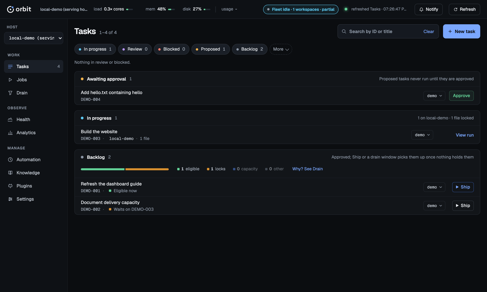
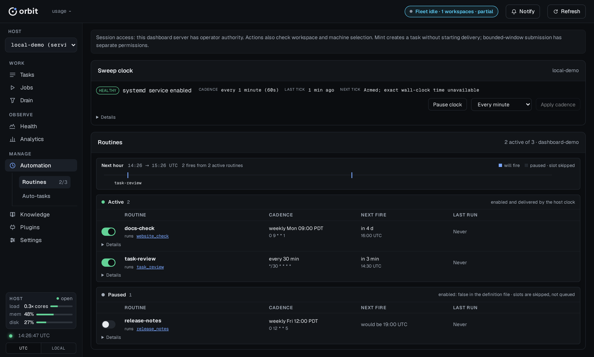
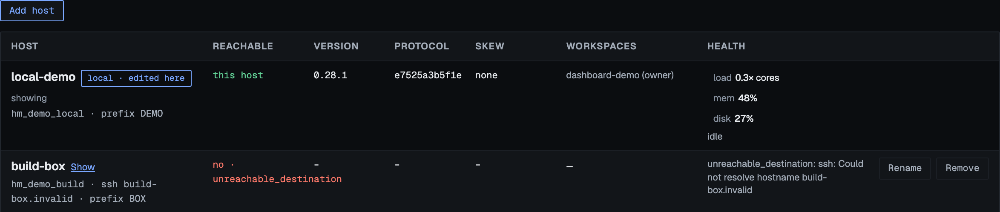

The Orbit dashboard is the browser UI for the host it runs on: tasks, runs,
errors, automation, and settings. It has no login and binds to loopback only.
To use another machine's dashboard, tunnel to it over SSH, or switch to a
registered host with the host picker.



## Open it locally

```bash
orbit web serve
```

This serves every workspace in the current Orbit registry at
`http://127.0.0.1:7878` and tries to open a browser.

| Option | Effect |
|---|---|
| `--no-open` | Do not open a browser. |
| `--port <N>` | Serve on another port. |
| `--workspace <SELECTOR>` | Open on this workspace: a registered name, `ws_*` ID, or checkout path. If nothing matches, the dashboard opens on **All workspaces**. |
| `--operator` | Enable operator controls without an interactive terminal. See [Authorization](#authorization). |
| `orbit --root <DIR> web serve` | Serve only the workspaces in `<DIR>/workspaces.json`, not `~/.orbit/workspaces.json`. |

`--global` is still accepted but does nothing. The server refuses
non-loopback addresses such as `--host 0.0.0.0`; use
[`orbit web connect`](#open-it-over-ssh) to reach another machine.

## Open it over SSH

```bash
orbit web connect my-server
```

`my-server` is anything `ssh` accepts: a hostname, `user@host`, or a
`~/.ssh/config` alias. The command:

1. Forwards a local loopback port to the remote dashboard port.
2. Attaches to a remote `orbit web serve` that is already running, or starts
   one with `--operator`.
3. Prints `http://localhost:<port>` and opens it in a browser.
4. On Ctrl-C, closes the tunnel. It stops the remote server only if it
   started it.

| Option | Effect |
|---|---|
| `--port <N>` | Local port. Default `7878`, or a free port if `7878` is busy. An explicit port that is busy fails. |
| `--remote-port <N>` | Remote dashboard port. Default `7878`. |
| `--workspace <SELECTOR>` | Open on this remote workspace. `connect` refuses `--root`. |
| `--no-operator` | Start the remote server without operator capability, so automation controls and settings writes stay read-only. |
| `--no-open` | Do not open a browser. |

`connect` cannot add operator capability to a server it did not start. If it
attaches to one running without it, it prints a notice. Restart that server
with `orbit web serve --operator`, or stop it and reconnect.

`connect` opens a separate tab, and its own port, for each machine. If the
machine is already registered with `orbit host add`, you can instead stay in
one dashboard and [switch hosts](#switch-hosts). Use `connect` when the
machine is not registered, when you want to choose its operator capability
with `--no-operator` or a different `--remote-port`, or when you want a
dashboard that does not depend on a machine in between. Use the host picker
to move between machines you have already registered.

## Switch hosts

When the serving machine has registered other hosts (see
[Run Orbit across hosts](../multi-host/)), the left rail shows a **Host**
picker above the workspace picker. It lists the serving host first, marked
`(serving host)`, then each registered host by name. Choose one and every
panel, action, log tail, and the load, memory, and disk chips show that host.
The chips are labelled with its name. The workspace picker then lists that
host's workspaces: the workspace you had stays selected if the host also
lists it, **All workspaces** stays the aggregate of that host's workspaces,
and anything else falls back to that host's remembered workspace, a workspace
with a live drain, then its registry default.

The serving dashboard reaches the host over SSH, with the SSH identity of the
machine that serves the dashboard, not your browser's machine. It opens a
tunnel when you first select a host, attaches to a dashboard already running
there or starts one, and closes the tunnel after five minutes without use.
The remote host stays authoritative: it answers from its own stores and
enforces its own gates. SSH runs without a prompt here, so a host that needs a
passphrase or password reports as unreachable. The remote dashboard is
expected on the default port, `7878`.

- **`?host=`** names the host in the URL, by registered name (any case) or
  machine ID, so a reload or copied link opens the same host. The URL always
  wins. Choosing the serving host removes the parameter.
- **Remembered choice.** The browser remembers the last host you picked and
  uses it when the URL has no `?host=`. It forgets a host that is no longer
  registered. Choosing the serving host clears it.
- **Skew banner.** A host on a different Orbit version or protocol than the
  serving host shows a persistent note above the panels, naming both. It is a
  warning, not a refusal: views and actions follow what that host supports.
- **Unreachable state.** A host that cannot be shown replaces every panel
  with one state naming the host, an error code, and its message. The codes
  are `unknown_host` (a `?host=` that is not registered, listed in the picker
  as `(not registered)`), `unreachable_destination`, `process_timeout`,
  `host_identity_mismatch`, and `host_too_old`. **Retry** tries the host again
  and **Back to** the serving host returns. The picker stays available. The
  dashboard asks the host again on each refresh and shows its panels once it
  answers.
- **Remote-run links.** Where a task's execution line says which machine ran
  it (`on build-box`) and that machine is registered on the serving host, the
  name links to that run on that host, as `?host=<name>&workspace=<workspace>&window=<window>#runs?run_id=<run>`.
  An unregistered machine stays plain text.
- **Run links.** Every run link (Drain, Jobs, Routines, Tasks, Health, Analytics) uses that
  same form and carries the selected host, workspace and time window, so a link
  opened in a new tab or copied shows the run in that scope.
- **Read-only.** Writes to another host go through the serving dashboard's
  [operator session](#authorization). Without one, a note reads `Read-only on
  <host>: <reason>` and write controls are disabled with the same reason.

**Settings › Hosts** edits the serving host's registry, including while
another host is selected, and says so. The picker reads that same registry.
Each reachable row also shows that host's load, memory, disk, admission
throttle, and drain or pull-drain state, so those readings do not require a
host switch. **Show** on a row switches the dashboard to that host.

## Workspace scope

With more than one workspace registered, the left rail has a workspace picker.
An explicit `?workspace=` link (including the `--workspace` match and
`workspace=all`) takes precedence. Otherwise, the dashboard restores the last
workspace you chose in this browser for the selected host. If that workspace
is unavailable, or browser storage is disabled, it selects an active workspace
with a live drain, then the registry default (the workspace containing the
server's current directory when available), then the first active workspace.
Choosing **All workspaces** in the picker is remembered too.

The header drain chip counts workspace/host pairs across registered hosts,
for example **2 of 20 workspaces draining**. A workspace registered on two
hosts counts twice. Click the chip to open the **All workspaces** fleet drains,
grouped by host with one line per workspace; select a workspace to inspect it
on its host.

- **All workspaces** lists tasks from every served workspace. Automation, the
  auto-drain, settings, and other per-workspace panels are read-only there.
  Task actions still work on a row that names its owning workspace and are
  sent to that owner. A row without an owner stays read-only.
- Inactive workspaces show as `<name> (unavailable)` and cannot be selected.
- The URL holds the host, workspace, and time window, so a reload or copied
  link opens the same view.
- **Analytics → Reliability → Pipeline** covers every workspace, whatever is
  selected.

Confirm the selected workspace before you act. A count or metric does not
prove that a particular task or run succeeded.

## Find your way around

| Rail | Shows |
|---|---|
| **Tasks** | Tasks, with the ones waiting on you first. The right dock holds the auto-drain card, a simple **Start a window** card, the locks held and a live log; an open task takes its place. |
| **Runs** | Job runs, newest first, and run detail. |
| **Health** | What is broken now: **Incidents** and **Doctor**. Incidents has three tabs: **Incidents** (grouped failures), **Events** (every audited call, opening on failures and denials), and **Errors** (step and event failures). |
| **Analytics** | How delivery is trending: **Metrics**, **Reliability** (with **Pipeline** and **Tools** tabs), **Codebase**, and **Cost**. |
| **Agents** | How well each agent role does its part, ranked by crew and model: **Orchestrators**, **Implementers**, **Reviewers**, and **Pilots**. |
| **Automation** | **Routines** (with the host scheduler clock), **Auto-tasks**, and **Jobs**. |
| **Knowledge** | Friction records. |
| **Plugins** | Installed plugins and the panels they add. |
| **Settings** | Effective, Workspace file, Global file, Crews, Keys, System, and Hosts. |

The top bar shows live load, memory, and disk readings for the serving host
(plus disk I/O stall on Linux hosts), its provider usage with each provider's
windows together (`claude 15% 5h | 32% 7d`), the drain state when a delivery window is active, and **Refresh**. Counts in
the selected window sit on the rail: failed, timed-out, and interrupted runs
under **Runs**, and doctor warnings, policy denials, and failing routines under
**Health**. Click a rail count to open the view behind it. The denial count
opens **Health → Incidents → Events** filtered to denials.

View URLs keep older section names: `#diagnostics/…` is Health,
`#operations/…` is Automation, and `#config/…` is Settings.

## Tasks

Search by ID or title, or filter by status. Done, Rejected, Archived,
Someday, All, and Not ready are under **More**. Press Enter on a full task ID
to open it even when the filter, page, or selected workspace hides it.
**New task** proposes a task.

Tasks are grouped in the order you act on them: **Awaiting approval**
(`proposed`), review, blocked, in progress, then backlog. Each row shows the
title on its first line and the full task ID on its second, followed by what a
backlog task waits on (`Waits on ORB-77`, `Throttled`) or where a running or
blocked task's run is. Each row carries the action its group waits on:
**Approve** on a proposed task, **Ship** on a backlog task, and **View run**
on a task in progress.

Open a task to see its detail and every action its status allows:

| Action | Shown for |
|---|---|
| **ship** | `backlog`. Runs the workspace's ship mode (`pr` or `local`). Disabled while a ship run for the task is in flight. |
| **approve** | `proposed` or `review`. Refused while a non-terminal local run lists the task; the error names that run, and the task, its comments, and its history stay unchanged. Stop the run, then approve. |
| **reject** | `proposed`, `review`, or `backlog`. |
| **archive** | Any status except `archived`. |
| **comment** | Any status. |

The row's crew dropdown and the detail's status dropdown are editable when a
workspace is selected, or in **All workspaces** for a row that names its
owner. The status list shows every status:

- Moves the [lifecycle table](../../concepts/tasks/#transition-rules) allows
  still ask for the evidence they need, such as a plan or completion summary.
- Every other status sits under **force (off-table)**, marked ⚠. Picking one
  asks for confirmation, then applies it as an operator override. This is the
  same as `orbit task update <id> --status <status> --force` and is recorded
  in task history as a `forced` event. Agents cannot force a status.

The right dock has two tabs. **Drain** shows the auto-drain card, a simple
**Start a window** card (window length, parallel tasks, admission control and
what happens after a task ships; see [auto-drain](#auto-drain)) and the files
tasks currently lock. Every other `orbit run auto` option is on the Drain
page's **Start a window** tab. On a replica checkout, the Tasks card disables
Start, shows why local draining is refused, and links to the Drain composer
to pull from the owner. There the card states a host throttle as its own amber note and draws each
forecast peak as a bar against its threshold. **Log** is a
live `orbit.log` tail you can filter to **all**, **err**, **deny**, or
**warn**. Opening a task replaces the dock with the task's detail; below
1000px wide the dock is only on the Drain page.

A task's detail leads with **Details**: status, complexity, crew, the
operating systems it can run on, who created and carried it, its run and the
machine it ran on, its pull request, when it was created and updated, and its
tags. A circled *i* beside a value explains it on hover or focus. Its tabs are
**Overview**, **Delivery** (only for a task with a delivery claim), **History**,
**Runs**, **Artifacts**, and **Comments**.

### Edit task metadata

Expand a row to edit these fields in place. Edits change the task record; they
do not dispatch work.

| Field | Where and how |
|---|---|
| **description** | Left column. **edit** opens a Markdown editor. |
| **acceptance criteria** | Left column, collapsed section. **edit**, then one criterion per line. |
| **complexity** | **Details**. Pick **low**, **medium**, **hard**, or **xhard**; it saves on change. A stored **unassessed** is shown but cannot be picked. |
| **tags** | **edit** after the tags in **Details**. Separate tags with commas or newlines. |
| **context files** | **context files** section. **edit**, then one selector per line: `file:…`, `dir:…`, or `symbol:…`. |

Text fields save with **save** and discard with **cancel**. A failed save
keeps your draft open with the error.

For context files, the server checks that the file or directory exists and is
the kind the selector names. It does not look up `symbol:` names. If the task
will create the target, check **allow missing context** before you save.

### Distributed tasks

On the owner of a [distributed drain](../distributed-drain/), a task with an
execution claim shows a **distributed execution** panel with the claim's
state and the accepted handoff.

- **approve** on a `review` task with a handed-off claim sends **Approve
  handoff** for the exact candidate shown.
- **Revoke authority** and **Recover claim → blocked** / **Recover claim →
  backlog** require a reason. With the field empty, they send nothing.
- A replica shows the claim as held by its owner and refuses all three
  actions.

## Auto-drain

The auto-drain card starts and stops a
[delivery window](../continuous-delivery/): a time-bounded run that ships
approved backlog tasks in parallel. It leads the **Drain** page's
**Overview** tab, with **Fleet drains** and **Locks held** beside it (below
it on a narrow screen); `#drain`, `#auto-drain` and `#operations/auto-drain`
open it. The page's **Start a window** tab (`#drain/start`) starts one. It
needs a single active workspace.

Above the cards, an amber banner says when a host resource throttle is
holding admissions: which resource, when admissions resume and since when,
with a gauge of the reading against its resume and stop thresholds. Summary
tiles follow: the window's state, slots in use, the queue's waiting and
eligible counts, and locked files with how many tasks hold them.


The card shows:

- **State.** **Draining**, with time left and `N running / M admitted`;
  **Winding down · N workers still running** once admissions stop; or `idle`.
  The header links the live window's run. Windows started from the CLI show
  here too.
- **Capacity.** Running tasks against the limit, free slots, and what a window
  started now would admit.
- **Admission forecast.** The last pass's forecast time, CPU and memory peaks
  against the admit thresholds (for example `85.6% / 98%`, then
  `peak at +10m · 27.4 cores · 12.4 pts under the ceiling`), the tasks it
  admitted with the profile that priced each one, and any candidate enforce
  held. A pass that built no
  forecast says `no forecast this pass` and, when an earlier forecast was
  kept, shows that one too. Shadow decisions are marked hypothetical; they
  do not hold anyone.
- **How this window was started.** Each setting the live window recorded,
  with the flag or configuration key that set it, and `not recorded` for one
  it did not record. Below it are the equivalent `orbit run auto` command with
  **Copy command**, and **Start a window like this**, which opens the composer
  with those settings.
- **Pulling from the owner.** On a replica running a pull window: the claim
  budget `held − min(reviewing, N) < N` with this window's figures, its claimed
  tasks by stage, and any settlement the owner refused, with its remedy.
- **Readiness.** **Start a window** counts the tasks eligible now and those
  waiting, from a read-only readiness snapshot. The task list's **Backlog**
  card splits the same snapshot into **Eligible now**, **Waiting on locks**,
  **Waiting on capacity**, and **Waiting, other**; click one to filter the
  card. Each backlog row's dot shows its pool, and its tooltip names the wait,
  such as `Waits on ABC-2` and the lock they contend for. On the Drain page,
  **Why N tasks are waiting** splits the same snapshot by pool and lists each
  wait with its count, a link to the task it waits on, and what that task
  holds. **Locks held** lists each task holding locked files, its status,
  file count, and how many waiting tasks it blocks; expand a row for the
  paths.

**Start a window** offers every option of `orbit run auto`, each with its
flag beside it. A sticky footer sums the window up, lists anything that blocks
**Start** or warns, and shows the equivalent command with **Copy command**.
Refusals use the command line's own words, and the server refuses whatever the
command line refuses (an unknown crew, for example) before any run exists.

| Control | Effect |
|---|---|
| **Where the work comes from** | **Local backlog** (`--workspace`) drains this workspace's backlog on its owner. **Pull from the owner** (`--pull <workspace> --host <owner>`) claims the owner's work from a replica and hands each result back. Pull is offered only on a replica, and Local is blocked there. A pull window greys the options the owner decides. |
| **Window length** | **One pass** (no `--for`), or `30m` to `12h` (`--for`). |
| **Parallel tasks** | How many tasks run at once. Blank uses the runtime default (5). Anything but a whole number of 1 or more disables **Start**. |
| **Mark shipped tasks done** | Off (default) leaves shipped tasks in `review`. On moves every task the window ships from `review` to `done`, not only those in the readiness snapshot before the window starts. It needs an operator session. |
| **Approve qualifying proposals** | Off (default) leaves `proposed` tasks for you. On (`--approve-proposed`) lets every pass approve proposed tasks that have context files and an assessed complexity (or the `no-diff-expected` tag) and a clean task-pilot verification, including tasks filed while the window runs; `no-auto-approve` tasks are skipped. It needs an operator session and is disabled on a replica, where only the owner approves work. A live window started with it shows **Approving proposed tasks** with its approved and held counts. A hold for pilot warnings also shows each finding's kind and first line. |
| **Auto-fix PR blockers** | Off by default. Repairs failed required checks and merge conflicts on the window's own PRs through the existing watcher and repair ledger. Needs an operator session on the owner machine; disabled on pull replicas with a visible reason. It never grants merging or proposed-task approval; merging still requires **Mark shipped tasks done**. |
| **Review before landing** | **Workspace policy** (default) leaves review to `review.timing`. **Add before-PR review** or **Add before-landing review** (`--review`) adds that layer to this window only when policy applies none. The layer policy already applies is accepted, and the other one, a workspace that sets neither `workflow.purpose_crews.pre_landing_review` nor `workflow.purpose_crews.review`, and local-only delivery are refused when you start. Disabled on a replica, where the owner decides review. See [Review layers](../../concepts/tasks/#adding-review-to-one-run). |
| **Allowed crews** | The configured crews this window may start (`--allow-crew`). All selected is unrestricted. |
| **Complexity pools** | For each tier, **Workspace** keeps `workflow.<tier>_complexity_crews`, **Override** replaces it for this window with `crew` or `crew:weight` entries, and **Off** turns it off (`--<tier>-complexity-crews`). Disabled for a pull window. |
| **Strict worker containment** | Requires a systemd user scope for the coordinator and every worker (`--strict-worker-containment`). |
| **Workspace claim token** | The token for this workspace's exclusive claim when another operator holds one (`--claim-token`). It never appears in the command, the confirmation or the run's detail. |
| **Start … window** | After a confirmation, runs `orbit run auto` with these settings and returns to **Overview**. Reads **Start another … window** while one is draining, **Run one pass** for one pass, and **Start pulling for …** or **Claim once** for a pull. |
| **Stop** | Stops new admissions (`orbit run auto --stop`). Admitted workers keep running; this is not cancellation. Needs an operator session. |
| **Send pending results** | Replaces **Stop** when no window is admitting. Delivers pull settlements this replica recorded but has not yet delivered to its owner. Needs an operator session. |

Without operator capability you can still start a window that stops at
review; **Mark shipped tasks done**, **Approve qualifying proposals**, and **Auto-fix PR blockers** stay disabled and say why. Each control's help is behind the circled *i* beside its label. Nothing is reserved or
started until you click **Start**. Results appear in the card's status line,
including whether auto-fix was enabled. If the submission response is lost, check
the window and run history before starting again; the browser does not retry it.

On a replica, a live pull drain counts as a window. The header reads **Pull
drain**, and the **Stop** confirmation says admitted leaves stay claimed by
their owner and that cancelling one fails its claim. See
[Set Up a Distributed Drain](../distributed-drain/#stop-cancel-and-settle).

## Runs and errors

**Runs** lists job runs for the selected workspace. Filter by **All**,
**Live**, or **Failed**, narrow the list with a task id or job id, and use
the same time window as the rest of the dashboard. The address keeps
`run_state`, `task_id`, `job_id`, and `window`, so a shared link reopens the
same list. A task id such as `ORB-15159` keeps that task's runs; any other
id keeps one job. **Window all** lists every matching run with no time bound.
Click a run for its metadata, steps, events, child
runs, and a timing chart when one is recorded. A failed, timed-out, or
interrupted run opens on the step it stopped at and the error it recorded.

| Action | Available for | Effect |
|---|---|---|
| **cancel** | `pending` or `running` | Cancels the run. |
| **Resume** | `failed`, `interrupted`, or `timeout` | Restarts from the first step that did not succeed. A run authorized to mark tasks done requires an operator session to resume. |
| **Replay run** | Any run (asks first if it is still running) | Submits a new run of the same job. |

A refused action shows its error above the list until you dismiss it or start
another action. If the action succeeded but the view could not refresh, the
message says the view is stale. A `409` from ship or another start means a
conflicting run or workspace claim is held: refresh and open the named run
instead of retrying.

On a distributed-drain follower, cancelling a run that works a claimed task
asks first: it fails the claim on the owner and blocks the owner's task, which
the confirmation names. The run detail shows the claim (`pull_claim`), and a
pull drain's detail lists the crews its window can run and those it excluded,
with the reason.

A delivery run's detail has a **review** cell with the review layer it
captured and its origin: the run's own `--review` option, workspace policy
with the key's source, or the owner's claim.

These counts answer different questions:

| Where | Counts |
|---|---|
| **Runs** rail count | Job runs that failed, timed out, or were interrupted in the window that count was computed for. Click the count to open Runs on **Failed** for that window; the list total matches the count. |
| Runs **Failed** filter | Failed, timed-out, and interrupted runs in the selected window. **All** drops the state filter and keeps the window. |
| **Health** denial count | Policy denials in the window that count was computed for. Click it to open **Events** filtered to denials. |
| **Health → Incidents → Errors** | Step and event failures in the selected window. The panel header names the window and reports when retention or the stderr read cap leaves part of it unread. |

From a terminal, the same facts come from `orbit task show <task-id>`,
`orbit run show <run-id>`, and `orbit audit list`.

**Events** opens on the **failure + denied** filter, because nearly every
audited call is a successful poll. Choose **all** to list every status. A
link from an incident lists its events whatever their status.

The **Analytics → Reliability → Tools** cards for **Failure categories**,
**Unexpected Failures by Callable Tool**, and **Lifecycle diagnostics** use
the capped incident scan. When the scan reaches its limit, each card marks its
counts as **capped** and shows partial coverage. These counts cover only the newest non-success audit rows in the
selected window; older failures and affected runs may be omitted. Per-tool
unexpected-failure rates use the scanned failure counts with successful-call
counts from the full window, so rates may be understated. Total audited events
and raw tool-call counts still cover the full window.

Tools follows the Analytics window independently of an Events cutoff. With
an **all** window, its bounded summary uses **24h**, named in the cards.
Select a tool on **Tools** to open its events for the window the card shows.
Exact incident-event links select **all** statuses because they list the
recorded event IDs without a status restriction. **Analytics → Cost** shows
managed-execution cost and token usage for the selected window.

## Agents

**Agents** ranks the crews and models behind each agent role in the
selected workspace and time window. Pick a role from the tabs above the panel;
each tab shows how many rows it ranks. A role whose scorecard is not computed
yet says so and lists the terms it will be scored on.

- **Who each problem counts against** splits the window's problems by the role
  they count against. Every problem counts against one role, or is not scored
  (for example, rework caused by infrastructure). Select a legend entry to open
  that role.
- **The ranking** lists one row per crew and model, with a rate per 100 units
  of work for each term and the score. Rows with fewer than 10 units are greyed,
  unranked, and listed last.
- **The detail column** shows the selected row: its score, its raw score and
  the fleet average (a row above the average is pulled down toward it, the
  more the less work backs it; a row below keeps its raw score), how each
  term adds to or takes from
  the score, the tasks behind its biggest penalty (each opens the task), and
  context such as active hours that is shown but never scored. Select another
  row to change it.
- **How the score works** lists every term with its weight and definition and
  the smoothing formula. It stays open while the page refreshes.

The **Orchestrators** tab replaces Analytics → Orchestrators, and old
`#analytics/orchestrators` links open it. An orchestrator earns one point per
landed task, whatever its complexity, and loses one per spec defect or
spec-caused rework, all per 100 owned tasks. Complexity does not count because
the orchestrator sets it when filing or piloting a task. Rework caused by the
crew and review rejects count against **Implementers**, and reviewer fixes
that failed revalidation count against **Reviewers**. Rework and regressions
with no recorded cause count against no one; their number shows under the
score as `N unclassified`, because such a score rests on less evidence.
The **Rework by cause** panel shows where each orchestrator's rework went.

The **Implementers** tab ranks each crew and model separately. It credits
weighted landed work and first-pass accepts, and counts review rejects,
reviewer repairs, crew-caused rework, and regressions that escaped because
there was no test. A review reject is counted once; regressions the reviewer
missed count against Reviewers. Each task counts once per crew and model
that started an implementation run in the window.

The tab has no role panel: the ranking, the detail column and **How the
score works** are the whole view. Cost per weighted landed task, median
completed run time and tasks by tier appear under **Shown, not scored** in
the detail column. Cost uses recorded delivery-run invocations, including
delivery reviews and repairs, and prefers provider cost to derived pricing.
Missing or unpriced telemetry and rows with no landed work show a dash; a
dash does not mean free work. Cost and time never change the score. On a
phone, the ranking scrolls within its own box and the detail stacks below
the ranking.

The **Reviewers** tab ranks the reviewers of the review gate, and the review
jobs that file findings as tasks, by how their verdicts turned out. A reviewer
earns for findings and fixes that held: fixes that passed revalidation, open
findings on a reject whose cited files the next run changed, and filed
findings that finding verification confirmed, each weighted by severity. It
loses for findings that were disposed or rejected by verification, for false
rejects (the next run changed none of the cited files and the next review
accepted), for fixes that failed revalidation, for `review_missed` regressions
against work it accepted, and for incomplete reviews not caused by
infrastructure. How often a reviewer accepts or rejects is never scored.

- **Provisional.** A review younger than 30 days can still be charged a
  `review_missed` regression filed later, so while the window has such reviews
  a banner says how many, and those scores can still fall.
- **accepts often** tags a reviewer whose accept rate is 10 or more points
  above the other reviewers' on the same task tiers. It is shown, never scored.
- The **How verdicts turned out** panel splits each reviewer's reviews into
  accepted and held up, caught a real problem, false alarm, missed a
  regression, and unresolved (not judged yet, incomplete, or fixes that
  failed).

The **Pilots** tab grades each task-pilot crew and model on the done tasks
whose newest pilot assessment was written in the window, compared with the
files each task actually landed. Bulk tasks (more than 12 landed files) and
`no-diff-expected` tasks are left out. It credits **F1 lift**, the F1 points the
pilot's selectors gained over the filer's own selectors, and **tier
calibration**, tasks assessed at the tier their cost placed them in. It counts
**costly misses**, landed files no pilot selector covered that a base conflict
or the task's own refused lock request named, and **lock-wait hours**, the
time other tasks waited on paths the task reserved through a pilot selector
that covered none of its landed files. The detail column also shows recall,
precision and F1 against the landed diff, the filer's F1, and missed and unused
selectors. This ranking replaces the task-pilot tile Analytics → Codebase used
to show.

The observed tier ranks the window's assessed tasks by total implementation
cost and cuts the ranking into tiers in the same proportions the pilots
assigned. The **Tier calibration** panel shows one matrix per row: assessed
tier down the side, observed tier across the top. The diagonal is on tier.
**Too easy** counts tasks assessed below their observed tier and **too hard**
tasks assessed above it. **Not placed** counts tasks without a tier or a
priced implementation. Cost only places tasks in tiers; it is never scored.

With **all** selected, Agents covers the last 90 days. From a terminal,
`orbit agents scorecard --role <role>` prints the same ranking and
`orbit agents show --role <role> --crew <crew>` one row's tasks.

## Automation

**Automation** has three views: **Routines** (with the host scheduler clock),
**Auto-tasks**, and **Jobs**. Its controls need a single active workspace and
an [operator session](#authorization). In **All workspaces** they are
read-only and say why. For what routines and auto-tasks are, see
[Schedule Recurring Work](../recurring-work/).

Each row shows the item, its trigger, when it fires next, its last result, and
one control. Rows are grouped by whether they will fire. **Details** expands
the longer fields.

### Routines



A **Next hour** strip shows each routine due in the next hour: solid if it
will fire, hollow if it is paused. A paused routine's slot is skipped, not
queued. An enabled routine that cannot take effect shows a **blocked** pill.

Each row's switch writes the routine's `enabled` field. It does not start or
stop the host scheduler clock.

### Scheduler clock

The bar above the routines shows this host's scheduler clock (`orbit clock tick`):
health, provider, whether the service is enabled, cadence, and the last and
next tick.

- **Pause clock** / **Enable clock** asks for confirmation. It does not change
  any routine definition.
- The cadence picker and **Apply cadence** change the interval without pausing
  or enabling the clock.

The CLI equivalents are `orbit clock status`, `orbit clock pause`,
`orbit clock enable`, and `orbit clock set --cadence-seconds <N>`.

### Auto-tasks

Definitions live in `.orbit/auto_tasks/` and are checked on every scheduler clock
tick, so pausing the clock pauses scheduled mints. Rows are grouped **On a
schedule**, **On delivery** (minted after landed deliveries), and
**Disabled**. The stats strip counts definitions with an open duplicate, and
the scheduler skips those slots; the row calls out the duplicate too.

- The switch writes the definition's `enabled` field after a confirmation. A
  disabled definition is skipped, not deleted.
- **Mint now** creates one task immediately. It ignores the schedule, the
  enabled flag, and dedupe, so it works on a disabled definition and creates
  another task even when one is open. The confirmation warns about this.
  `orbit auto-task mint <name>` does the same.

### Jobs

**Jobs** lists the jobs this workspace's routines target or recently ran,
with **Running now** above them. They are grouped **Sweeps** (housekeeping and
intake, safe to run by hand), **Delivery** (task and workspace pipelines), and
**Other**.

**Run ▸** starts the job in this workspace with no input and reports the new
run ID. It is disabled on **Delivery** rows, which need a task or a window:
use **ship** or the [auto-drain](#auto-drain). **Details** shows the
equivalent command, such as
`orbit run job worktree_gc_pipeline --workspace orbit`.

## Settings

**Settings** shows the configuration this workspace runs on, with the same
layering and descriptions as `orbit config show`.

| View | Shows |
|---|---|
| **Effective** | The merged result: workspace values over global values over built-in defaults. |
| **Workspace file** | The keys `.orbit/config.toml` sets, and what each would fall back to if removed. |
| **Global file** | The keys `~/.orbit/config.toml` sets, and whether each reaches the selected workspace. Edits here write the global file. |
| **Crews** | The crew table. |
| **Keys** | Every settable key with its type, section, description, and accepted values. |
| **System** | Live resource readings, throttle marks, resume thresholds, and the host's current admission verdict. |
| **Hosts** | This serving machine's local identity and registered SSH hosts, independent of the workspace selection. |

**Effective** opens with a strip naming both files, then one panel per section
(Delivery, Crews, Execution, Review, Housekeeping) and a read-only **Paths**
grid. Each row shows the value, where it came from, and the key's description.
The source is `workspace`, `global`, `default` (no file sets it), `unset` (no
value at all), or `registry` (from the workspace registry, not
`config.toml`).

Rows also flag two things the value alone hides:

- `overrides global: trunk`: the workspace file replaced a global value.
- `global sets … — not inherited while a workspace file exists`: a workspace
  `config.toml` must restate the security keys `execution.codex.sandbox`,
  `execution.codex.approval_policy`, and `execution.env.pass` to keep them.
  The Execution panel shows a badge, and the strip warns whenever a workspace
  file exists.

A **registry strip** shows the registered `base_branch` and `ship_mode`.
Delivery uses these, not `workflow.base_branch`, and the strip flags a
disagreement. Change them with `orbit workspace`; the strip is read-only.

### Tidy the workspace file

**Workspace file** lists only the keys `.orbit/config.toml` sets, grouped by
TOML table. Three cards count them by what removing a key would do:

- **Own value**: the effective value would change.
- **Restates global**: the global file sets the same value.
- **Restates built-in default**: Orbit ships the same value.

Click a card to filter the table to that kind of key.

Each row's **If removed** column names the layer and value the key would fall
back to, followed by `no change` or `value changes`. When that fallback is not
reported, it says `may change`. Execution keys fall back to the built-in
default, not the global value, while the workspace file exists, and the row
says so.

When some keys only restate a value, a callout counts them. Its **Select**
button checks those rows. **Remove from file** then removes each checked key
from the file in turn and lists each key's outcome. A key the server refuses
to remove stays checked, with the reason on its row. **Edit**
changes a value in place and previews the matching `orbit config set`
command. **+ Add key** offers the registered keys the file does not set yet.

### Check what the global file reaches

**Global file** opens with **This machine**: the machine id and task prefix,
which no edit changes, and the name, which **Rename** changes. Three cards
count the keys the file sets, relative to the workspace selected in the
sidebar:

- **In effect**: the workspace runs the global value.
- **Overridden by its workspace file**: the workspace file sets the key, and
  the card says how many set the same value.
- **Not inherited**: an execution key the workspace takes from its own file or
  the built-in default, because it has a workspace file.

Click a card to filter the table. Each row's **In** column says the same for
one key, with the workspace file's value when it sets one. When you edit a
key, the editor previews the matching `orbit config set --global` command and
says whether the change reaches the selected workspace or only workspaces that
do not set the key.

### Edit a value

Click a row, or its pencil, to edit it. The editor matches the key's type: a
choice list, toggle, number field, or chip list. Each row saves on its own.

- In **Effective**, saves go to the workspace file (`.orbit/config.toml`,
  per-user and git-ignored). Only **Global file** writes `~/.orbit/config.toml`.
- A save passes the same checks as `orbit config set`. A refused value shows
  that command's message on the row.
- If the workspace has no `config.toml` yet, the first save is refused,
  because creating the file moves the security keys off global policy. The row
  offers **Copy global policy** (`--seed-from-global`) or **Start empty**
  (`--fresh`).
- Writes need an operator session. Each records a `config.set` audit event
  with the key, the old and new values, and the file. Without the capability,
  rows are read-only.

**Crews** shows one row per crew with its provider, model, effort, tags, and
source layer. The crew named by `workflow.default_crew` is marked. You can
add, edit, and delete crews inline, with two refusals:

- You cannot delete a crew that key still names.
- A file that defines any `[crews.*]` table must resolve
  `workflow.default_crew` within itself, so adding the first crew to a file
  with no default crew is refused.

Routines, auto-task definitions, and the workspace registry are not editable
here. Workspace settings show one workspace at a time; **Hosts** also works
in **All workspaces**.

### Hosts

Open **Settings › Hosts** (`#config/hosts`) to manage the serving machine's
[`hosts.toml`](../../reference/config/#host-registry). Through
`orbit web connect`, this is the remote machine's registry.



Captured on 2026-10-10 from an isolated demo registry.
`build-box.invalid` is an intentionally unreachable example SSH target.

The local host comes first, labelled **local · edited here**. Remote rows
show their SSH target, task prefix, reachability, Orbit version, protocol,
skew, and workspace roles. The Health column shows current load, memory, and
disk for every reachable host, with the same severity as the top-bar chips,
and whether a drain or pull drain is active and whether admissions are
throttled. **Show** switches the dashboard to that host. An unreachable host
stays visible with its typed error in place of those readings. Opening the
view and **Reload** probe every host. Periodic refreshes reread the file and
retain the last probe results; they open no background SSH sessions for that
probe. The same refresh reads each reachable host's resources and drain
capacity through the host forward. A CLI-added host appears on the next
refresh, and its readings wait until it has been probed.

- **Add host** opens an inline form for an SSH target and an optional name.
  Saving probes the host and registers its identity here, as `orbit host add`
  does. It writes nothing on the remote.
- **Rename** edits the local entry name; the machine ID and SSH route stay
  the same.
- **Remove** asks for confirmation inline. A `host_in_use` refusal lists
  dependent replica checkouts and pull drains and offers a separate force
  confirmation, which removes their route.

Edits need an [operator session](#authorization). Without one, this view is
read-only. The local host cannot be removed or renamed here. If a newer
host file fails validation, a banner shows the error and the last valid
snapshot stays visible until you repair the file. Mutations always validate
the current file.

For host setup and typed errors, see [Run Orbit across hosts](../multi-host/).

## Authorization

The dashboard has **no login** and binds loopback only. Origin and Fetch
Metadata checks reduce browser CSRF but do not control access. When a request
includes `Sec-Fetch-Site`, the server accepts only `same-origin` and `none`;
it refuses `same-site`, `cross-site` and unknown values. The header is absent
for direct CLI/curl requests and some older browsers. Anyone who can reach the
port, including a forwarded port, can call the same write endpoints the browser
uses, with the server process's authority. Keep that port inside your operator
boundary.

Older browsers that omit Fetch Metadata do not get this additional request
check; their requests rely on the loopback Host and Origin checks. In
particular, an old browser's GET without an Origin is not distinguished from a
direct command-line request.

Two gates apply:

1. **Workspace scope.** **All workspaces** and inactive workspaces are
   read-only, even for an operator. The exception is task actions on rows that
   name their owner, and the machine-global **Settings › Hosts** view.
2. **Operator capability.** Needed for routine and auto-task switches,
   **Mint now**, **Run ▸**, clock controls, **Mark shipped tasks done**, **Stop** and
   **Send pending results**, settings writes, plugin enable and disable, and the
   owner's handoff approve, revoke, and claim-recovery actions.

The dashboard server has operator capability when:

- it was started from a local interactive terminal;
- it was started with `orbit web serve --operator`;
- it was started by `orbit web connect`, which passes `--operator` by default
  because the SSH login is the operator act (pass `--no-operator` for a
  read-only remote); or
- its process has `ORBIT_OPERATOR=1`, which the audit trail records.

When you [switch to another host](#switch-hosts), a write is forwarded only
if the dashboard you are using, the serving one, has operator capability.
Operator access on the remote machine is not enough on its own, and a
dashboard without it is read-only for every other host. The forward refuses
the write with `403` and `code: authorization_denied`, naming the
`host.forward` operation, before it opens an SSH connection. Operator
capability on the serving dashboard reaches every registered host its SSH
identity can log in to: a dashboard it starts there gets `--operator`, while a
dashboard already running there keeps its own capability. The remote host's
own authorization still applies to each request.

MCP is separate: `orbit mcp serve --operator` is its only operator path.

An unauthorized control is disabled and shows the reason, and the panel says
how to get operator access. A request that reaches the API anyway gets `403`
with `code: authorization_denied`.

Task **ship**, **approve**, **reject**, and **archive**, plus run **cancel**
and review-only **Resume**, do not need operator capability. They need a
concrete active workspace, and they fail closed on conflicts such as an
in-flight ship or a held workspace claim.

**Resume** keeps the source run's completion policy. If that policy marks
tasks done, resuming requires operator capability and otherwise returns
`403` with `code: authorization_denied` and `operation: auto_drain.complete`.
Starting a window with `approve_proposed` set without operator capability
returns the same `403` with `operation: auto_drain.approve_proposed`.
Starting with `auto_fix: true` requires operator capability too and returns
`operation: auto_drain.auto_fix` on refusal. Owner admission and workspace claims
are checked by the shared drain submission path before a run is persisted.
**Replay run** requires operator capability for any source run.

## Troubleshooting

| Symptom | What to check |
|---|---|
| No browser, or `connection refused` | Is `orbit web serve` still running? `curl -s http://127.0.0.1:7878/healthz` returns `ok` from a live server. |
| `refusing to bind dashboard to non-loopback address` | Bind `127.0.0.1` or `::1`. Reach another machine with `orbit web connect`. |
| `orbit web connect does not accept --root` | Pass `--workspace <SELECTOR>`. |
| Connect waits, then fails readiness | SSH must work without prompts, and `orbit` must be on the remote `PATH`. The remote server has about 30 seconds to answer `/healthz`. |
| Automation buttons disabled | Select one active workspace. If the reason mentions operator authority, see [Authorization](#authorization). `connect` cannot upgrade a remote server it did not start. |
| Ship returns `409` `ship_run_in_flight` | The task already has an unfinished ship run. Open the named `run_id`. |
| `409` `workspace_claim_held` | Another operator holds the workspace claim. Wait for it to expire or inspect the holder; do not retry in a loop. |
| **Runs** rail count disagrees with **Health → Incidents → Errors** | They count different things. See [Runs and errors](#runs-and-errors). |
| Settings save says "no workspace config exists yet" | Expected on the first write. Choose **Copy global policy** or **Start empty**. |
| Settings save returns an admission error | `orbit config set` refuses the value too. The message lists the accepted values. |
| New workspace missing after `orbit workspace init` | Click **Refresh**. The server reloads `workspaces.json` when it changes, and keeps the last good list if the file is malformed. |
| **connecting…** stays orange after startup | The first API request probably failed. **Refresh** or the `/healthz` probe tells a dead process from a slow workspace. |

For uptime monitoring, use the detailed probe. It also checks each workspace's
store and log sink:

```bash
curl -s 'http://127.0.0.1:7878/healthz?detailed=true'
```

It returns `200` when every check passes and `503` when any fails. Plain
`/healthz` checks liveness only.

## Next

- [First Task](../../getting-started/first-task/): take one task from your
  agent's request to a reviewed pull request.
- [Schedule Recurring Work](../recurring-work/): routines, the host scheduler clock,
  and auto-task definitions.
- [Run a Delivery Window](../continuous-delivery/): prepare, start, stop, and
  recover a bounded drain.
- [Connect Your Agent](../mcp-integration/): the tool surface agents use,
  separate from this operator UI.
