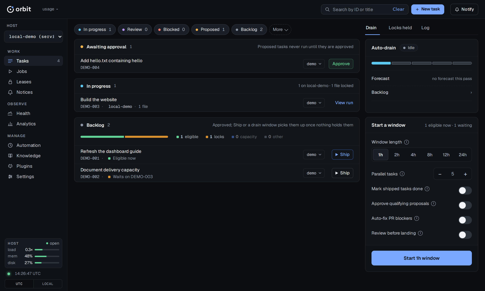
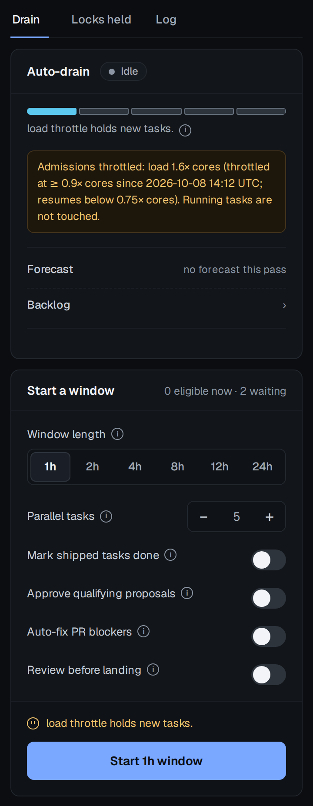
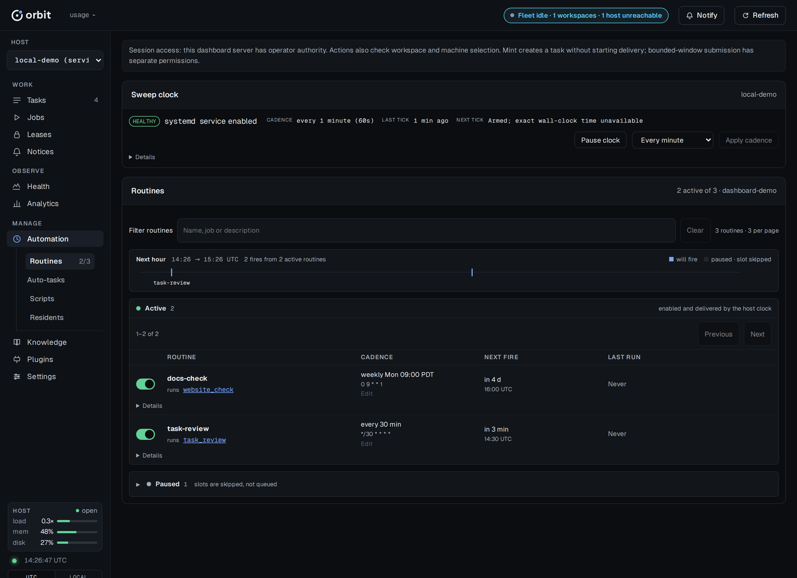
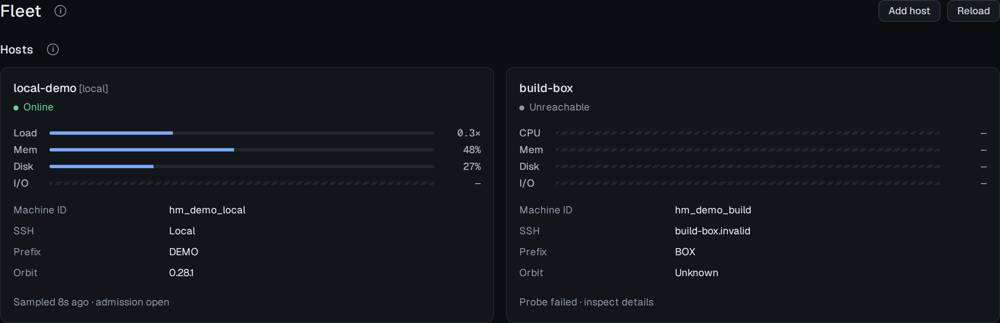

Use the Orbit dashboard to approve and ship tasks, run a delivery window,
read a failed run, and change settings from a browser. It serves one host,
has no login, and binds to loopback only. To use another machine's dashboard,
tunnel to it over SSH or switch to a registered host with the host picker.



## Open it locally

```bash
orbit web serve
```

This serves every workspace in the Orbit registry at `http://127.0.0.1:7878`
and tries to open a browser.

| Option | Effect |
|---|---|
| `--no-open` | Do not open a browser. |
| `--port <N>` | Serve on another port. |
| `--workspace <SELECTOR>` | Open on this workspace: a registered name, `ws_*` ID, or checkout path. If nothing matches, the dashboard opens on **All workspaces**. |
| `--operator` | Grant operator capability, which most write controls need. Nothing else grants it. See [Authorization](#authorization). |
| `orbit --root <DIR> web serve` | Serve the workspaces in `<DIR>/workspaces.json` instead of `~/.orbit/workspaces.json`. |

The server refuses non-loopback addresses such as `--host 0.0.0.0`. To reach
another machine, use `orbit web connect`.

## Open it over SSH

```bash
orbit web connect my-server
```

`my-server` is anything `ssh` accepts. The command forwards a local port to
the remote dashboard, attaches to an `orbit web serve` already running there
or starts one with `--operator`, then prints `http://localhost:<port>` and
opens it. Ctrl-C closes the tunnel, and stops the remote server only if
`connect` started it.

| Option | Effect |
|---|---|
| `--port <N>` | Local port. Default `7878`, or a free port if `7878` is busy. An explicit port that is busy fails. |
| `--remote-port <N>` | Remote dashboard port. Default `7878`. |
| `--workspace <SELECTOR>` | Open on this remote workspace. `connect` refuses `--root`. |
| `--no-operator` | Start the remote server without operator capability. |
| `--no-open` | Do not open a browser. |

`connect` cannot add operator capability to a server it did not start. If it
attaches to one running without it, it prints a notice. Restart that server
with `orbit web serve --operator`, or stop it and reconnect.

`connect` gives each machine its own tab and port. For machines registered
with `orbit host add`, you can stay in one dashboard and
[switch hosts](#switch-hosts) instead.

## Switch hosts

When the serving machine has registered other hosts (see
[Run Orbit across hosts](/how-to/multi-host/)), the left rail shows a **Host**
picker above the workspace picker. Choose a host and every panel, action, log
tail, and workspace list shows that host.

The serving dashboard reaches the host over SSH as the machine that serves
the dashboard, not your browser's machine. SSH runs without a prompt, so a
host that needs a passphrase or password reports as unreachable. The remote
dashboard is expected on port `7878`, and the remote host enforces its own
gates.

| You see | Meaning |
|---|---|
| `?host=` in the URL | The selected host, so a copied link opens the same host. Without it, the browser reuses the last host you picked. |
| A version note above the panels | The host runs a different Orbit version or protocol than the serving host. This is a warning: views and actions follow what that host supports. |
| One error state in place of every panel | The host cannot be shown. The state names an error code: `unknown_host` (the `?host=` value is not registered), `unreachable_destination`, `process_timeout`, `host_identity_mismatch`, or `host_too_old`. **Retry** tries again. |
| `Read-only on <host>: <reason>` | Writes to another host need an [operator session](#authorization) on the serving dashboard. |

To add, rename, or remove hosts, and to compare their load, use
[Settings › Hosts](#hosts).

## Workspace scope

With more than one workspace registered, the left rail has a workspace picker.
A `?workspace=` link wins, then the workspace you last chose in this browser
for the selected host, then a workspace with a live drain, then the registry
default. The URL holds the host, workspace, and time window, so a copied link
opens the same view.

**All workspaces** is mostly a read view:

- Tasks lists tasks from every active workspace, each row with a workspace
  pill. The **Workspaces** chip narrows the list.
- Task actions go to the owner the row names. A row without an owner is
  read-only. Review approval requires selecting the owning workspace.
- The Drain tab stays usable: pick the workspace and drain host on its card.
- Automation and settings are read-only. Most Analytics views, Knowledge, and
  Plugins show "Select a workspace to view this panel".
  **Analytics → Reliability → Pipeline** always covers every workspace.

Confirm the selected workspace before you act.

## Find your way around

| Rail | Shows |
|---|---|
| **[Tasks](#tasks)** | Tasks, with the ones waiting on you first. The right dock holds **Drain**, a live **Log**, and **[Notices](#notices)**. |
| **Drain** | Only in windows 1000px wide or narrower, where it opens the dock's Drain tab in place of the task list. |
| **[Jobs](#runs-and-errors)** | **Live** (runs pending or running now), **History** (every run, with run detail), and **Catalogue** (jobs you can run by hand). |
| **Health** | What is broken now: **Incidents** (grouped failures, with **Events** and **Errors** tabs) and **Doctor**. |
| **[Analytics](#analytics)** | How delivery is trending: **Metrics**, **Reliability**, **Codebase**, **Resources**, **Forecast**, **Cost**, **[Agents](#agents)**, and **Experiments**. |
| **[Automation](#automation)** | **Routines** (with the host scheduler clock), **Auto-tasks**, **Scripts**, and **Residents**. |
| **Knowledge** | **Frictions** (friction records) and **Memory** (crew memory). |
| **[Plugins](#plugins)** | Installed plugins and the panels they add. |
| **[Settings](#settings)** | Workflow, Execution, Review, Crews, Machine, Hosts, and Other. |

The rail also carries counts. **Jobs** counts the job runs pending or running
now, plus an **N failing** pill for jobs whose recent runs failed in a row.
**Health** counts doctor errors, warnings, and failing routines.

The rail foot shows live load, memory, and disk readings for the host. The
top bar has one chip per provider with its usage, such as `claude 13% ×1.09`.
Hover or click a chip for each usage window, when it resets, and the gate
that holds crews back.

## Notices

**Notices** is a tab on the Tasks dock, after **Log**. It lists the open
fleet notices in the selected workspaces, then those closed or expired in
the last 24 hours. The tab shows how many are open when that number is above
zero. `#notices` opens Tasks with this tab selected. A banner shows open
incident and maintenance notices, and its link lands on the same tab. With
an [operator session](#authorization) and one workspace selected, **Post**
opens a form for a new notice and **Close** on a row asks for a reason. For
the rules, see [Post and retire fleet notices](/how-to/fleet-notices/).

## Tasks

**Tasks** groups tasks in the order you act on them: **Awaiting approval**
(`proposed`), review, blocked, in progress, then backlog. Each row carries the
action its group waits on: **Approve** on a proposed task, **Ship** on a
backlog task, and **View run** on a task in progress.

To find a task, search by ID or title from the top bar, or filter by status.
Less common filters, such as Done, Not ready, and Pilot warnings, are under
**More**. Press Enter on a full task ID to open it even when the filter or
selected workspace hides it. **New task** proposes a task.

A backlog row says what the task waits on, such as `Waits on ABC-2` or
`Throttled`. A percentage on a row is the task's estimated regression risk,
from its size and the history of completed tasks; `~` marks an estimate with
partial support. A task without an estimate shows no percentage, and the
**Risk** chip in its detail gives the reason.

Open a task to see its detail and every action its status allows:

| Action | Shown for |
|---|---|
| **ship** | `backlog`. Runs the workspace's ship mode (`pr` or `local`). Disabled while a ship run for the task is in flight. |
| **approve** | `proposed` or `review`. Refused while an unfinished local run lists the task; the error names the run. Stop the run, then approve. |
| **reject** | `proposed`, `review`, or `backlog`. |
| **archive** | Any status except `archived`. |
| **comment** | Any status. A comment's **#** button copies a link to that comment. |

You can also change the crew from the row and the status from the detail.
Moves the [lifecycle table](/concepts/tasks/#transition-rules) allows still
ask for the evidence they need, such as a plan or completion summary. Every
other status sits under **force (off-table)**. Picking one asks for
confirmation, then applies an operator override, as
`orbit task update <id> --status <status> --force` does.

The detail's [**Artifacts**](/concepts/tasks/#task-artifacts) tab lists and
previews files already stored on the task; it does not attach files.

In the right dock, **Drain** holds the [auto-drain](#auto-drain) card,
**Log** is a live `orbit.log` tail you can filter to **all**, **err**,
**deny**, or **warn**, and **Notices** lists open and recently closed fleet
notices. Opening a task replaces the dock with its detail.

With one workspace selected, Tasks updates live; other views refresh every
30 seconds. A hidden tab stops refreshing, but new failed runs add a
`(N failed)` prefix to the page title. Click **Notify** to get a browser
notification when a drain ends or a task is newly held on a red base.

### Edit task metadata

In a task's detail you can edit the description, acceptance criteria,
complexity, tags, context files, and, until the task starts, the scheduled
time. Edits change the task record; they do not dispatch work. A failed save
keeps your draft open with the error.

Context files take one selector per line: `file:…`, `dir:…`, or `symbol:…`.
The server checks that each file or directory exists. If the task will create
the target, check **allow missing context** before you save.

### Distributed tasks

On the owner of a [distributed drain](/how-to/distributed-drain/), a task
with an execution claim shows a **distributed execution** panel. **approve**
on a `review` task with a handed-off claim sends **Approve handoff** for the
candidate shown. **Revoke authority** and **Recover claim** require a reason;
**Recover claim** moves the task to the status you pick. A replica refuses
all three actions.

### Diagnose and recover blocked work

A blocked task, or a delivery the pipeline is holding, opens with a read-only
**Why stuck** card. Read it before you choose an action. It shows the
**Escalation** note and **Root cause** the run recorded, the **Landing
review** verdict, whether the pull request is **Mergeable** (`mergeable` or
`conflicting`), and each of its **Required checks** (`passed`, `failed`, or
`pending`). `unavailable` means the dashboard could not read the fact; `none`
means the run recorded it as absent. To open the failed step behind a block,
use the detail's **Runs** tab.

Then choose by what the evidence shows:

| Action | Use when | Effect |
|---|---|---|
| **Resume candidate** | The cause is fixed and the candidate is sound. | Returns the task to backlog and keeps the candidate and pull request its stopped run published. The next run validates, reviews, and lands them. |
| **Discard and re-implement** | The candidate is wrong or stale. | Discards the candidate, closes the task's undelivered pull requests, and returns the task to backlog. The next run implements from scratch. The dashboard cannot undo this. |
| **Settle merged PR** | You merged the delivery pull request yourself. | Moves the task to `done` with a landing note naming the pull request and merge commit. If the pull request has not merged, nothing changes. |

**Resume candidate** and **Discard and re-implement** appear on `blocked`
tasks and ask for a reason, which is recorded in task history. An empty
reason sends nothing and shows `[requeue_reason_required]`. **Settle merged
PR** also appears on `in-progress` and `review` tasks.

The same three actions from the command line:

```bash
orbit task requeue "$TASK_ID" --reason "flaky test fixed; rerun the candidate"
orbit task requeue "$TASK_ID" --reason "candidate is stale" --discard-candidate
orbit task settle-merged "$TASK_ID"
```

### Skip pilot in Readiness

A backlog task held by its pilot assessment, including a stale assessment or
a pilot finding, shows **Skip pilot** in Readiness. Confirm it to add the
`no-pilot` tag and proceed without a new assessment. Adding the tag after a
pilot receipt, or while a pilot is pending, requires an operator. Remove
`no-pilot` to restore the pilot gate.

From the CLI, `--tag` replaces the whole tag list, so read the tags first and
include every tag you want to keep. If `docs` is the only existing tag:

```bash
orbit task show "$TASK_ID" --fields tags
orbit task update "$TASK_ID" --tag docs,no-pilot
# Restore the pilot gate, keeping the other tag:
orbit task update "$TASK_ID" --tag docs
```

Skipping the pilot does not clear other holds, such as dependencies, locks,
and unverified review findings. To refresh an assessment instead, see
[Prepare proposed work](/how-to/continuous-delivery/#1-prepare-proposed-work).

### Clear a pilot admission hold

A backlog task that a pilot assessment held from admission shows a **Pilot
admission hold** callout in its detail, with two actions:

- **Clear hold** records that the held requirement is satisfied, and asks for
  evidence.
- **Approve anyway** records a deliberate override, and asks for a reason.
  The task is admitted despite the finding.

Blank evidence sends nothing and shows
`[pilot_admission_evidence_required]`. While an open **Decision needed**
request exists for the pilot-admission gate, the callout is hidden: answer
that request's options instead.

From the command line, the decision is a comment whose first line is exact,
with the evidence on the following lines:

```bash
orbit task update "$TASK_ID" \
  --comment $'task-pilot-admission: clear\nThe duplicate finding is wrong: the migration is new.'
```

[Continuous delivery](/how-to/continuous-delivery/) explains each hold.

### Human tasks and decisions

A task assigned to a [human crew](/reference/config/#human-crews) opens with
a panel badged `For you · <crew>`: its summary, numbered steps, and a
**Copy** button beside each command. Nothing runs from the panel. The **My
work** filter, under **More**, shows only your human crew's open tasks.

An open decision on a task is a card with a note field and one button per
option, the recommended one first. Clicking an option shows its consequence,
asks you to confirm, and records the answer with your note, as
`orbit decision answer` does. A blocked task's
[final-recovery decision](/how-to/continuous-delivery/#7-recover-from-a-failed-delivery)
sits in its block callout, and a pilot-warning decision in the pilot-hold
callout. Every other open decision lists under **Decision needed**; see
[Decision channels](/how-to/decision-channels/#decisions-an-agent-raises-on-a-human-task).

### If a task action is refused

- Recovery and pilot-admission actions need operator capability. Without it,
  the server refuses with `403` and `code: authorization_denied`. See
  [Authorization](#authorization).
- The same actions are disabled, with the reason on hover, in **All
  workspaces** unless the row names its owner, and on a host that shows
  `Read-only on <host>:`. Select the task's workspace or host, then try again.
- A refused action changes nothing. Its code and message show on the task.

## Auto-drain

The **Drain** tab in the Tasks dock starts and watches a
[delivery window](/how-to/continuous-delivery/): a time-bounded run that
ships approved backlog tasks in parallel.



To start a window:

1. Open **Tasks**, then the dock's **Drain** tab. In a narrow window, use the
   rail's **Drain** item.
2. Under **Start a window**, check how many tasks are eligible now, then set
   the controls below.
3. Click **Start … window** and confirm. Nothing starts before that.

| Control | Effect |
|---|---|
| **Window length** | Whole hours from 1 to 24 (`--for`). The default is `1h`. |
| **Parallel tasks** | How many tasks run at once. Blank uses the default of 5. |
| **Mark shipped tasks done** | Off (default) leaves shipped tasks in `review`. On moves every task the window ships to `done` (`--complete`). |
| **Approve qualifying proposals** | Off (default) leaves `proposed` tasks for you. On (`--approve-proposed`) lets each pass approve proposed tasks that have context files, an assessed complexity (or the `no-diff-expected` tag), and a clean task-pilot verification. Tasks tagged `no-auto-approve` are skipped. |
| **Auto-fix PR blockers** | Off by default. On (`--auto-fix`) repairs failed required checks and merge conflicts on the window's own pull requests. It does not merge or approve anything. |
| **Review before landing** | On adds before-landing review to this window only (`--review before-landing`). When workspace policy already sets `review.timing`, the switch is on and locked: a window can add review, never remove it. It is refused when no reviewer crew is configured and for local-only delivery. See [Review layers](/concepts/tasks/#adding-review-to-one-run). |
| **Stop** | Stops new admissions (`orbit run auto --stop`). Admitted workers keep running; this is not cancellation. |

**Mark shipped tasks done**, **Approve qualifying proposals**, **Auto-fix PR
blockers**, and **Stop** need an [operator session](#authorization). Without
one you can still start a window that stops at review. If the response to
**Start** is lost, check the card and **Jobs › History** before you start
again; the browser does not retry.

The card shows the live window, including windows started from the CLI:

| On the card | Meaning |
|---|---|
| **Draining** | A window is admitting work. The card shows time left and `N running / M admitted`. |
| **Winding down · N workers still running** | Admissions have stopped; admitted workers are finishing. |
| A queued window | A window started while another runs waits under the live one. **Cancel** removes it only before it starts. |
| A line under the capacity bar | Why nothing more can start. |
| Admission forecast | The last pass's forecast CPU and memory peaks against the admit thresholds, such as `85.6% / 98%`, and the tasks it admitted or held. Shadow decisions are marked hypothetical and hold nothing. |

In the task list, the **Backlog** card splits the backlog into **Eligible
now**, **Waiting on locks**, **Waiting on capacity**, and **Waiting, other**.
Click one to filter the list.

### On a replica or follower

- On a replica checkout, **Start** pulls work from the owner. The header of a
  live pull reads **Pull drain**.
- **Mark shipped tasks done**, **Approve qualifying proposals**, **Auto-fix PR
  blockers**, and **Review before landing** are disabled on a replica: the
  owner decides those.
- When no window is admitting, a replica shows **Send pending results** in
  place of **Stop**. It delivers pull settlements this replica has recorded
  but not yet delivered to its owner.
- When the fleet lists followers, a **Drain host** select chooses the owner
  (the default) or a follower to run the pull.
- Stopping a pull drain leaves admitted tasks claimed by their owner. See
  [Stop, cancel, and settle](/how-to/distributed-drain/#stop-cancel-and-settle).

## Runs and errors

**Jobs › History** lists job runs for the selected workspace. Filter by
**All** or **Failed**, narrow the list with a task ID or job ID, and pick a
time window.

Click a run for its steps, events, and child runs. A failed, timed-out, or
interrupted run opens on the step it stopped at and the error it recorded.

| Action | Available for | Effect |
|---|---|---|
| **cancel** | `pending` or `running` | Cancels the run. |
| **Resume** | `failed`, `interrupted`, or `timeout` | Restarts from the first step that did not succeed. Resuming a run authorized to mark tasks done requires an operator session. |
| **Replay run** | Any run | Submits a new run of the same job. Requires an operator session. |

A `409` from ship or another start means a conflicting run or workspace
claim is held: refresh and open the named run instead of retrying. On a
distributed-drain follower, cancelling a run that works a claimed task fails
the claim on the owner and blocks the owner's task.

These counts answer different questions:

| Where | Counts |
|---|---|
| **Jobs** rail count | Job runs pending or running now, not tasks. It ignores the History window and filters. |
| **Jobs › History**, **Failed** | Failed, timed-out, and interrupted runs in the selected window. |
| **Health → Incidents → Events** | Audited calls. It opens on **failure + denied**; choose **all** to list every status. |
| **Health → Incidents → Errors** | Step and event failures in the selected window. |

From a terminal, the same facts come from `orbit task show <task-id>`,
`orbit run show <run-id>`, and `orbit audit list`.

## Analytics

**Analytics** shows how delivery is trending on the host you are viewing.
**Reliability → Pipeline** covers every workspace on the host; the other
views below show the selected workspace. The dashboard time window (`1h`,
`24h`, `7d`, `30d`, or **all**) drives Metrics and Cost; the other views have
their own windows.

Across the charts, a hollow point rests on too few samples to trust, usually
fewer than three. Work that cannot be measured, such as a task with an
unpriced model, is left out and counted, never drawn as zero.

### Metrics

**Metrics** answers whether implementation is getting slower, how many
tasks are finishing, and what each task costs in tokens and rework.

| Trend | Counts |
|---|---|
| **Implementation time** | Wall-clock time of implementation runs, by complexity. **Succeeded** (default) counts runs that committed a candidate; **All** adds failed, cancelled, and no-diff runs. |
| **Tokens per task**, **Tokens** | Mean and total normalized tokens of the tasks that closed in each bucket. |
| **Turns to first edit** | Tool calls before the first file edit in a task's first implement invocation. |
| **Lines changed** | Lines added and deleted by landed deliveries. `workflow.test_paths` and `workflow.non_code_paths` set which paths count as tests or non-code. |
| **Delivery friction** | Recoveries, PR auto-fixes, merge conflicts, failed CI, cost, and tokens. **Per done task** divides by the tasks done in the same bucket. |
| **Defects** | Bug tasks filed, grouped by **Lineage** (what `regression_from` names as the cause) or **Origin** (the review or sweep that filed them). |

Below the chart, **Actors within a complexity** always covers the last 30
days and **Outcome by complexity** covers all time.

### Codebase

Open **Codebase** when a path keeps showing up in regressions, blocked runs,
or rejections, or when tasks keep reserving the same files. Its window
defaults to `90d`. Group by **File**, **Directory**, or **Crate**. **Min.
tasks** (default 15) is the smallest sample a ranked row needs.

| Signal | Rate |
|---|---|
| **Regressed** | Done tasks that later regressed at a recorded defect site under the path. |
| **Footprint miss** | Tasks widened onto the path mid-run, over tasks that declared it. |
| **Blocked** | Tasks blocked by a run failure, over tasks that declared it. |
| **Rejected** | Tasks rejected after a run, over tasks that had a run. |

A task declares a path by listing it in its context, which is not always the
diff that landed. Select a path to see the tasks that
regressed and the files that land with it. **Coupling & locks** lists paths
that tasks reserve together and the time tasks waited on each file's lock.

From a terminal, for the active workspace:

```bash
orbit codebase analytics --window 30d --rollup file
orbit codebase show path/to/file.rs
orbit codebase related path/to/file.rs
```

Flags are in the [CLI reference](/reference/cli/#analytics).

### Resources

**Resources** shows the profiles that forecast admission uses: what one
delivery of each kind costs this host in CPU and memory, minute by minute
since admission. A profile appears once a delivery the drain admitted here
finishes. Forecast admission for a window is `off`, `shadow`, or `enforce`
(`orbit run auto --auto-concurrency`); the host default is
`machine.auto_concurrency.mode`.

- A dimmed series is **sparse**: it has fewer deliveries than
  `machine.auto_concurrency.min_profile_deliveries` (default 10), and
  admission uses a wider profile instead.
- In **% of host** units, the dashed line is the admit threshold: 90% of
  cores by default (`machine.auto_concurrency.admit_cpu_percent`) and 75% of
  memory. It bounds the whole host's forecast, not the one delivery drawn.

From a terminal, `orbit run profiles` prints the profiles, and
`orbit run profiles --accuracy` compares recorded forecasts with what the
host measured. See the [CLI reference](/reference/cli/#run-inspection).

### Forecast

**Forecast** estimates how long the backlog takes to drain and what it
costs, by replaying recent delivery history. It covers backlog, in-progress,
and blocked tasks; review and someday tasks are left out. Every figure is a
range: **p50** (as likely over as under) and **p90** (nine times in ten it
finishes under).

- **Scenario** chooses the tasks forecast: **Current backlog** (default,
  assumes no new tasks arrive), **With N proposed** (as if they were
  approved), or **With new arrivals** (at the recent filing rate).
- **unknown** in a tile means the figure cannot be computed. It is never
  zero, and the tile's info icon gives the reason.
- When some tasks depend on work the drain cannot start, the totals cover
  only the schedulable tasks, and a note gives the counts.

The **Data gaps** tab lists what reduces confidence in the forecast. The
**Accuracy** tab checks earlier forecasts against what happened: a
well-calibrated forecast has about half of actuals under p50 and nine in ten
under p90, and a share more than five points off its target is amber.

### Cost

**Cost** shows managed-execution spend and token use, grouped by task
ownership. Interactive session overhead is excluded.

**Provider-reported** dollars come first. **Derived estimate** is an estimate
with its own coverage. Do not add the two: compare them under
**Same-invocation comparison**. `<$0.01` is a non-zero amount that rounds to
zero, and **unknown** means the figure was not reported.

### Reliability

**Pipeline** covers every workspace on this host. A rate whose sample is too
small shows raw counts and **n too small**. Its window is `1h`, `24h`, `7d`,
or `30d`; with the dashboard on **all** it uses `7d`.

**Tools** summarizes tool failures over `24h`, `7d`, or `30d`; a dashboard
window of `1h` or **all** uses `24h`. Cards marked **capped** cover only the
newest failures in the window, so per-tool failure rates may be understated.

## Agents

**Agents** is an Analytics view that ranks the models behind each agent role
in the selected workspace. Each row is one model at one recorded reasoning
effort (`model @ effort`).

| Tab | Ranks |
|---|---|
| **Rank** | Implementer models by score and cost per task. Agents opens here. **Not ranked** lists models still short of eligibility. |
| **Implementers** | Implementing models. Credits landed work and first-pass accepts; counts review rejects, reviewer repairs, crew-caused rework, and escaped regressions. |
| **Reviewers** | Reviewers, by how their verdicts turned out. Findings and fixes that held earn; false rejects, failed fixes, and missed regressions lose. How often a reviewer accepts is never scored. |
| **Pilots** | Task-pilot models, by how well their context selectors predicted the files each task landed and whether they assessed the right complexity tier. |

Implementers, Reviewers, and Pilots default to the **Last 500** delivery
attempts. Select a row for its breakdown. **How the score works** lists every
term with its weight.

| You see | Meaning |
|---|---|
| A greyed, unranked row | Fewer than 10 units of work. |
| **p10–p90** | How much the score moves when the row's own work is resampled. A narrow band means a stable score. |
| A dash for cost | Missing or unpriced telemetry, not free work. Cost never changes the score. |
| **Provisional** (Reviewers) | Reviews younger than 30 days can still be charged a regression filed later, so those scores can fall. |
| **accepts often** (Reviewers) | The reviewer's accept rate is 10 or more points above other reviewers' on the same task tiers. Shown, never scored. |

On Implementers, the **execution** control picks which tasks count:
**Managed** (default, implemented by a delivery run), **Interactive** (worked
in an interactive session, with no cost or run-time record), or **All**.

From a terminal, `orbit agents scorecard --role <role>` ranks one role over
its own `--window` (`30d` by default), and
`orbit agents show --role <role> --crew <crew>` lists one row's tasks.

### Experiments

**Experiments** shows the experiments in the selected workspace: how close
each arm is to its minimum sample and what the readout says so far. With an
[operator session](#authorization) you can create, edit, start, and conclude
an experiment here. Pause, resume, reweight, clone, and abandon stay in the
terminal. See [Run an experiment](/how-to/experiments/).

Open an experiment for its detail:

| You see | Meaning |
|---|---|
| Verdict badge | `collecting`, `no verdict`, `winner <arm>`, `no difference`, or `inconclusive`, with the reasons behind it. |
| `shadow` badge | The experiment assigns tasks and applies nothing. |
| **Health** | The readout's warnings: arm counts that do not match the weights, an arm whose overlay changed (`drifted`), outcomes still open, or a primary metric with no data yet. |
| **Difference from control** | The dot is the difference and the bar its 95% interval. A bar that crosses zero is a difference the sample cannot tell from none. |

To conclude a running or paused experiment, use its **Conclude** card: pick
the winning arm or **No winner**, give a reason, and submit. Choosing an arm
files one proposed task to make that arm's overlay the default. Concluding
changes no configuration or repository file.

### Create, edit, and start an experiment

With an operator session, **New experiment** opens a form:

- **Mode**: `shadow` (the default) or `live`, which applies each arm's
  overlay.
- **Population**: an empty filter enrolls every task.
- **Arms**: one control and one or more treatments, each with a weight and
  overlays for the crew pool, instructions, tools, skills, and config values.
  Config values accept only the keys `experiments.config_keys` allows.
- **Guardrails**: a metric and a threshold such as `-5pt` or `+0.5`.

**Save draft** creates a draft, which has **Edit** and **Start**. **Save and
start** shows the arms, weights, population, and mode, then saves and starts
on confirmation. If Orbit refuses the start, the draft stays saved and open
in the form. Once an experiment has started, its definition can no longer be
edited.

Orbit checks the definition as `orbit experiment create`, `update`, and
`start` do, and shows each message next to the field it names. Starting is
refused while `experiments.enabled` is false or three experiments are already
running.

## Automation

**Automation** holds the workspace's recurring work: **Routines** (with the
host scheduler clock), **Auto-tasks**, **Scripts**, and
[**Residents**](#residents). Its controls need one active workspace and an
[operator session](#authorization). For what routines and auto-tasks are, see
[Schedule recurring work](/how-to/recurring-work/).

### Routines



Each routine's switch writes its `enabled` field; it does not start or stop
the scheduler clock. Paused routines sit in the collapsed **Paused** group.

The **Next hour** strip shows each routine due in the next hour: solid if it
will fire, hollow if it is paused. A paused routine's slot is skipped, not
queued. An enabled routine that cannot take effect shows a **blocked** pill.

### Scheduler clock

The bar above the routines shows this host's scheduler clock. **Pause
clock** or **Enable clock** asks for confirmation and changes no routine
definition. The cadence picker and **Apply cadence** change the interval. The
CLI equivalents are `orbit clock status`, `orbit clock pause`,
`orbit clock enable`, and `orbit clock set --cadence-seconds <N>`.

### Auto-tasks

Auto-task definitions are checked on every scheduler clock tick, so pausing
the clock pauses scheduled mints. A row whose previous task is still open
says whether the next due slot is skipped or mints again.

- The switch writes the definition's `enabled` field after a confirmation. A
  disabled definition is skipped, not deleted.
- **Mint now** creates one task immediately, as `orbit auto-task mint <name>`
  does. It ignores the schedule, the enabled flag, and dedupe, so it creates
  another task even when one is open.
- **Delete** removes the definition after a confirmation. Tasks it already
  minted stay open.

### Jobs

**Jobs › Catalogue** lists the jobs you can run by hand. **Run ▸** starts the
job in this workspace with no input and reports the new run ID. **Details**
shows the equivalent command, such as
`orbit run job worktree_gc_pipeline --workspace orbit`. Delivery jobs are not
listed: use **ship** or the [auto-drain](#auto-drain).

### Scripts

**Scripts** lists workspace scripts with their state (`granted`, `stale`,
`ungranted`, `revoked`, `orphaned`, or `witness refused`) and requested
capabilities. Review the diff shown, then grant it with
**Grant `<digest>`**. The grant is bound to the digest you reviewed. See
[Script steps](/reference/activity-job-yaml/#script-steps).

### Residents

**Residents** sets up and steers
[resident mandates](/reference/resident-mandates/) in the selected workspace.

To start one, click **Start a resident** and fill in three steps: what it
should do, what it may do (rights need **Your words**; with no rights the
resident only observes), and when it runs. The flow creates the mandate,
grants the rights, then turns the cycle routine on. If a later step is
refused, the message names the step and says what already exists.

The **Cycle routine** row must be on: without it, no cycle wakes a mandate.
Mandates that need you (an open request, an invalid mandate, or a stall) sort
first. Select a mandate to answer its requests and steer it:

- **Pause**, **Takeover**, and **Stop** ask for a reason, as
  `orbit resident control` does. **Relay** asks for the direction to send, as
  `orbit resident relay` does. **Wake for status**, **Resume**, and
  **Release** run at once.
- **Change authority** adds or removes rights and workspaces, and can shorten
  the deadline. A widening needs your words in **Quote**.

## Knowledge › Frictions

**Knowledge** lists the selected workspace's friction records: what made
work harder than it should have been, reported with `orbit friction add`.
The list opens on **Active** records (`open` and `triaged`); **Show** changes
the status filter. Select a row to open the full record and triage it:

- **status** sets `open`, `triaged`, or `resolved`, and **tags** replaces
  the record's tags, as `orbit friction update` does.
- **Resolve** marks the record resolved, as `orbit friction resolve` does.

Nothing here files a task or moves a record to another workspace. For both,
see [Report and triage friction](/how-to/friction/).

## Knowledge › Memory

**Memory** shows crew memory for the selected workspace. It is read-only.
While `crew_memory.enabled` is false (the default), the panel says Memory is
off for this workspace.

Select a key to read its current revision, evidence, files, and history, or
**Global proposals** to see open and recently closed proposals. To accept or
reject a proposal or write memory, use the
[crew memory CLI commands](/reference/cli/#crew-memory-experimental). To turn
memory on, see [Give models a memory](/how-to/crew-memory/).

## Plugins

**Plugins** lists the plugins installed on the selected host and how the
selected workspace uses them. Open it when a tool or panel is missing, or to
switch a plugin on or off. Installing, upgrading, removing, and editing
grants stay on the command line; see
[Install and grant plugins](/how-to/plugins/).

| Status | Meaning |
|---|---|
| `active` | Installed, enabled, and serving its tools. |
| `disabled` | Switched off on this host, or in this workspace only. |
| `missing` | This checkout pins it, and this machine has not installed it. |
| `inactive` | Enabled, but refused when it loads. The card shows the diagnostic. |

| Chip | Meaning |
|---|---|
| **pinned** | `.orbit/plugins.yaml` in this checkout names the plugin. A pin grants no permission. |
| **unsandboxed** | A warning: the backend runs with no confinement, and this host granted that. |
| **certified for** `<version>` | `orbit plugin test` passed for that Orbit version on this host. **· behind host** means the certificate is older than this host's Orbit. |
| A dimmed tool chip | The tool is not active: the plugin is not serving tools, or a grant it needs is missing. See [Diagnose inactive tools](/how-to/plugins/#diagnose-inactive-tools). |

Panels and link tiles appear only while the status is `active`.

### Enable or disable a plugin

Each card has a **Host** row and a **Workspace** row. The host row is the
ceiling: disabling it takes the plugin off every workspace on this host. A
workspace can only narrow it. **Effective: disabled by host** or **disabled by
workspace** names the layer that switched the plugin off.

With an [operator session](#authorization), the card has four buttons:

| Button | Effect | CLI |
|---|---|---|
| **Disable host** | After a confirmation, tools stop registering and the plugin's skills are unlinked. The scheduler skips routines and auto-tasks it seeded. | `orbit plugin disable notes` |
| **Enable host** | Turns the host row back on with the grants already recorded. | `orbit plugin enable notes` |
| **Disable workspace** | Writes this workspace's toggle only, without asking. | `orbit plugin disable notes --scope workspace` |
| **Enable workspace** | Turns this workspace's toggle back on. | `orbit plugin enable notes --scope workspace` |

`notes` stands in for a plugin name. A failed toggle leaves the previous
state and prints the error on the card:

- **Enable workspace** while the host has the plugin disabled writes nothing.
  Enable it on the host first.
- **Enable host** fails when the manifest asks for a grant you have not
  given. The error names the `orbit plugin enable notes --grant …` command to
  review.
- **Enable host** on a `missing` card does not install the plugin. Run
  `orbit plugin sync` when the checkout pins it, or
  `orbit plugin add <source>` when it does not.

## Settings

**Settings** groups configuration by topic:

| View | Shows |
|---|---|
| **Workflow** | Shipping, crew routing, task pilot, recovery, and steering settings. |
| **Execution** | `execution.*` settings and resolved paths. When this workspace sets execution policy, a warning explains that `execution.*` keys in the global file are not inherited. |
| **Review** | Review layers, `review.timing`, reviewer pools, and before-landing settings. |
| **[Crews](#crews)** | The crew table. |
| **Machine** | Machine identity, auto-concurrency, resource throttle, and `tasks.id_start`. Edits write `~/.orbit/config.toml` only. |
| **[Hosts](#hosts)** | The serving machine's registered SSH hosts. |
| **Other** | Keys no other Settings page shows, workspace cleanup, and the raw TOML files. |

Routines, auto-task definitions, and the workspace registry (`base_branch`,
`ship_mode`) are not editable here. Writes need an
[operator session](#authorization).

### Edit a value

1. Click **Edit** on a row. The drawer shows what the key accepts, the value
   at each layer, and **if removed**, the value you fall back to.
2. Choose where to save: **This workspace (.orbit/config.toml)** or **Every
   workspace on this machine (~/.orbit/config.toml)**. Machine rows and
   global-only keys save to the global file.
3. Enter the value. Lists take one item per line, and tables take a JSON
   object. The drawer previews the matching `orbit config set` command.
4. Click **Save**. A refused value leaves the drawer open with the error.

If the workspace has no config policy file yet, a workspace write offers
**Seed from global** (`--seed-from-global`) and **Start empty** (`--fresh`)
in place of **Save**. Creating the file changes execution inheritance: **Seed
from global** copies the global policy, and **Start empty** uses built-in
security defaults.

**Remove workspace value** deletes the workspace entry. Check **if removed**
first. To tidy the whole workspace file, open **Other**: **Keys that only
repeat the global or built-in value** lists the workspace values you can
remove without changing anything, and **Remove all N workspace values**
removes them.

### Crews

**Crews** lists each crew and marks the one named by
`workflow.default_crew`. You can add, edit, and delete crews inline, with two
refusals:

- You cannot delete a crew that a key still names.
- A file that defines any `[crews.*]` table must resolve
  `workflow.default_crew` within itself. Adding the first crew to a file with
  no default crew is refused.

### Hosts

**Settings › Hosts** manages the serving machine's
[`hosts.toml`](/reference/config/#host-registry). Through
`orbit web connect`, that is the remote machine's registry.



The screenshot shows a demo registry. `build-box.invalid` is an intentionally
unreachable example.

Each remote row shows its SSH target, reachability, Orbit version, and
current load, memory, disk, and drain state. An unreachable host shows its
error instead. Opening the view and **Reload** probe every host.

- **Add host** takes an SSH target and an optional name. Saving probes the
  host and registers its identity, as `orbit host add` does. It writes
  nothing on the remote.
- **Remove** asks for confirmation. A `host_in_use` refusal lists the replica
  checkouts and pull drains that depend on the host and offers a separate
  force confirmation, which removes their route.
- **Show** switches the dashboard to that host.

The local host cannot be removed or renamed here. If `hosts.toml` fails
validation, a banner shows the error and the last valid list stays visible
until you repair the file. For host setup and error codes, see
[Run Orbit across hosts](/how-to/multi-host/).

## Authorization

The dashboard has no login. Anyone who can reach its port, including a
forwarded port, can call the same write endpoints the browser uses, with the
server process's authority. Keep that port inside your operator boundary.

Two gates apply to writes:

1. **Workspace scope.** **All workspaces** and inactive workspaces are
   read-only, even for an operator. The exceptions are task actions on rows
   that name their owner, the Drain tab, and **Settings › Hosts**.
2. **Operator capability.** The server has it only when started with
   `orbit web serve --operator`. `orbit web connect` passes `--operator` when
   it starts a remote server, unless you pass `--no-operator`. A local
   terminal and `ORBIT_OPERATOR=1` do not grant it.

These need operator capability:

- Automation switches, **Mint now**, **Run ▸**, and clock controls.
- Settings, crew, host, and plugin changes.
- A window's **Mark shipped tasks done**, **Approve qualifying proposals**,
  and **Auto-fix PR blockers**, plus **Stop** and **Send pending results**.
- **Replay run**, and **Resume** of a run that marks tasks done.
- Recovery, pilot-admission, and distributed-claim actions on a task.
- Notices, experiments, residents, and script grants.

Task **ship**, **approve**, **reject**, and **archive**, run **cancel**,
**Resume** of a run that stops at review, and starting a window that stops at
review do not.

A control you cannot use is disabled and shows the reason. A request that
reaches the API anyway gets `403` with `code: authorization_denied`.

When you [switch to another host](#switch-hosts), a write is forwarded only
if the serving dashboard has operator capability. The remote host's own
authorization still applies to each request.

MCP is separate: `orbit mcp serve --operator` is its only operator path.

## Troubleshooting

| Symptom | What to check |
|---|---|
| No browser, or `connection refused` | Is `orbit web serve` still running? `curl -s http://127.0.0.1:7878/healthz` returns `ok` from a live server. |
| `refusing to bind dashboard to non-loopback address` | Bind `127.0.0.1` or `::1`. Reach another machine with `orbit web connect`. |
| `orbit web connect does not accept --root` | Pass `--workspace <SELECTOR>`. |
| Connect waits, then fails readiness | SSH must work without prompts, and `orbit` must be on the remote `PATH`. The remote server has about 30 seconds to answer `/healthz`. |
| Automation buttons disabled | Select one active workspace. If the reason mentions operator authority, see [Authorization](#authorization). |
| Ship returns `409` `ship_run_in_flight` | The task already has an unfinished ship run. Open the named `run_id`. |
| `409` `workspace_claim_held` | Another operator holds the workspace claim. Wait for it to expire or inspect the holder; do not retry in a loop. |
| Settings save says "no workspace config exists yet" | Expected on the first write. Choose to copy the global policy or start empty. See [Edit a value](#edit-a-value). |
| New workspace missing after `orbit workspace init` | Reload the page. The server reloads `workspaces.json` when it changes, and keeps the last good list if the file is malformed. |
| **connecting…** stays in the status line after startup | The first API request probably failed. Reload the page, or probe `/healthz` to tell a dead process from a slow workspace. |

For uptime monitoring, use the detailed probe. It also checks each
workspace's store and log sink, and returns `200` when every check passes and
`503` when any fails:

```bash
curl -s 'http://127.0.0.1:7878/healthz?detailed=true'
```

## Next

- [First task](/getting-started/first-task/): one task from request to
  reviewed pull request.
- [Run a delivery window](/how-to/continuous-delivery/): prepare, start,
  stop, and recover a drain.
- [Schedule recurring work](/how-to/recurring-work/): routines, the scheduler
  clock, and auto-tasks.
- [Connect your agent](/how-to/mcp-integration/): the tool surface agents
  use.
