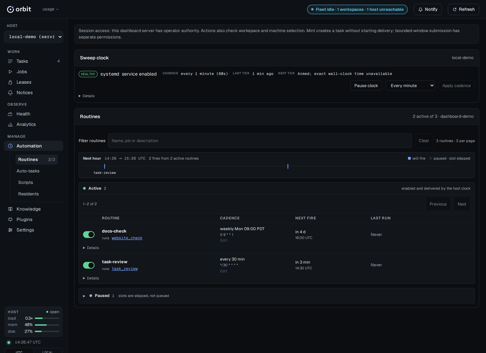

Install the host scheduler clock, then choose what it runs: **routines** start
jobs on a schedule, and **auto-tasks** file tasks on a schedule. For the model
behind them, see [Routines and auto-tasks](/concepts/scheduling/).

:::tip[Let your agent set it up]
Ask your agent to **install the Orbit clock and turn on worktree GC**, or to
**file a dependency audit every Monday**; the `orbit-setup` skill does both.
After that, the dashboard's [Automation view](/how-to/dashboard/) toggles
routines and auto-tasks and controls the clock.
:::

## 1. Install the clock

```bash
orbit routine init --install-clock
```

This installs a per-user unit (launchd on macOS, a systemd user timer on
Linux) that runs `orbit clock tick` every minute. Each tick reads the routines
and auto-tasks of every registered owner checkout on this machine. Nothing is
scheduled until the clock runs.

```bash
orbit clock status
orbit clock pause                       # stop scheduled ticks
orbit clock enable
orbit clock set --cadence-seconds 300   # whole minutes only
```

Pausing the clock leaves each routine's own pause state alone, and a manual
`orbit clock tick` still works.

To see what a change would do, run a tick by hand:

```bash
orbit clock tick --dry-run --verbose     # what would fire; writes nothing
orbit --workspace <name> clock tick      # only that workspace's schedules
```

The clock starts runs without your login shell. If scheduled runs need a
provider token or a `GITHUB_TOKEN`, set up
[scheduled credentials](#scheduled-credentials).

### If the Orbit binary moves

The unit runs Orbit by absolute path. If that binary moves or is removed,
ticks stop while `orbit clock status` can still report the clock as enabled.
`orbit update` repairs the unit; after installing Orbit another way, run
`orbit clock repair`. Repair never resumes a clock you paused.

## 2. Turn on routines

`orbit workspace init` seeds the shipped routines into `.orbit/routines/`.
`orbit workspace sync` refreshes them after an upgrade and keeps your edits.

| Routine | Ships | What it does |
|---|---|---|
| `worktree-gc` | Enabled | Removes worktrees left by settled tasks. Start here. |
| `task-pilot` | Enabled | Pilots eligible new tasks. |
| `crew-memory-dream` | Enabled | Files nothing while `crew_memory.enabled` is false or no memory experiment is running. |
| `store-gc` | Disabled | Daily audit and run-state retention. |
| `ci-failure-sweep` | Disabled | Files failing CI runs as proposed repair tasks. |
| `dependabot-alert-sweep` | Disabled | Files dependency alerts as tasks. |
| `resident-cycle` | Disabled | Runs a cycle for each resident that is due. |
| `task-publication` | Disabled | [Publishes task snapshots](/how-to/task-publication/#scheduled-publication) weekly, Sunday at 04:47 host-local time. Leave it off until you opt into publishing task prose. |

Turn a routine on or off with its switch in **Automation → Routines**, or from
the CLI as an operator:

```bash
orbit routine list            # enabled, paused, next due, last fire
orbit routine show <name>
orbit routine enable <name>
orbit routine disable <name>
```

Git ignores `.orbit/`, so the change applies to this checkout on this machine.
No routine ships work; for that, see [Ship unattended](#ship-unattended).



### Write a routine

Add a YAML file under `.orbit/routines/`:

```yaml
schemaVersion: 1
name: ci_failure_sweep_myrepo
description: File failing CI runs as proposed repair tasks.
enabled: true
trigger:
  cron: "5 * * * *"     # 5-field cron, host-local time
  missed_run: skip      # or catch_up_once: one make-up run after downtime
target: job:ci_failure_sweep_pipeline
policy:
  timeout_minutes: 30
  overlap: forbid       # skip a fire while the previous one runs; or allow
  retries:
    max: 0
    backoff_minutes: 15
```

- `target` must be a job. To schedule one activity, wrap it in a one-step job.
- Orbit skips an invalid file; it never fires with defaults.
- `orbit doctor` warns when an enabled routine's last success is older than
  three times its schedule interval.

Every field and trigger type is in
[Scheduling YAML](/reference/scheduling-yaml/).

### Keep a routine off one machine

A routine has no host field. Every machine with a registered owner checkout
and a running clock evaluates it. To keep it off one machine, pause it there:

```bash
orbit routine pause <name>
orbit routine resume <name>
```

Pauses stay on that machine, are never synced, and survive reboots.

## 3. Define recurring chores as auto-tasks

An auto-task is a task template that the clock files on a schedule. A new
chore is a new definition; there is no routine to enable. For ready-made
repository audits, start from a
[built-in maintenance sweep](#built-in-maintenance-sweeps).

```bash
orbit auto-task add \
  --name weekly-dep-audit \
  --cron "0 9 * * 1" \
  --title "Audit outdated dependencies" \
  --body "Audit the lockfile and file follow-up tasks." \
  --criterion "List outdated packages and their latest versions." \
  --criterion "File follow-up tasks for known advisories." \
  --tag maintenance
```

Each fire files one task. This definition files it as `proposed`, so you
approve it before it runs.

Give exactly one trigger:

| Trigger | Fires | Starts |
|---|---|---|
| `--cron "<expr>"` | On a 5-field cron schedule, host-local time. | Enabled |
| `--every-minutes <n>` | Every `n` elapsed minutes. | Enabled |
| `--deliveries-landed '<JSON>'` | Once verified deliveries land on a branch. | Disabled. Check it with `orbit auto-task show <name> --preview`, then enable it. |

| Option | Effect |
|---|---|
| `--status` | Status of filed tasks. With the default `backlog`, a task is filed as `proposed` unless the definition is tagged `no-diff-expected`. Any other status is used as given. |
| `--dedupe` | `skip-if-open` (default) skips a fire while the previous task is still open. `always` files regardless. |
| `--crew` | Crew for filed tasks. |
| `--priority` | `low`, `medium` (default), `high` or `critical`. |
| `--tag` | Extra tag on each filed task, beside the `auto-task:<name>` tag. Repeatable. |
| `--required-tools` | Exact tool names copied to each filed task. |

The definition file's fields, dedupe and preconditions are in
[Scheduling YAML](/reference/scheduling-yaml/).

### Mint one now

```bash
orbit auto-task mint weekly-dep-audit
```

This files one task immediately, like **Mint now** in the dashboard. It
ignores the schedule, the dedupe policy and `enabled`, and does not move the
next scheduled fire. Use it to see what a definition produces before you leave
it running.

### Change, turn off, or delete

```bash
orbit auto-task list --enabled
orbit auto-task show weekly-dep-audit
orbit auto-task update weekly-dep-audit --cron "0 9 * * 2"   # only the fields you pass
orbit auto-task toggle weekly-dep-audit off                  # keeps definition and history
orbit auto-task delete weekly-dep-audit --reason "moved to Renovate"
```

`delete` refuses while a task filed from the definition is still open, and
names those tasks. `--force` deletes anyway and leaves them alone.

Deleting a shipped definition also opts out of it: later
`orbit workspace init --force` and `orbit workspace sync` runs leave it out.
`orbit auto-task restore <name>` brings it back with its shipped settings.

### Repair a delivery-triggered definition

A `--deliveries-landed` definition keeps a ledger of the deliveries it still
owes a review. `recover` and `reset` only preview until you pass `--reason`:

```bash
# Resume after a settings change; this keeps the debt.
orbit auto-task recover <name> --adopt-settings --reason "<why>"
# Reconcile a rebased branch; this keeps the debt.
orbit auto-task recover <name> --replay-history --reason "<why>"
# Re-file a settled action that closed without accepted evidence.
orbit auto-task recover <name> --reissue-action --reason "<why>"
# Forget the debt and re-baseline at the branch head.
orbit auto-task reset <name> --reason "<why>"
# Waive one settled failed batch.
orbit auto-task update <name> \
  --waive-batch <batch-id> \
  --waiver-reason "<why>"
```

`reset` refuses while an action is executing; `reset --force` abandons that
action instead of cancelling it. Deleting the definition runs the same reset,
so `delete` refuses whenever `reset` would. The trigger's fields are in
[Scheduling YAML](/reference/scheduling-yaml/).

## 4. Watch it work

A routine fire is an ordinary run, and a filed task is an ordinary task. The
**Automation** view shows each routine's and auto-task's next fire and last
result; `orbit routine list` and `orbit auto-task list` show the same. Find
what was filed by its tag:

```bash
orbit task list --tag maintenance
orbit task list --tag auto-task:weekly-dep-audit
```

Approve anything filed as `proposed`, then let a
[delivery window](/how-to/continuous-delivery/) pick it up.

## Ship unattended

No routine ships work. To ship while you are away, start an `orbit run auto`
drain for a window, or run `orbit run ship` yourself. A drain without
`--complete` leaves shipped work in `review` for you. Turn on worktree GC
first.

The `ship-sweep` routine and the `workflow.auto_ship` setting were removed. A
workspace or config that still has one loads with a warning and never ships.

## Scheduled credentials

The clock starts `orbit clock tick` with no login shell, so a variable you
export interactively never reaches a scheduled run. Put those credentials in
`~/.orbit/clock.env` instead. The file is machine-global, never synced, and
never copied into the unit file.

1. Installing the clock creates the file, owner-only and holding only
   comments, and never overwrites an existing one. The tick
   refuses a file that is a symlink, owned by another user, or readable by
   group or others, so keep it that way:

   ```bash
   chmod 600 ~/.orbit/clock.env
   ```

2. Add one `NAME=value` per line:

   ```ini
   # ~/.orbit/clock.env — never commit or share this file
   CLAUDE_CODE_OAUTH_TOKEN=<token-from-claude-setup-token>
   ANTHROPIC_CREDITS_API_KEY_1=<api-key-for-the-credits-crew>
   GITHUB_TOKEN=<github-token>
   ```

3. Admit each name. A name that nothing admits is loaded for nobody.

   - **For every crew:** add it to the workspace's
     [`execution.env.pass`](/reference/config/#settable-keys). The list
     replaces the default, so restate the baseline names:

     ```bash
     orbit config set execution.env.pass \
       '["HOME", "PATH", "CODEX_HOME", "TMPDIR", "USER", "CLAUDE_CODE_OAUTH_TOKEN", "GITHUB_TOKEN"]'
     ```

     Once a workspace `config.toml` exists, its list is the one that counts
     for that workspace, not the global one.
   - **For one crew:** map it in the crew's `env` (global config only). This
     crew's agents receive `ANTHROPIC_API_KEY` with the value of the
     `ANTHROPIC_CREDITS_API_KEY_1` line; other crews are unaffected:

     ```bash
     orbit config set --global crews.<name>.env \
       '["ANTHROPIC_API_KEY=ANTHROPIC_CREDITS_API_KEY_1"]'
     ```

4. Verify. These commands print names, never values:

   ```bash
   orbit clock tick --json   # a real tick; clock_env_loaded lists the loaded names
   orbit doctor              # env-pass row, and claude-worker-token on macOS
   ```

A drain or ship run you start by hand does not read `clock.env`; start it
from a login shell. A dry-run tick loads nothing. The full loading rules are
in the [`clock.env` reference](/reference/config/#scheduled-credentials-clockenv).

### Claude on macOS

On macOS, give scheduled Claude runs a dedicated credential:

```bash
claude setup-token   # requires a Claude subscription; prints the token once
```

Store the token as `CLAUDE_CODE_OAUTH_TOKEN` in `~/.orbit/clock.env` and admit
that name as above. An admitted `ANTHROPIC_API_KEY`, or a per-crew `env`
mapping that supplies either name, also works.

Without one of them, Orbit refuses a Claude activity before `claude` starts,
and a drain on that host excludes the Claude crews. It does not fall back to
the Claude Desktop login, which the Desktop revokes mid-run. `orbit doctor`'s
`claude-worker-token` row names what is missing.

## Built-in maintenance sweeps

Three shipped auto-tasks find maintenance work in your repository. They
discover its languages, manifests, conventions and CI configuration instead of
assuming a toolchain.

| Definition | Finds | Shipped schedule | Output |
|---|---|---|---|
| `code-health-sweep` | Dead code, duplication, needless complexity, local architectural drift, and compatibility paths ready to retire. | Every 4,320 minutes (3 days) | `code-health.json` and up to six proposed tasks. Confirmed bugs are filed separately. |
| `architecture-audit` | Dependency cycles, layering drift, misplaced abstractions, and packages to split or merge, from a module dependency graph. | Every 20,160 minutes (14 days) | `architecture.json` and up to three proposed tasks. |
| `dependency-freshness` | Outdated, unused and duplicate dependencies. | `0 9 1 * *` (09:00 on the first of each month) | `dependency-freshness.json` and up to three proposed tasks. |

All three ship disabled, with `skip-if-open` dedupe. The clock only files the
assessment task; an agent runs it through your normal workflow. The assessment
gathers evidence and files follow-up tasks. It edits no source, dependencies,
tests or CI configuration.

### Try one, then enable it

Run these from your registered owner checkout, with the
[clock installed](#1-install-the-clock):

```bash
orbit workspace sync --check                 # after an upgrade; exits 3 when changes are pending
orbit workspace sync
orbit auto-task show dependency-freshness --json
orbit auto-task mint dependency-freshness    # file one assessment now
# After reviewing that task, optionally change the cadence, then enable.
orbit auto-task update dependency-freshness --cron "0 9 * * 1"
orbit auto-task toggle dependency-freshness on
```

- An open minted task blocks later scheduled copies under `skip-if-open`.
- Turning a definition off does not cancel tasks already filed.
- `workspace sync` refreshes a shipped definition's instructions and keeps
  your cadence, enabled state, crew, priority and complexity. If you edit its
  body or criteria, it becomes a local fork that sync no longer refreshes.
- `structure-sweep`, `flaky-test-hunt` and `ci-budget-watch` are no longer
  shipped. If your workspace has them, sync keeps them as your own
  definitions.

### Read the results

```bash
orbit task list --tag auto-task:dependency-freshness
```

Open the assessment task's artifacts and execution summary in the
[dashboard](/how-to/dashboard/). The assessment checks existing work before it
files, and a run with no findings still succeeds. Review and approve the
proposed follow-ups yourself; enabling a sweep does not approve them.

### What a sweep needs

- The executing agent needs repository access, the installed Orbit skills, and
  the definition's required tools.
- `code-health-sweep` and `architecture-audit` read a pinned revision of the
  integration branch. They run no builds or tests.
- `dependency-freshness` needs ecosystem tooling and registry access. It
  reports missing tools as gaps, and without registry access it ends with no
  proposals. It leaves dependencies under a security advisory to security
  work.

## Blind regression-label audit

Check whether recorded regression labels would be labeled the same way by
someone who has not seen them. A regression link's escape, nature and
severity decide which role is charged and how much, and the agent that filed
the link sets all three. Use this audit when you want a second opinion on
that accuracy without touching the recorded data.

It ships disabled, as a medium-priority chore that files weekly on Monday at
07:30 host-local time, with `skip-if-open` dedupe. Each pass samples up to
10 regression links filed in the previous 7 days and reports how often an
independent re-judgement disagrees on escape, nature and severity. A short
sample still succeeds and names its eligible population, and a first pass
with no prior artifact succeeds as a baseline.

Run it from your registered owner checkout, with the
[clock installed](#1-install-the-clock):

```bash
orbit workspace sync --check                 # after an upgrade; exits 3 when changes are pending
orbit workspace sync
orbit auto-task show regression-label-audit
orbit auto-task mint regression-label-audit   # file one audit now
# After reviewing that pass, optionally change the cadence, then enable.
orbit auto-task update regression-label-audit --cron "30 7 * * 1"
orbit auto-task toggle regression-label-audit on
```

Minting files one pass immediately. It ignores the schedule, the dedupe
policy and `enabled`, and does not move the next scheduled fire. Turning the
definition off does not cancel passes already filed. `workspace sync`
refreshes the shipped instructions and keeps your cadence, enabled state,
crew, priority and complexity; editing its body or criteria makes it a local
fork that sync no longer refreshes.

The pass stays blind: a different model family re-labels each sampled link
from an evidence packet of titles, descriptions, acceptance criteria and
context files only. The packet carries neither the recorded labels nor any
model, provider or crew name, and the second labels are saved before
anything is compared. A link whose packet leaks that information is excluded
and replaced, and links your own family filed or a previous pass already
judged are left out of the draw.

Find the passes and read the result:

```bash
orbit task list --tag auto-task:regression-label-audit
```

Open the pass task's artifacts and execution summary in the
[dashboard](/how-to/dashboard/). Each pass attaches
`regression-label-audit.json`, with the sampled links, the second labels,
the recorded labels, agreement per field, and the three disagreement rates
for escape, nature and severity, each with its disagreed and judged counts.
The execution summary reports the sample size, the eligible population and
the same three rates.

The audit changes nothing it measures: it edits no regression link and no
scorecard or rank number.

## Host-health auto-task

`host-health` reads a machine's health and files tasks for what it finds. It
ships disabled; turn it on with `orbit auto-task toggle host-health on`. When
enabled on the workspace owner, it runs weekly on Monday at 07:10 host-local
time. It never repairs anything: it restarts no service, changes no config and
reads no credentials.

```bash
orbit auto-task toggle host-health off
orbit auto-task toggle host-health on
orbit auto-task update host-health --cron '10 7 * * 1'
orbit auto-task update host-health --every-minutes 10080
```

The clock files a pass task and an agent runs it like any other task. The
pass reads:

- `orbit doctor --json`. Any warning or error qualifies on first sight.
- The host's user services and their logs (systemd user units on Linux,
  LaunchAgents on macOS) and Orbit's own logs. A log signature qualifies after
  three distinct events across two collection windows within 14 days; a single
  error files nothing.
- The installed version, available updates and pending workspace migrations.
  The pass records these and installs nothing.

Orbit takes service names from the host's service manager, so there is nothing
to configure. Unreadable logs or a failed doctor run are reported as missing
coverage, never as a healthy pass.

### What it files

A pass files at most five tasks. It first searches open tasks, tasks closed
within 30 days and open frictions; it comments on a covering task instead of
filing a copy, and does not refile a finding you rejected.

| Finding | Filed as |
|---|---|
| A verified Orbit defect | A bug for an agent crew, with file and function evidence. |
| A host, credential, service or operator-only finding | A task for a [human crew](/reference/config/#human-crews). |
| The same, when no human crew can be chosen | A `proposed` chore tagged `needs-operator` and `no-auto-approve`. |

:::caution
Do not approve a `needs-operator` chore before an operator assigns it a human
crew. The tags alone do not stop dispatch.
:::

Every filing has a `## Resolve` section with exact commands or numbered steps
for that host, and a command that verifies the result. You run them; the pass
never does.

Each pass task attaches `host-health-report.json`, with the findings and
coverage gaps. Find the pass tasks and the filings that need you:

```bash
orbit task list --tag auto-task:host-health
orbit task list --tag needs-operator
```

### Other hosts

A pass covers only the workspace owner, and reports every other host as
missing coverage. A [follower](/how-to/multi-host/) is not offered the pass.
Follower collectors are unavailable, so do not add a collector definition for
one on the owner or on the replica.

## Recover a tripped routine

When a routine keeps failing, Orbit stops firing it on that machine until one
trial fire succeeds. Check whether the breaker tripped, fix the underlying
failure, then close the breaker or let one trial through.

After 3 fires in a row fail with the same error class, the scheduler stops
firing the routine on this host. It tries one trial fire after a backoff that
grows each time a trial fails (15 minutes up to 4 hours), or at the first tick
after Orbit is upgraded. A successful trial closes the breaker and the routine
fires as scheduled again. Breakers are host-local: other machines keep firing
their copies, and every trip, trial, reset and bypass is recorded.

```bash
orbit routine list
orbit routine show <name>
```

`list` marks a tripped routine with its error class, its next trial and the
reset command. `show` reports `Next due: tripped (fires only as a breaker
trial)`, the breaker line with the same details, and the recent breaker
events.

Fix the root cause before you recover: read the recent fires and the run
output, and repair what keeps failing (a missing credential, for example; see
[Scheduled credentials](#scheduled-credentials)). A reset without a fix trips
the breaker again.

```bash
orbit routine breaker reset <name>    # close the breaker now; fires as usual
orbit routine breaker bypass <name>   # fire once on the next tick as a trial
```

`reset` closes a tripped routine's breaker now so the scheduler fires it as
usual. `bypass` lets the scheduler fire a tripped routine once on its next
tick: a trial that succeeds closes the breaker, and one that fails leaves it
open with a longer backoff.

A tripped breaker is neither a pause nor a disabled definition.
`orbit routine pause` and `orbit routine resume` are a deliberate stop you
control on this host, and `orbit routine enable` and `orbit routine disable`
change the versioned definition. Tripping changes neither, and resetting or
bypassing changes neither back.

## If nothing fires

Check in this order:

1. The clock is enabled: `orbit clock status`.
2. This checkout is registered as an owner: `orbit workspace list`.
3. The definition has `enabled: true`.
4. The routine is not paused on this machine: `orbit routine list`.
5. Fires start but fail on a missing credential: see
   [Scheduled credentials](#scheduled-credentials).
6. The routine tripped its circuit breaker: `orbit routine list` names the
   error class and the next trial; [recover it](#recover-a-tripped-routine).

`orbit clock tick --dry-run --verbose` shows the decision for every routine
and auto-task. The [CLI reference](/reference/cli/#scheduler) lists every
scheduler command.
